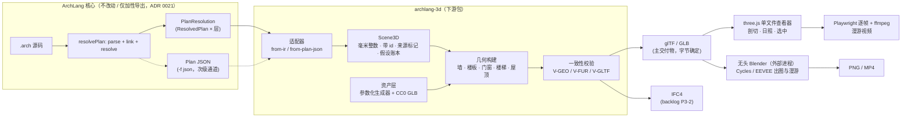
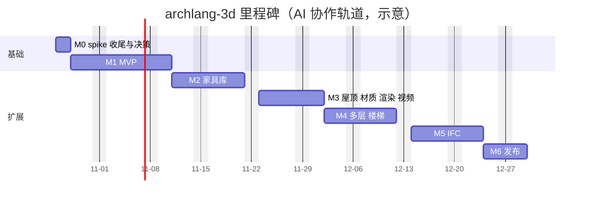

# archlang-3d：从平面图到 3D 模型与渲染图的自动化工作流——开发计划

## 0. 元信息与 TL;DR

### 0.1 元信息

- **Status:** Proposed（文档版本 **v0.5**；§10.2 的 Q1–Q22 均已有所有者决定：Q1–Q16 在 2026-10-23 分两批，Q17–Q22 在 2026-10-24 第三批；其中 Q4 为"判据已决（含 Q17 补充的几何保真一条）、待 spike 执行"。剩下的是动作、复核与未核实项，见 §0.3 与附录 H）
- **Date:** 2026-10（v0.1 初稿、v0.2、v0.3、v0.4 均为 2026-10-23；v0.5 为 2026-10-24；变更见 §11.9）
- **Owner:** ChanMeng666（项目所有者；2026-10-23 分两批对 Q1–Q16 作出决定、2026-10-24 对 Q17–Q22 作出决定，记录见 §10.3）
- **Scope:** 新增一个**下游工具包** `@chanmeng666/archlang-3d`（名称与孵化方式已由所有者决定，见 §10.2 Q1/Q2）：读取 ArchLang 已解析的平面（`.arch` → 已解析 IR / Plan JSON），确定性地生成 3D 场景中间表示 `Scene3D`，再输出 glTF/GLB、IFC 与 three.js 查看器，并以外部进程调用无头 Blender 出渲染图与漫游视频。**不改变** ArchLang 核心的 plan-first 定位；核心侧只提议少量**加性、字节不变**的导出口（§2.6）。
- **Related:** [ADR 0021](../../adr/0021-plan-first-view-deprecated.md)（plan-first，3D 走"数据而非绘图"）· [ADR 0018](../../adr/0018-zero-dep-wall-joinery.md)（零依赖墙体连接）· [ADR 0028](../../adr/0028-rooms-primary-derived-walls.md)（房间优先、墙由房间推导）· [ADR 0029](../../adr/0029-furniture-relations.md)（家具关系）· [ADR 0002](../../adr/0002-optional-dep-geometry.md)（可选依赖）· [ADR 0015](../../adr/0015-cli-as-agent-interface.md)（CLI 即 agent 接口）· [ADR 0005](../../adr/0005-no-invisible-architect.md)（不做隐形建筑师）· [ADR 0022](../../adr/0022-exact-decisions-and-bounded-input.md)（精确判定与有界输入）· backlog **P3-2**（[`docs/backlog.md`](../../backlog.md)，"IFC4 export"）· [`docs/furniture.md`](../../furniture.md) · [`docs/language-reference.md`](../../language-reference.md) 的 *Heights (datum layer)* 与 *Levels* 章 · [`docs/axonometric.md`](../../axonometric.md)（将随 `--view` 在 2.0 删除）· 同级方案 [plan-soundness](../plan-soundness/README.md)
- **核对基线:** 仓库 `main@0d2dbc04`（`package.json` 版本 1.43.1，含已合并但**尚未发布到 npm** 的 ADR 0028/0029 语法），`schemas/plan.schema.json` 与 `src/ir.ts`、`src/index.ts`、`src/wall-lowering.ts` 的实际内容；联网资料核对日期 2026-10-23。v0.3 另只读核对了 PR #229（`swing inward|outward`，PS3.8）合并后的公开仓库 `main@98a4156`：`src/index.ts`、`src/ir.ts`、`schemas/plan.schema.json`、`package.json`、`vitest.config.ts`、`scripts/check-test-wiring.mjs`、`test/docs-table-pipes.test.ts`（详见 §2.7、§2.8）；文中其余核心细节仍以 `main@0d2dbc04` 为准，**以 PR #229 合并后的核心为准、C1 的 PR 提交时再核对**。v0.4 在 `main@98a4156` 的检出里**运行**了脚本（导出闭包、每墙所有权、IFC 读回、楼梯/屋顶/资产/渲染/性能；单机、非基准），逐方向的证据与未验证项见 [`research/`](research/00-deep-dive-ranking.md)，脚本与小结果在 [`spike/`](spike/README.md)。文中所有版本号、许可、数字均来自查证（§11.4 给链接）；查不到的写"待核实"。
- **配套文件:** [`README.md`](README.md)（目录入口）· [`adr-draft-0030-3d-as-downstream-package.md`](adr-draft-0030-3d-as-downstream-package.md)（ADR 草案）· [`spike/`](spike/README.md)（M0 最小验证与 v0.4 深挖实验的代码与结果）· [`research/`](research/00-deep-dive-ranking.md)（v0.4 深挖研究：排序依据与 7 份方向报告）。

> **怎么读这份文档。** 想 5 分钟了解全貌：读下面的 TL;DR 和 §3.1 管线图。想直接动手：读 §9（里程碑、前两周逐日任务、**§9.10 第一周开工包**）和 §7（CLI/接口）。仍待执行的动作集中在 §0.3，需要核心仓库配合的事项集中在 §2.8。想质疑结论：读 §2.4（spike 实测）、§10（风险、问题与决策记录）。本文区分三种说法：**[实测]** 在本次 spike 或仓库里亲手跑出/读到的；**[引用]** 来自带链接的外部资料；**[估算/建议]** 作者的判断，需要在实施中证伪。

---

### 0.2 TL;DR（一页摘要）

**结论：能做，而且不该在核心里做。** "出了 `.arch` 平面图，再跑一个工作流得到 3D"是可行的：ArchLang 已经把墙、洞口、家具、楼层、楼梯、屋檐轮廓解析成确定性的结构化数据；缺的只是**竖向与外观信息**（家具高度与模型、屋顶坡度、材质、板厚），这些必须在 3D 层以**带来源标记的默认值**补上，不能塞进平面语言（ADR 0005、backlog 对 `roof` 的既有立场）。

**架构（§3）：** `.arch` →（核心 `resolvePlan`，底层即 `resolveAll`；经 C1 导出，Q18）→ **适配器** → **`Scene3D`**（与渲染器无关、毫米整数、带 id 的中间表示）→ 多个后端：**GLB**（主交付物）、**three.js 单文件查看器**（交互/剖切/日照）、**IFC4**（回答 backlog P3-2，与 GLB 共用同一个 `Scene3D`）、**无头 Blender**（Cycles/EEVEE 出图与漫游，外部进程，GPL 不进入我们的依赖图）。组件库（家具/门窗）先用**参数化 TypeScript 生成器**（零许可负担、尺寸与平面精确一致），热门品类再接 CC0 资产。

**本次 spike 的真实数据（§2.4，代码在 `spike/`）：**
- 用 Plan JSON + shapely/trimesh，对 `examples/` 的 34 个示例（32 个能在无 import 环境下编译）生成 GLB：39 份 Plan JSON 中 **37 份成功**，全部网格闭合、glTF-Validator **0 错 0 警告**，转换 13–259 ms/份（中位 74 ms）；同输入跑三次**字节一致**（SHA-256 相同）。
- laneway-house：6 面墙、3 个地板、4 扇门、4 扇窗、12 件家具与手建模型**逐类对应**，外包围盒平面尺寸完全一致（8.3 m × 7.3 m）；洞口射线探针 8/8 通过；地板面积 48.75 m² = 平面值。
- 但 **Plan JSON 对 3D 是有损的**：32 个可编译示例里 **13 个（41%）**依赖 Plan JSON 里没有的信息——弧墙被**静默压成弦**（aquarium、hexagon-pavilion、library、hillside-villa）、`walls from rooms` 的墙**不在 `walls[]` 里**（two-bed、relational 得到 0 面墙）、多层只给分开的文件而**没有层号与标高**、楼梯/电梯/自动扶梯/洞口/屋檐/室外/栏栅**整体缺失**。与 ArchLang 自己的墙体连接结果对比：35 个可比平面里 29 个 IoU ≥ 0.99，所有明显偏差都出在弧墙平面（最差 0.46）。**所以适配器的主通道必须是库 API `resolveAll`，Plan JSON 只做次级通道。**

**v0.4 深挖结论与 v0.5 的决定（证据与未验证项见 [`research/`](research/00-deep-dive-ranking.md)；除标注外为 [实测]，单机、非基准；Q17–Q22 已由所有者于 2026-10-24 全部按推荐方案决定）：**
- **输入通道有一处必须更正（[`01`](research/01-core-contract-and-input-channel.md)）：** 通道 A 不能写成"`compile().ast` → `resolveAll`"——该 `ast` 未链接，对带 `import` 的平面**静默丢元素**（`imports.arch` 只得 3 个元素）；核心内部的 `resolvePlan` 才是完整路径，所以 C1 再导出 `resolvePlan`、`AnalyzeOptions`（以及 `JoinerySplit`）——**Q18 已决定**；`resolvePlan` 的稳定性等级仍待核实（附录 H 第 31 项）。C1 的类型闭包已推导：10 个直接类型 + 2 个门词汇类型。
- **H1 成立（[`02`](research/02-wall-geometry.md)）：** 机制是 `joinWallSet` 的 `split.faceOf = id`（不是"分组键"）；45 个平面（34 示例 + 11 个合成压力平面）零空所有权、体积精确、join ≤ 10 ms；夹点与切口跨片要求"每个连通片一个实体、对每个被覆盖的片开洞"；混合高度有 1.6% 的合成缺块（示例里 0 例；**Q19 已决定**：接受并发 `W3D_MIXED_HEIGHT_JOINT` 告警，出现真实平面再找核心）。H1 的 +3/+2 人天退路取消。
- **IFC（[`03`](research/03-ifc-output.md)，只给证据、不替所有者选型）：** 自研最小写入器原型（117 行）在 43 个平面上 0 校验问题、两次导出逐字节相同、墙体积 −0.14%；`@ifc-lite/create` 输出干净且可确定，但高层 API 做不了弧墙/带洞口的多边形墙；IfcOpenShell 对弧墙的共面切口**静默跳过开洞**（需 20 mm 外扩）。Q4 字面判据没覆盖"几何保真"，**Q17 已决定补第三条判据**（读回体积误差 ≤ 1%）；最终选型仍待 M5 spike。
- **垂直与屋顶（[`04`](research/04-vertical-and-roof.md)）：** 8 个带屋檐的示例，环**全是矩形**（凹环 0 个）；5 个可推导楼梯里 3 个合规，另 2 个坡度本身超限（与踏步数无关）；`straight-skeleton@3` 在 npm 标 MIT，实质封装 GPL 的 CGAL，须排除；纯 TS 的 1.1.0 对共线与近圆多边形不可靠。M3 因此重估；楼梯不合规时**生成并告警、不拒绝**（**Q22 已决定**）。
- **渲染（[`05`](research/05-rendering-and-materials.md)）：** Blender CPU 与无头 three.js 同机重复渲染均**逐像素相同**（PNG 文件字节不同，须比像素）；耗时 4–12 s 与 0.04 s；**跨机器确定性未测**；**Q21 已决定**：CI 的视觉回归判据 = 钉死 Chrome 版本的无头 three.js，Blender 不进阻断。
- **资产（[`06`](research/06-assets-and-fixtures.md)）：** 核心 83 个家族/129 个词；按使用频次前 30 个家族覆盖 91.1%；卫浴（`wc`+`basin`）最常用、最需曲面，而 Poly Haven 一个卫浴模型都没有。
- **工程（[`07`](research/07-agent-loop-and-engineering.md)）：** 核心侧三项合计 ≤ 15 ms/平面；npm 的 `license` 字段会放过"标 MIT 实为 GPL"的包，§8.5 L1 **已决定强化**（**Q20**）：不信 npm 的 `license` 字段，核对被封装/依赖的实际代码。

**关键建议（§10 逐条给出推荐答案）：**
1. 做成 monorepo 里的**孵化包** `packages/archlang-3d`（核心永不依赖它；**已决定**，Q1），M6 再评估是否拆仓；写一份 [ADR 0030](adr-draft-0030-3d-as-downstream-package.md) 固化"3D 是下游数据消费者"。
2. **复用核心的墙体连接**（`joinWallSet`，ADR 0018），不在下游再写第二套——所以核心需要把它及其签名可达的类型加性导出（§2.6 C1，**所有者已接受**，Q10；PR 草案见 §2.7）。
3. **不进核心的东西：** 太阳/日照模型（语言文档明确"没有太阳模型"）、屋顶坡度、材质、家具高度。全部进 3D 层，并写入"假设账本"（`assumptions[]`，每个非作者给定的数值标注 `provenance`）。
4. **确定性是卖点：** 同一输入 + 同一 `archlang-3d` 版本 + 同一资产包 ⇒ GLB 字节一致；渲染图不保证字节一致（软件 GL / Cycles 采样），但保证可复现参数。
5. **验证管线先于漂亮图：** 3D 与平面的几何一致性（IoU、面积、洞口探针）是 CI 门槛；这是针对"渲染看着对、尺寸却错"这一社区常见坑的解药（§1.1）。

**工作量（估算，±50%）：** M0–M6 合计约 **85 人天（纯人工）/ 约 47 人天（AI agent 协作，人工评审与验收）**（v0.4 据深挖证据重估，v0.3 为 92/50：M1 +1/+1，M3 −8/−4，见 §9.0；v0.5 落实 Q17–Q22 后**无变化**，理由见 §9.0）；MVP（M1，墙/地板/门窗/方块家具/平屋顶 + GLB + 查看器）约 19 / 10 人天。前两周逐日任务见 §9.8，第一周开工清单（前置条件、命令、不做清单）见 §9.10。

**决策状态（详见 §0.3）：** Q1–Q22 **全部已有所有者决定**（2026-10-23 第一批 Q1/Q2/Q5/Q6/Q7/Q10、第二批 Q3/Q4/Q8/Q9/Q11/Q12/Q13/Q14/Q15/Q16；2026-10-24 第三批 Q17–Q22）。其中 Q4 是"判据已决（Q17 补了几何保真一条）、待 M5 第 1–2 天 spike 执行"，**不是最终选型**；Q9 的白名单细则与 Q13 的资产包许可最晚在 M2 开工前复核。剩下的是**动作、复核与未核实项**，不是决定（§0.3 第二张表、附录 H）；需要核心仓库配合的事项集中在 §2.8。

### 0.3 决策状态与剩余动作（v0.5，2026-10-24）

本节是当前**唯一需要所有者看的清单**；每个问题的完整推荐与理由在 §10.2，决定的记录在 §10.3，需要核心仓库配合的事项在 §2.8。**Q1–Q22 全部已有决定（Q1–Q16：2026-10-23；Q17–Q22：2026-10-24）；没有待决问题，剩下的是动作与复核。**

**已决定**（所有者 ChanMeng666）：

| ID | 决定 | 日期 | 落到哪里 |
|---|---|---|---|
| Q1 | monorepo 孵化：`packages/archlang-3d`，`private: true`，M6 评估拆仓 | 2026-10-23（第一批）| §3.2；ADR 0030 决定 10；§9.10 D1 |
| Q2 | 包名 `@chanmeng666/archlang-3d`；命令 `archlang3d`；资产包 `@chanmeng666/archlang-3d-assets` | 2026-10-23（第一批）| §3.2、§7；ADR 0030 |
| Q5 | 3D 发布（M6）之前，官网/落地页不宣传 3D | 2026-10-23（第一批）| §1.4、R8、§9.7 |
| Q6 | 默认楼板厚 200 mm（`--slab` 可覆盖，不新增语言关键字）| 2026-10-23（第一批）| §1.5、§2.5、§4.2 |
| Q7 | 默认平屋顶；坡屋顶仅显式 `--roof`；缺 `--pitch` 用 30°（示意）| 2026-10-23（第一批）| §2.5、§4.5 |
| Q10 | 核心接受加性导出 C1/C2；C3 不做（C4/C5 同样不做）| 2026-10-23（第一批）| §2.6、§2.7、§2.8；ADR 0031 |
| Q3 | 输入主通道 = 通道 A（库 API；入口为 `resolvePlan`，**Q18 已决定**）+ 核心加性导出 C1/C2；C4（Plan JSON v1.1 / `-f building`）暂缓 | 2026-10-23（第二批）| §2.1、§2.6；§9.10 D2 |
| Q11 | 门默认姿态"闭合"；`--doors open:<deg>` / `plan` 显式。**补充：C1 必须包含 `doorSwing`**，3D 直接使用核心解析好的开向（PR #229 之后 `swing inward\|outward` 已折算为墙相对的 `in\|out`），不自行推断 | 2026-10-23（第二批）| §2.7、§4.3、§8.1 V-GEO-09 |
| Q16 | 方案 A：轻量单测放 `packages/archlang-3d/test/`，由核心 `npm test` 在 Node 18/20/22 与 Windows 腿覆盖；重测试放 `e2e/`，后缀非 `.test.ts`、独立 vitest 配置，由 `check:3d` 运行；包 `engines.node >=20`；会被 Node 18 腿执行的轻量单测须在 Node 18 通过或在 Node < 20 时跳过 | 2026-10-23（第二批）| §3.2.1；§9.10 D1 |
| Q13 | 包 MIT；资产包 CC0-1.0（逐件登记）；**资产包许可最晚 M2 开工前复核** | 2026-10-23（第二批）| §8.5 L5；§9.10 D1 |
| Q14 | spike 代码随文档入库，按原样 | 2026-10-23（第二批）| §11.7；`spike/` |
| Q15 | 计划目录为 `docs/plans/archlang-3d/` | 2026-10-23（第二批）| 本目录；§9.10 D1 |
| Q9 | T0 参数化优先；T1 只收 CC0 与自制；默认包不含 CC-BY。**白名单细则最晚 M2 开工前复核**（方向已决）| 2026-10-23（第二批）| §5.4 |
| Q8 | M3 只交付 RF0–RF2（自研闭式解）；RF3 直骨架先评估纯 TS 库，排除 GPL 的 CGAL-WASM；评估结论在 M3 第 1 周（**v0.4：评估已提前完成**，结论见 [`research/04`](research/04-vertical-and-roof.md)：RF3 不在 M3 交付，候选库与防护见 §4.5）| 2026-10-23（第二批）| §4.5、§9.4 |
| Q12 | 日照不进核心；3D 层仅可视化，须由用户给纬度/日期/时间 | 2026-10-23（第二批）| §1.3 N3、§6.4 |
| Q4 | **判据已决，待 spike 执行（不是最终选型）：** M5 第 1–2 天 spike 后按判据选择——先试 `@ifc-lite/create`，若其输出经 IfcOpenShell 读回干净且可注入确定性 GlobalId **且几何保真达标（Q17：体积误差 ≤ 1%）**则采用，否则自研最小 STEP 写入器（IFC4 子集）。另：核心 backlog P3-2 与此相关，C1 的导出字段应考虑 IFC 的需要，标为"与 P3-2 协调"。（两条路线的实测证据见 [`research/03`](research/03-ifc-output.md)）| 2026-10-23（第二批）；Q17 补充：2026-10-24 | §4.10、§9.6、§2.7（P3-2 行）、§2.8 第 3 项 |
| Q17 | Q4 的判据补第三条"几何保真"：对 H1 的所有权多边形（含弧、含洞口），IfcOpenShell 读回的墙体积与所有权棱柱体积（扣除洞口）的总量偏差 ≤ 1%，另加弧墙开洞回归。**这是判据的补充，不是选型**；不需要核心改动 | 2026-10-24（第三批）| §4.10、§8.1 V-IFC-04/05、§9.6 |
| Q18 | C1 增加导出 `resolvePlan`、`AnalyzeOptions`（以及 `JoinerySplit`）；通道 A 的入口为 `resolvePlan(source, { world })`，**不再**用 `compile().ast` → `resolveAll` 处理带 `import` 的平面。`resolvePlan` 的稳定性等级仍待核实（附录 H 第 31 项）| 2026-10-24（第三批）| §2.1、§2.6–§2.8、§9.10 D2/D3；R21 |
| Q19 | 同层混合墙高：接受"最厚者拥有"，检测到时发 `W3D_MIXED_HEIGHT_JOINT` 告警；出现真实混合高度平面再请核心加所有权优先级（§2.8 第 11 项，新 C6）| 2026-10-24（第三批）| §4.1、§8.1 V-GEO-12、§9.5 |
| Q20 | 强化 §8.5 L1 许可门：不只信 npm 的 `license` 字段，核对被封装/依赖的实际代码（仓库、LICENSE、是否封装或移植其他项目），登记 `THIRD_PARTY_NOTICES`，建显式拒绝清单（先放 `straight-skeleton@3`，教训：标 MIT、实质封装 GPL v3+ 的 CGAL）| 2026-10-24（第三批）| §8.5 L1、§9.2、R23 |
| Q21 | 视觉回归以**钉死 Chrome 版本的无头 three.js** 为 CI 判据（GLB 的 SHA-256 仍是主判据）；Blender 不进 CI 阻断，只作非阻断的辅助（同环境比像素哈希，不比 PNG 文件字节）| 2026-10-24（第三批）| §6.7、§8.1 V-DET-04/05、V-VIS-01、§8.3；R22 |
| Q22 | 楼梯占地推不出合规梯段时**照常生成并发 `W3D_STAIR_PROPORTION` 警告（示意），不拒绝、不"修正"**（ADR 0005）| 2026-10-24（第三批）| §4.7 第 4 步、§9.5 |

**仍待执行的动作与复核**（它们**不是决定**；"阻塞"指不做就无法完成对应里程碑的某一天任务）：

| 事项 | 类型 | 何时 | 阻塞？ |
|---|---|---|---|
| ADR 0030 评审（草案已写入上述决定）| 评审 | M0 D1 的 docs-only PR | 阻塞 M0 验收，不阻塞 D1 的动手 |
| 实测 `check:test-wiring` 对非 `.test.ts` 文件的处理 | 实测（附录 H 第 18 项**仍标未实测**）| 第一个 PR 的验证环节（§9.10 D1）| 阻塞 D1 的骨架定稿（Q16 方案 A 的前提）|
| npm 四个名称的占位复查 | 复查 | 开工当天与首次发布前 | 不阻塞（2026-10-23 已核：均 404）|
| 核心 C1/C2 PR 的提交与合入（含 `doorSwing`；与 P3-2 协调；**Q18 已决定：另含 `resolvePlan`、`AnalyzeOptions`、`JoinerySplit`**；PR 描述里写明 `resolvePlan` 的稳定性等级待核心评审确认）| 核心仓库工作 | **M0 D3 前提交**（Q18 已决，剩下是动作）；见 §2.8、§9.10 D3 | 不阻塞 M0 动手；**阻塞 M0 验收①对 `imports`/`museum-wings` 走公共导出、以及 M1 验收**（超期则原型分支临时 deep-import `src/analyze`，记 R1）|
| 核心版本号 `^1.44` 是假设，需在核心发版时核对 | 复核 | 核心发版时 | 阻塞 M6 的 npm 发布 |
| Q4 的 spike（判据含 Q17 的几何保真一条）| 执行 | M5 第 1–2 天 | 不阻塞 M0–M4（M1–M4 不得依赖任何 IFC 库）|
| Q9 白名单细则、Q13 资产包许可 | 复核 | **最晚 M2 开工前** | 阻塞 M2 导入第一件 T1 资产 |
| ~~Q8 的 RF3 评估~~ | **v0.4 已完成**（[`research/04`](research/04-vertical-and-roof.md)）| — | 结论：M3 不交付 RF3；现有 8 个屋檐环全是矩形 |
| 附录 H 的未核实项 | 核实 | 各自的里程碑（见附录 H）| 个别项阻塞，见附录 H |
| Q20 的许可门落地：`check:3d` 的"来源核对"清单、`THIRD_PARTY_NOTICES`、显式拒绝清单（先放 `straight-skeleton@3`）| 实现 | M1 的 CI 骨架（`check:3d`）建立时 | 阻塞 M1 的 CI 骨架验收 |
| Q21 的落地：钉死 Chrome 版本、three.js 无头基线与 PSNR 阈值；跨机器确定性实验（R22）| 实现 + 实测 | 引擎已选定；基线最晚 M2 结束前建立，跨机器实验在 M3 | 阻塞 M3 的视觉回归验收 |
| Q19/Q22 的告警码与规则落地（`W3D_MIXED_HEIGHT_JOINT`、`W3D_STAIR_PROPORTION`）；Q17 的体积对账进入 M5 spike 口径 | 实现 | M1（Q19）/ M4（Q22）/ M5 第 1 天（Q17）| 分别阻塞对应里程碑的验收 |
| Q19 的重议 | 条件触发 | 出现真实的同层混合墙高平面时 | 不阻塞 |
| C4（`-f building`）的重议 | 条件触发 | 出现非 TypeScript 消费者的真实需求时 | 不阻塞 |

---

## 1. 背景与目标

### 1.1 为什么现在做

本次会话为 ArchLang 做宣传片时，我们手工建了一栋 laneway-house 的 3D 小屋（[实测]：186 行 Blender 脚本，6 面墙、4 个窗、2 扇滑门、3 片门扇、12 件家具、1 个山墙屋顶，导出 46 个节点的 GLB）。过程暴露了三件事：

1. **坐标是手抄的。** 墙的洞口位置、家具占地都是照着编译出的平面抄进脚本的，而 ArchLang 其实已经输出了全部这些结构化信息（`rooms[]/walls[]/openings[]/furniture[]`）。平面一改，3D 就得重抄。
2. **平面里没有的东西是手填的**：墙高 2.7 m、门头 2.1 m、窗台 0.9/1.2 m、家具高度、山墙屋顶的 1.15 m 起坡——这些就是 §2.5 缺口分析要正式化的内容。
3. **"渲染好看"不等于"尺寸对"。** 社区里反复出现这个教训（见 §11.5 的调研摘要：有人让两个模型各做 5 栋房子，渲染都"看着对"，但 2/5 的尺寸错了——帖子作者自述，未复现）。ArchLang 的核心卖点恰恰是"平面是可校验的制品"，3D 也必须带自检。

另一个背景事实：商用工具（Planner 5D、Homestyler）把 2D 平面→3D 做成**图像识别**（上传图片/PDF/DWG，AI 或半自动识别墙门窗，处理 10 分钟到 24 小时，且自称需要清晰、高对比度的平面）——这是有损的逆向工程。ArchLang 的平面是**源码**，语义是精确的（哪面墙、哪扇门、铰链在哪侧、家具靠哪面墙），把它转成 3D 是**正向编译**，不需要识别。这是本方案相对同类产品的结构性优势（§11.4 [引用] 链接）。

### 1.2 目标

| ID | 目标 | 衡量 |
|---|---|---|
| G1 | 给定任意能通过 `archlang compile` 的 `.arch`，一条命令生成**带语义命名**的 GLB（墙、地板、门、窗、家具、楼板、楼梯、屋顶） | `archlang3d build x.arch -o x.glb`；corpus 覆盖率见 §8.4 |
| G2 | **确定性**：同输入同版本字节一致 | CI 中三次构建 SHA-256 相同（spike 已在 Plan JSON 通道验证，§2.4） |
| G3 | **3D 与平面可机器核对**：地板面积、洞口、墙体占地、家具数量与平面一致 | §8.1 的 V-GEO 系列检查，进 CI |
| G4 | 交互查看：three.js 单文件查看器（旋转、分层、剖切、屋顶开关、按 id 选中、日照滑块） | §6.1 |
| G5 | 出图：无头 Blender（Cycles/EEVEE）鸟瞰、剖切、每房间室内镜头、漫游视频 | §6.2–6.5；无 GPU 预算见 §6.6 |
| G6 | 回答 backlog **P3-2**（IFC4 导出），与 GLB 共用 `Scene3D` | §4、§9 M5 |
| G7 | **agent 友好**：`--json`、manifest、退出码契约与 ADR 0015 一致；提供 skill 与可选 MCP | §7 |

### 1.3 非目标

| ID | 非目标 | 理由 |
|---|---|---|
| N1 | 不在 ArchLang **核心**里加 3D 绘制/渲染，不复活 `--view` | ADR 0021 决定 2、5；`--view` 将在 2.0 删除（删除分支已准备好） |
| N2 | 不发明建筑意图：屋顶坡度、材质、家具高度只能是**显式默认值或用户参数**，且进"假设账本" | ADR 0005；backlog 中 `roof` 的既有立场（"没有坡度基准，近似它正是 `roof` 拒绝做的事"） |
| N3 | 不做日照/采光**测量** | 语言文档：核心里"没有太阳模型、纬度、日期"，且是有意为之；3D 层的日照仅为**可视化**，必须由用户给出纬度/日期/时间，并在所有输出上标注"仅示意"（Q12 已决定）|
| N4 | 不做 BIM 创作工具/编辑器 | 单向：`.arch` → 3D；改 3D 不回写 `.arch` |
| N5 | 不做图像识别式的逆向（光栅平面→3D） | 同类产品的赛道，且有损；我们有源码 |
| N6 | 不做 AI 生成式 3D（文本/图像→网格） | 不确定、不可复现，违背确定性卖点（可作为用户自带资产的来源，不在核心路径） |
| N7 | 不追求照片级资产库；MVP 用参数化几何 | 尺寸与平面精确一致优先于外观 |
| N8 | 不承诺跨机器**渲染图**像素一致 | 软件 GL 与 Cycles 采样有差异（宣传片实测：5 帧重渲，4 帧逐位一致，1 帧 117/2,073,600 像素不同）；承诺的是 **GLB 字节一致 + 渲染参数可复现** |

### 1.4 与 ADR 0021（plan-first）对账

ADR 0021 的原话要点与本方案的对应：

| ADR 0021 的条款 | 本方案如何遵守 |
|---|---|
| "ArchLang is plan-first. It draws plans; it does not draw the building." | 核心不增加任何 3D 绘制；`archlang-3d` 是**另一个包**，核心既不依赖它也不在落地页推广它（§10 Q5，**已决定**）。 |
| 轴测视图被弃用，理由之一："**不可校验**"——`describe()`/`lint()` 永远不知道它的存在，画出来的东西无法对照平面检查 | `archlang-3d` 反其道而行：**每个 3D 构件携带来源 id，并有 V-GEO 一致性检查**（面积、洞口、占地 IoU、数量），3D 是**被平面校验的**，不是画出来就算。 |
| 理由之二："**无消费者**" | 本方案有明确的消费者：three.js 查看器、Blender 渲染、IFC/BIM 软件、宣传片（本次会话就是第一个用户）；并且在 §9 M0 用真实 corpus 验证。 |
| 理由之三："**违背定位**，落地页放一张图会引来 'does it do 3D?' 的无解提问" | 下游包 + 文档明确"ArchLang 本身只画平面；3D 来自独立工具"；官网/落地页在 M6 之前不提及 3D（Q5，**已决定**）；M6 之后仅在"生态/集成"处加一行。 |
| 理由之四：携带开放缺陷与维护面（`pipeline.ts`、SVG/PDF/DXF 后端、CLI、缓存键、十个测试） | 下游包**不触碰**这些路径；核心侧只做**纯导出**（C1/C2；C3 不做，Q10 **已决定**），不进入 `compile()` 路径，不影响缓存键与任何已有字节。 |
| 决定 4："**The height datum is kept.** Heights … become the input of a future data export rather than of a picture." | 本方案正是这个 data export 的消费者：`RWall.height`、`sill/head`、`storeyHeight`、`elevation` 是 3D 的竖向基准（§2.3）。 |
| 决定 5："**3D goes through data export** (IFC, backlog P3-2), not through a drawing backend." | `Scene3D` 是数据；IFC 与 GLB 同为 `Scene3D` 的后端；渲染发生在**下游进程**（Blender / 浏览器）。 |
| 结果段："A reader who wants a picture of the building has to use a tool that consumes the export." | 这个"tool"就是 `archlang-3d`。 |

一个**需要在 ADR 0030 里写明的微妙之处**：ADR 0021 说的是"导出数据（IFC）"，没有说"数据"是 IFC 还是别的。本方案把"数据导出"落实为**核心已导出的 IR（`resolveAll`）+（可选、暂缓的 C4）一个加性的 Building JSON**，IFC 变成**下游的一个后端**而不是核心功能。这扩展而非推翻 ADR 0021 的决定 5，所以 ADR 0030 标记为 *Extends* 0021（草案见 [adr-draft-0030](adr-draft-0030-3d-as-downstream-package.md)）。

### 1.5 与 backlog P3-2（IFC）的关系

backlog 现状（[`docs/backlog.md`](../../backlog.md) 的 "Not scheduled" 一节）：**P3-2 的前置条件已完成**（v1.35 竖向基准：`RWall.height`、开口 `sill/head`、`storeyHeight/elevation`）；P3-2 本身仍开放；并且记录了一个重要发现——**板厚（slab thickness）仍不存在**（v1 的层高是楼面到楼面，墙高占满整层），"需要区分结构厚度与净高的消费者必须自己补"。

本方案的立场：

- **P3-2 不再是"核心里做 IFC 导出"，而是 `archlang-3d` 的 M5 后端**：IFC 与 GLB 共享 `Scene3D`，一次建模两种出口，避免"GLB 一套几何、IFC 又一套几何"导致两者不一致。
- **板厚**：在 `Scene3D` 构建参数里给出显式默认（`slab: 200` mm，可覆盖；Q6 **已决定**），写入假设账本；**不**要求核心新增 `slab` 关键字（若将来需要，走 §2.6 的 C5 并另写 ADR）。
- P3-2 的验收口径改写为："`archlang3d export ifc` 对 `examples/` 全部可编译示例产出合法 IFC4（IfcOpenShell 读回成功，几何迭代无异常，Space 的 NetFloorArea 与 `describe().rooms[].net_area_m2` 一致）"。backlog 条目在 M5 开工时更新（引用本计划，不是现在改）。

### 1.6 需要新增的 ADR

| 编号（以仓库当前最大编号 0029 + 1 为准） | 标题 | 何时写 | 状态 |
|---|---|---|---|
| **0030** | 3D 是下游包：`archlang-3d` 消费已解析 IR，核心不画建筑 | **M0 结束前**（先于任何核心改动） | 草案已附：[adr-draft-0030](adr-draft-0030-3d-as-downstream-package.md)；v0.2 已写入所有者 2026-10-23 的决定（仍为 Proposed，待评审）|
| 0031 | 核心加性导出 IR 接缝（C1/C2）：导出面清单、稳定性等级、与下游的契约（C4 Building JSON 不做，不在本 ADR 内）| **与 C1/C2 的核心 PR 同期**（先于 M0 D3 合入）| C1/C2 已获所有者接受（Q10）；PR 草案见 §2.7 |
| （包内 ADR，非核心） | `archlang-3d` 的 Scene3D 约定、假设账本、IFC 映射 | M1/M5 | 放在 `packages/archlang-3d/docs/adr/`，沿用核心的 ADR 格式 |

---

## 2. 现状与输入契约

### 2.1 三条可用的输入通道

ArchLang 已经向外提供了三层"已解析的平面数据"（均为核心的**既有**公开出口，来源：`src/index.ts`、`src/ir.ts`、`src/wall-lowering.ts`）：

| 通道 | 取得方式 | 优点 | 对 3D 的缺点 | 在本方案中的角色 |
|---|---|---|---|---|
| **A. 库 API：`resolvePlan(source, {world})` → `{ir, diagnostics, levels[]}`**（底层 `resolveAll` → `PlanResolution`）| **`resolvePlan(source, { world })`**（核心内部函数，经 C1 导出，**Q18 已决定**；C1 合入前的原型期临时 deep-import `src/analyze`，记 R1；返回 `{ ir, diagnostics, levels }`，已链接 `import`）。**不要**用 `compile(src).ast` → `resolveAll(ast)`：该 `ast` 是未链接的 AST，对带 `import` 的平面**静默丢元素**（v0.4 实测：`imports.arch` 只得 3 个元素，见 [`research/01`](research/01-core-contract-and-input-channel.md)）；仅单文件、无 `import` 的平面可用此简写| 信息最全：`RWall.arcs`、`height`、`points`；`RRoom.poly/circle`；`ROpening` 的 `sill/head/host`；`RStair/RElevator/REscalator/RRoof/RVoid/ROutdoor/RFence`；`ResolvedPlan.storeyHeight/elevation/level/siteBoundary/north`；`walls from rooms` 已展开 | 部分类型未从包入口导出（见 §2.6 C2）；`joinWallSet` 未导出（C1）；需要 Node 侧自己实现 `World`（接口只有 `read(path)` 和可选 `now()`，十行代码，spike 已验证可行） | **主通道** |
| **B. `compile().scene` 的 `Scene.walls`（`SceneWall[]`）** | `attachSceneWalls` 提供的惰性投影，原为 DXF 导出而设 | 墙已带洞口 | 只有墙；无楼层、家具、屋檐等 | 仅作交叉校验，不作输入 |
| **C. Plan JSON：`archlang compile -f json`** | CLI；每层一个文件（`name.L1.json`）；[`schemas/plan.schema.json`](../../../schemas/plan.schema.json)（`$id` 为 `https://archlang.uk/plan.schema.json`）| 稳定、语言无关、可被 Python/Blender 脚本直接读；本次 spike 全程使用 | **有损**（见 §2.4）；无层号/标高；无弧；`walls from rooms` 的墙不在 `walls[]` | **次级通道**：给非 TS 消费者（Blender 脚本、其他语言），并作为 M0/M1 的快速路径 |

> **v0.4 更正：** 本节与 §2.4 在 v0.3 及以前把通道 A 写成"`compile().ast` → `resolveAll`"。该写法对 `imports`、`museum-wings` 以及任何用 `import`/`place` 的平面是错的（已测得，不是风险）。正确入口是 `resolvePlan(source, { world })`；`resolveAll` 仍可用于已经链接过的 AST。**Q18 已决定（2026-10-24）：** 通道 A 一律走 `resolvePlan`，C1 为此导出 `resolvePlan`、`AnalyzeOptions`（以及 `JoinerySplit`）；适配器不再接受"先 `compile()` 再 `resolveAll(ast)`"这条路径处理带 `import` 的平面。

> ADR 0021 决定 4 把"竖向基准"留作"未来数据导出的输入"。通道 A 就是这个数据导出已经存在的形态；本方案不是去创造一个新导出，而是**把它用起来**，并在必要处做加性补丁。

**一个值得记住的先例。** `src/wall-lowering.ts` 里 `joinWallSet` 的注释写道：它被拆出来，正是为了让**轴测视图**直接消费 `JoineryResult.outline`（"A 3D extrusion needs the edges, not the primitive … Re-deriving the footprint in the view would be a second joinery, and two of those is exactly how a drawing and its own extrusion come to disagree"）。也就是说，核心已经有过一次"把同一份墙体连接结果拔高成 3D"的实现；`archlang-3d` 沿用同一原则——**不在下游写第二套墙体连接**——只是把消费位置从 `src/view/`（将随 `--view` 删除）移到下游包。这也是 §2.6 C1 的依据。另外，ADR 0021 的"Phase B"删除清单明确写了 **"Keep `joinWallSet` (the plan path uses it)"**——2.0 删除 `--view` 之后它依然存在，导出它不会和删除计划冲突。

### 2.2 Plan JSON 字段清单（按 `schemas/plan.schema.json` 实际内容）

必填顶层字段：`plan, rooms, walls, openings, furniture`。以下"3D 用途"一列是本方案的处理方式。

| 路径 | 类型 / 取值 | 3D 用途 |
|---|---|---|
| `version` | 恒为 1 | 契约版本检查（适配器拒绝未知版本） |
| `plan` | string | `Scene3D.name` |
| `units` / `grid` | `mm` / number | 单位固定 mm；`grid` 仅用于容差推断 |
| `north` | `up/down/left/right` 或度数 | **日照朝向**：页面上"北"的方向（顺时针自页顶）；仅用于可视化 |
| `site.street` / `site.hemisphere` | 四向 / 南北半球 | 朝向命名；半球可作为太阳模型的**可选交叉校验**（纬度仍须用户给） |
| `storey_height` | mm，默认 3000 | 层高（**楼面到楼面**，见 ADR 0021 / `docs/language-reference.md` Heights） |
| `rooms[]` | `id, label, room_type, uses[], x,y,width,height` 或 `polygon[]`；输出：`area`, `floor_polygon[]` | 地板多边形（用 `floor_polygon`，**不要**用 bbox）；`room_type/uses` → 地板材质预设；`area` → 校验 |
| `walls[]` | `id, category, points[]（折线）, thickness, height, closed, material, material_scale, material_angle` | 墙中心线与厚度（**但弧丢失**）；`height` 是该墙**自己**写的高度，缺省时需回落到 `storey_height`；`material` 是**填充图案名**（poché），不是 3D 材质 |
| `walls_from_rooms` | `exterior, partition, except[], open[], between[]` | 仅回显规则；**推导出的墙不在 `walls[]` 里**（spike 实测） |
| `openings[]` | `kind: door/window/opening`, `id, x,y（中心，落在墙中心线上）, width, wall, hinge, swing, door_kind, slide, mirror, open（绘制开度）, sill, head, on{}, relation{}` | 洞口矩形（宽×[sill, head]）；门的铰链/摆向/类型决定门扇与开启姿态。`sill/head` 为**可选**输出：缺省时用数据层默认（门头 2100、窗台 900、窗头 2100、cased opening 头=墙高）。**PR #229 之后**另有 `swing_building: inward\|outward`（平面里写了该词时才出现；与已解析的 `swing: in\|out` 并列，输入时优先于 `swing`），本表其余字段按 `main@0d2dbc04`，该字段按 `main@98a4156` 的 schema 核对；spike 的 Python 原型读的是 PR #229 之前的 JSON，**未处理**它 |
| `furniture[]` | `category, id, room, x,y,width,height（已解析的占地左上角+尺寸）, rotate∈{0,90,180,270}, mirror, centered/anchor/inset/flush, against_wall/against_edge/segment/offset/side, facing, clear_front/clear_sides, label` | 实例化位置/朝向；`category` → 资产；`clear_*` 与 `against_*` 可用于验证"靠墙家具背面贴墙"。**没有高度，也没有模型** |
| `columns[]` | `id, x,y,width,height`（左上角+平面尺寸） | 柱（矩形截面）；高度 = 层高 |
| `dims[]` | 尺寸线 | 3D 可选：作为标注覆盖层（M3） |
| `title` | 标题栏元数据 | 写入 glTF `asset.extras` |
| `room_count, total_area, room_types, edges, input_graph` | 输出专用 | 交叉校验；`edges/input_graph`（门通达关系）可用于漫游路径规划（M3） |

**明确不在 Plan JSON 里的**（从 schema 的属性集合核对）：层号与标高、弧墙（`arcs`）、圆形房间（`circle`）、楼梯/电梯/自动扶梯、楼板洞口（void）、屋檐（roof ring）、室外面（outdoor）与栏栅（fence）、`site.boundary`（地界线）、派生墙。

### 2.3 通道 A 额外提供的字段（`src/ir.ts`）

| IR 类型 | 与 3D 相关的字段 | 备注 |
|---|---|---|
| `ResolvedPlan` | `storeyHeight`、`elevation`（**下方各层高度之和**，不是 `level × storeyHeight`）、`level/levelName`、`north`、`site`、`siteBoundary?: Point[]`、`walls`、`elements` | 多层时 `resolveAll().levels[]` 每层一个 `ResolvedPlan`；单层时 `levels` 为空 |
| `RWall` | `points`、`thickness`、**`arcs?: Array<Arc\|undefined>`（按线段下标，圆心/半径/带符号扫角，resolve 时**一次**算好）**、`closed`、**`height`（必填，始终已解析）**、`category`、`material`、`hatch*` | 墙高回落链 wall → level → plan → 3000 已在 resolve 内完成 |
| `RRoom` | `at/size`、`poly?`（多边形）、`circle?: {c, r}`、`uses`、`label` | 圆房间/多边形房间在这里有真实几何 |
| `ROpening`/`RDoor`/`RWindow` | `at`、`width`、`host: WallSegment\|null`、`hinge/swing`（门）、`head`（及 `sill`） | `host` 给出宿主墙与线段，**无需再做"洞口落在哪面墙"的几何猜测**；`RDoor.swing` 已是**解析后的墙相对词** `in\|out`——PR #229 的 `swing inward\|outward` 在 resolve 时折算成它，原词存在内部字段 `_swingBuilding`（下划线字段，**不要依赖**，§2.3 的既有规则）；3D 用 `swing`，不用 `_swingBuilding` |
| `RFurniture` | `category`、`at/size`、`rotate`、`room`、`_mirror` 等内部字段 | 内部下划线字段**不应**被下游依赖 |
| `RStair` | `at`、`size`、`dir`（`VerticalDir`）、`width`、内部 `_tail`（入口边） | 踏步线在平面里只是符号；3D 层必须自己推导踏步数（§4.7） |
| `RElevator`/`REscalator` | `at`、`size`（、`dir`） | 电梯井道/扶梯 |
| `RRoof` | `ring: Point[]`（`overhang` 语法糖已在 resolve 展开成显式顶点） | **只有轮廓，没有坡度** |
| `RVoid` | `at`（左上角）、`size` | 楼板洞口（常配楼梯） |
| `ROutdoor` | `surface`（地面类型）、`at/size`、`poly?`、`rail?`（栏杆边集合，已具体化） | 阳台/露台/庭院；`poly` 存在时 bbox 仅用于索引 |
| `RFence` | `style`、`points`、`closed` | 刻意**不是**墙：无厚度/材质/洞口 |
| `RWallsFromRooms` | ADR 0028 的推导规则 | 派生墙在 `ir.walls` 里已存在（通道 A 可见，通道 C 不可见） |

**类型导出现状（实测）：** `src/index.ts` 只把 `ResolvedPlan, ResolvedElement, RWall, RRoom, RDoor, RWindow, RFurniture, RDim, RColumn, RAxis, RZone` 作为命名类型导出；`ROpening、RStair、RElevator、REscalator、RRoof、RVoid、ROutdoor、RFence、Arc` 虽可经 `ResolvedElement` 联合类型间接取得（`Extract<ResolvedElement,{kind:"stair"}>`），却没有名字。→ §2.6 C2 提议补名字（纯类型，零字节影响）。

### 2.4 Spike 实测：Plan JSON 能走多远（M0 已完成的部分）

> **v0.4 注：** 本节只覆盖 Plan JSON 通道（Python）。库 API 通道的实测（导出闭包、每墙所有权、IFC、楼梯/屋顶、资产、渲染、性能）在 [`research/`](research/00-deep-dive-ranking.md)，结果在 `spike/results/`。

**方法。** 用从仓库 `main` 构建的编译器（`npm ci --ignore-scripts` + `tsx`）对 `examples/` 全部 34 个 `.arch` 生成 Plan JSON（多层的按层分文件，共 39 份），再用 `spike/src/plan2glb.py`（shapely 做墙带与洞口切割、trimesh 出网格）转成 GLB，并用 `spike/src/verify.py` 等脚本核对。详见 [`spike/README.md`](spike/README.md)。

**结果（全部为本次实测；Python 3.13、shapely、trimesh；单机、非基准测试）：**

| 指标 | 结果 |
|---|---|
| 成功生成 GLB | **37 / 39** 份 Plan JSON；其余 2 份（`relational`、`two-bed`）因 `walls from rooms` 在 Plan JSON 中没有 `walls[]` 而被适配器显式拒绝（`NO_WALLS_IN_PLAN_JSON`） |
| 网格质量 | 37 份 GLB 所有节点**水密**（0 个非水密节点） |
| glTF 合规 | Khronos glTF-Validator（npm `gltf-validator`）**0 错误 0 警告**（抽检 laneway 与 corpus 若干） |
| 转换耗时 | 13–259 ms/份，中位 74 ms（含 shapely 布尔，不含 Python 启动；非基准） |
| 确定性 | 同输入 3 次构建，SHA-256 **完全相同**；且与 `PYTHONHASHSEED` 无关 |
| 可复现性 | 在**全新目录 + 全新 venv + 全新拷贝的仓库**里按 `spike/README.md` 重跑：37/39 成功，laneway-house 的 GLB（32 544 字节）与此前一次**逐字节相同** |
| laneway-house | 36 个节点：6 墙、3 地板、1 楼板、1 屋顶、8 窗节点（4 窗×框+玻璃）、5 门节点（含两片滑门扇）、12 家具；与手建模型逐类对应；平面外包围盒与手建一致（8.3 m × 7.3 m，含 300 mm 檐口）|
| 洞口探针 | 沿宿主墙法线向洞口中心发射射线，laneway **8/8** 洞口无墙体遮挡，且对照射线（打在洞口旁的实墙上）全部命中 |
| 地板面积 | laneway 网格面积 48.75 m² = Plan JSON 值；全 corpus 165/176 间房与 `describe` 的 `net_area_m2` 一致（容差 0.02 m²），**11 个例外全部在含弧/圆的平面** |
| 与核心墙体连接比对 | 以核心自己的 `joinWallSet` 输出（`spike/tools/joinery-dump.mts`）为真值，对 35 个可比平面做平面投影 IoU：**29 个 ≥ 0.99，中位 1.0，最差 0.46**；偏差全部出现在弧墙平面 |
| 渲染 | Blender 5.2.3 无头、Cycles CPU，一张等轴测图约 4 s（`spike/src/render_glb.py`） |

**缺口（"Plan JSON 对 3D 有损"的定量证据）。** 对 32 个能在无 import 环境下编译的示例（`imports`、`museum-wings` 需要 `World` 才能解析 import），用 IR 覆盖探针（`spike/tools/coverage.mts`）统计：

- **19 / 32（59%）** 的平面只用 Plan JSON 里的信息就足以建出完整、正确的 3D（`accessible, attached, classroom-block, clinic, corner-cafe, furnished-flat, gallery-l, garden-loft, laneway-house, materials, museum-wing, museum, one-room, parametric, practice-office, sheet-notes, studio, terrace-row, themed`）。
- **13 / 32（41%）** 依赖 Plan JSON 没有的信息：

| 平面 | Plan JSON 缺失的信息 |
|---|---|
| `aquarium`、`hexagon-pavilion` | 弧墙 |
| `hillside-villa` | 2 层、弧墙、楼梯、楼板洞口、屋檐 |
| `library` | 弧墙、楼梯、电梯 |
| `relational`、`two-bed` | `walls from rooms`（两者在 Plan JSON 通道**得到 0 面墙**）；`two-bed` 另有屋檐 |
| `garden-house` | 2 层、楼梯、屋檐、室外面、栏栅 |
| `townhouse` | 3 层、楼梯、屋檐 |
| `two-storey` | 2 层、楼梯、楼板洞口、屋檐 |
| `transit-hall` | 电梯、自动扶梯 |
| `bungalow`、`tiny-house`、`courtyard-house`（含室外面） | 屋檐 |

其中**会让几何出错或缺失**（而非"只是少了某类构件"）的是：弧墙平面（被**静默压成弦**，Plan JSON 里只剩折线顶点；`aquarium/hexagon-pavilion/library` 在 spike 里出现"洞口中心偏离宿主墙 0.6–8 m"的警告和 0.1–0.6 m² 的面积偏差）、`walls from rooms`（无墙）、多层（无层号和标高，只能靠文件名 `.L1/.L2` 猜）。**结论：通道 A 是主通道；通道 C 适合"无弧、无派生墙、单层"的子集，并且必须在适配器里显式拒绝其余情形，而不是静默产出错的几何。**

**一个意外的发现（版本偏移）。** npm 上已发布的 `@chanmeng666/archlang@1.43.1` 无法解析仓库 `main` 的三个示例（`materials`、`relational`、`two-bed`，用到 ADR 0028 的 `walls from rooms` 与 ADR 0029 的 `facing`，报 `E_PARSE`）——`main` 的语法领先已发布版本。下游包因此必须**钉住核心版本，并在 CI 里同时测"已发布版"和"main"**（§8.3、§10 R2）。这也是 Q1 决定采用 monorepo 孵化的直接理由之一。

### 2.5 缺口分析：3D 需要而平面没有的信息

原则（来自 ADR 0005 与 backlog 对 `roof` 的立场）：**事实归事实，默认值归默认值，两者永远分开标注。** 每个下游补出来的量，必须出现在 `assumptions[]`，并带 `provenance ∈ {authored, derived, default, user-param}`。

| 3D 所需量 | 平面中的现状 | 来源（优先级自上而下） | 缺省策略 | 是否需要核心增量 |
|---|---|---|---|---|
| 墙高 | `RWall.height` 始终已解析（wall→level→plan→3000） | authored/derived | 无需默认 | 否 |
| 洞口 sill/head | 可选；缺省为数据层默认（门头 2100、窗台 900、窗头 2100、cased=墙高） | authored → default | 同左，标 provenance | 否（IR 已解析） |
| **楼板厚** | **不存在**（层高是楼面到楼面，墙占满整层，backlog 已记录） | user-param → default | **默认 200 mm**（可 `--slab`）；楼板位于楼面标高**之下**（顶面 = 楼面标高），上层墙从该顶面起算；写账本 | 否（C5 仅在将来需要时） |
| 标高 | `elevation`（IR）= 下方各层高度之和 | derived | — | 否（仅通道 C 缺） |
| 墙体连接/拐角/T 型/洞口切割 | `joinWallSet` 已解决，但未导出 | derived | **复用核心**，不重写 | **C1** |
| 弧墙/圆房间 | IR 有 `arcs/circle` | derived | 以固定弦高容差离散成折线（§4.1） | 否 |
| 屋顶坡度/类型 | 只有 `RRoof.ring` | user-param → default | `--roof none\|flat\|gable\|hip\|shed`；**默认 `flat`**（沿作者给的 `roof` 轮廓做一块平板，不发明坡度）；`gable/hip/shed` 只在显式指定时生成，未给 `--pitch` 时用 30°（**3D 层默认，写账本，输出上标注"示意坡度，非建筑意图"**）；平面没有 `roof` 时用墙外轮廓外扩 0 的平板（仅 `--roof flat` 时）| 否 |
| 材质 | 墙 `material` 是填充图案名；房间有 `uses/room_type` | default（预设表） | 材质预设 `material-presets.json`（§4.6），可 `--palette` 覆盖 | 否 |
| 家具高度/模型 | 只有 `category` + 占地 | asset manifest（§5） | Tier-0 参数化体块；缺品类 → 占地×默认高度的灰盒并发 `W3D_ASSET_MISSING` | 否 |
| 门扇/窗框尺寸 | 只有洞口宽、sill、head、kind、hinge/swing | default（可配置） | 门扇厚 40、框宽 40、窗框 60/40（与手建模型一致，`doorLeaf`/`windowFrame` 参数） | 否 |
| 楼梯踏步 | 只有占地矩形、`dir`、宽、入口边 | derived + default | 踏步高 = 层高/步数，目标 ≈ 170 mm，步数取整；若踏面深度超出 `[250,300]` 发警告（数值为建议默认，**待核实**与当地规范）| 否（C2 仅导出类型） |
| 太阳方位 | 无（语言文档：核心里没有太阳模型） | user-param（纬度/日期/时间） | 无默认；缺参则不画太阳，仅用 `north` 摆放天空 | 否（**不进核心**） |
| 地形/场地 | `siteBoundary`（IR）、`ROutdoor`（地面类型） | derived | 地界线→薄片；地面 = 平面（默认），不做地形 | 否 |
| 房间天花 | 无 | default | 默认不生成（顶视/剖切友好）；`--ceiling` 打开 | 否 |
| 材质/颜色在语言里的表达 | `theme` 是**绘图**主题（颜色与图案），不是建筑材料 | — | 不复用，避免把"绘图主题"误当"建筑材料" | 否 |

### 2.6 核心侧最小增量（均为加性；不改任何现有输出字节）

目标：让下游包**不必 deep-import `src/*`**。**Q10 已决定（2026-10-23）：接受 C1/C2，C3/C4/C5 不做；Q18 已决定（2026-10-24）：C1 增加 `resolvePlan`、`AnalyzeOptions`、`JoinerySplit`。**所有增量满足：只新增导出，不进入 `compile()` 路径，不改缓存键，不改 `examples/` 的任何产物，因此 `docs/testing.md` 列出的字节一致性摘要（`iso-byte-identity`、`height-byte-identity`、`fixture-byte-identity` 等）不受影响。

| ID | 增量 | 说明与成本 | 若被拒绝的退路 | 状态 |
|---|---|---|---|---|
| **C1** | 从包入口导出 `joinWallSet` 及其签名可达的类型（`JoinableWall`、`JoinedWallSet`、`JoinedCut`、`JoineryResult`、`JoinerySplit`、`EdgeLoop`、`Edge`、`Opening`、`Arc`）、`loopsToPolygons`，**以及 `resolvePlan` 与 `AnalyzeOptions`**（**Q18 已决定**：通道 A 对带 `import` 的平面必需；3D 对每墙所有权要用 `joinWallSet` 的第三参数 `split`，故 `JoinerySplit` 必须可命名；`AnalyzeOptions` 只是 `Pick<CompileOptions, "plugins" \| "world">`，它与 `resolvePlan` 返回值可达的 `CompileOptions`、`World`、`ElementDef`、`ResolvedPlan`、`Diagnostic`、`ResolvedLevel` 在 `98a4156` 的根入口**均已导出**，所以这一项不新增类型闭包——[读码]，核对方法见 [`research/01`](research/01-core-contract-and-input-channel.md) §2.1；**`resolvePlan` 的稳定性等级仍待核实**，附录 H 第 31 项），以及 `doorSwing`（铰链/摆向/扫掠几何，下游不应复制；**Q11 追加：必须包含**，3D 直接用核心解析的开向）与其 `DoorSwing`/`DoorLike` 及签名可达的 `DoorSwingDir`、`DoorHinge` 等类型（`src/index.ts` 在 `98a4156` 只导出了 `DoorKind`，其余门类型**未见导出**，以闭包推导为准）；**精确清单以 §2.7 的闭包推导为准**（v0.4 已在 `98a4156` 上推导，见 §2.7 与 [`research/01`](research/01-core-contract-and-input-channel.md) §2.1）| 纯再导出（≈10–15 行 + 一个"导出面"契约测试）。理由：ADR 0018 的"不要第二套墙体连接"。风险：把内部结构变成公共 API，今后改动要考虑兼容 → 核心**没有** `@experimental` 的既有约定（`src/`、`docs/agents/`、`docs/adr/` 中无此词，已核），所以稳定性等级写进 ADR 0031，并在导出处用 JSDoc 注明 | 下游用 shapely/clipper2 自己做墙带（spike 已证明可行，IoU 中位 1.0，但弧墙与极端 T 型会偏离，且多一套要维护的几何）| **已接受**（Q10，2026-10-23；`doorSwing` 由 Q11 追加；`resolvePlan`、`AnalyzeOptions`、`JoinerySplit` 由 Q18 追加，2026-10-24）|
| **C2** | 补充类型导出：`ROpening、RStair、RElevator、REscalator、RRoof、RVoid、ROutdoor、RFence、Arc` 的命名导出（`PlanResolution`、`ResolvedLevel` 已在 `src/index.ts` 导出，无需重复）| 纯类型，零运行时影响 | 下游用 `Extract<ResolvedElement,…>` | **已接受**（Q10）|
| **C3** | 导出 Node 版 `World`（`makeNodeWorld`，现仅在 `src/cli/io.ts`）或在文档中给出 8 行参考实现 | `World` 接口只有 `read(path)`；下游自己实现也很容易 | 下游自己写（推荐先这样，不碰核心）| **不做**（Q10：下游自己 8 行实现）|
| **C4**（可选） | 新增 `buildingJson`：Plan JSON 的**加性** v1.1 兄弟——`-f building`：每层带 `level/elevation/storey_height`、弧、派生墙、楼梯等、屋檐 ring，`version: 1`（不动）+ 新的 `kind: "building"` 文档 | 为"非 TS 消费者"提供无损格式；成本高（schema、生成器、golden、文档），**不是 MVP 必需** | 非 TS 消费者仍用通道 C 的受限子集，或通过 `archlang3d export scene3d` 获取 Scene3D JSON | **暂缓**（Q3；Q10 不做）|
| **C5**（仅在将来需要） | `slab <mm>` 语言关键字 | 会碰语法/文档/lint/describe，量大；**不推荐**，用 3D 参数解决 | 3D 层 `--slab` | **不做**（Q6：200 mm 默认 + `--slab`）|

**向后兼容与字节一致的验证方式。** 核心增量合入前后，`npm run check`（类型检查 + lint + test-wiring + vitest）与单独的 `npm run check:drift` 必须全绿，且 `examples/*.svg` 的哈希无变化——这是沿用 `docs/testing.md` 的"每个新形式都要有字节一致定律"，不新增机制。下游包的契约测试（§8.2）读取 `index.d.ts` 的导出面快照，核心若删/改这些导出，下游 CI 先红。

### 2.7 核心 C1/C2 的 PR 草案（描述；不含实施）

> **状态：** Q10 已决定接受（2026-10-23），Q18 追加 `resolvePlan` 等（2026-10-24）。本节是写给核心评审者的 PR 描述草案，使 C1/C2 可以在 M0 D3 之前作为一个独立、可审的小 PR 提交。下表中的文件位置都是读仓库 `main@0d2dbc04` 所得（[实测]）；"以编译器为准"的地方在 PR 时核对。

**PR 标题（草案）：** `Export the wall-joinery seam, resolvePlan and the remaining resolved-element type names (additive; no output change)`

| 项 | 内容 |
|---|---|
| 动机 | ADR 0018（一套墙体连接）；ADR 0021 决定 4/5 与"Phase B"清单（"Keep `joinWallSet` (the plan path uses it)"）；下游包不应 deep-import `src/*`；spike 已证明下游自带墙体连接会在弧墙平面上偏离（§2.4）|
| 改动的文件（预计）| ① `src/index.ts`：新增 `export { joinWallSet, loopsToPolygons, doorSwing, resolvePlan }` 与对应 `export type { … }`（C1 的类型 + `AnalyzeOptions` + C2 的类型名）。现有位置：`resolvePlan`、`AnalyzeOptions` 在 `src/analyze.ts`。现有位置：`joinWallSet / JoinableWall / JoinedWallSet / JoinedCut` 在 `src/wall-lowering.ts`；`loopsToPolygons / JoineryResult` 在 `src/geometry/joinery.ts`；`EdgeLoop` 在 `src/geometry/band.ts`；`doorSwing` 在 `src/geometry.ts`；`ROpening…RFence`、`Opening`、`Arc` 的声明位置以编译器为准（待核实）。② `test/public-surface.test.ts`：该文件已有"公共面必须闭合"的守卫（从 `SceneSummary` 出发、由 TypeScript 编译器**推导**需导出的类型，不手写清单）；新增同法的用例，从 `joinWallSet`、`doorSwing` 与 `resolvePlan` 的签名出发，要求它们可达的自有类型都能从 `src/index.ts` 命名；另加一条行为用例：对 `examples/imports.arch`、`examples/museum-wings.arch` 经 `resolvePlan` 得到的 `ir.elements` 数量等于 `describe()` 看到的元素数（防止回到"丢元素"的路径）。③ `CHANGELOG.md`：`[Unreleased]` 下 `### Added` 一条，并写明"output byte-identical"（核心已有 `### Changed — internal, output byte-identical` 的先例写法）。④ `docs/adr/0031-….md`：导出面清单、稳定性等级、下游契约。 |
| 明确不改 | `compile()`、缓存键、SVG/PDF/DXF 后端、语法、`describe()/lint()`、`examples/` 与任何生成产物 |
| 验收命令（核心仓库根目录）| `npm run check`（类型检查 + lint + test-wiring + vitest）· `npm run check:drift`（生成物无漂移，`examples/*.svg` 无变化）· `npm run check:test-wiring` · `npm run build` 后确认 `dist/index.d.ts` 含新名字 |
| 版本与发布 | 加性导出，按语义化版本是 minor；实际版本号与发版时机由核心的发布流程决定（CONTRIBUTING 要求同时更新 `CHANGELOG.md` 与根 `package.json` 的版本）。下游 peer 范围在发布后钉定（§3.3；文中的 `^1.44` 是**假设**，待核实）|
| 评审时再定的细节（不阻塞草拟）| (a) `joinWallSet` 的第三参数 `split`（`faceOf/faces`）：v0.3 曾认为 3D 用不到，**v0.4 更正为必须**——H1 的机制就是 `split.faceOf = id`（[`research/02`](research/02-wall-geometry.md)），所以 `JoinerySplit` 必须可命名，**不再有"不带 `split` 的薄包装"这个选项**；(b) `resolvePlan` 的稳定性等级与 `levels` 语义（Q18 已决定导出；**稳定性等级仍待核实**，附录 H 第 31 项；ADR 0031 里写明）；(c) `DoorLike` 入参是否足够稳定 |
| **核对：PR #229 合并后的核心**（2026-10-23，只读）| 公开仓库 `main@98a4156`（PR #229 的合并提交）：① `src/index.ts` 仍未导出 `joinWallSet`、`doorSwing`，C1 仍然需要；② `src/ir.ts` 的 `RDoor.swing` 是解析后的 `DoorSwingDir`（schema 枚举 `in`/`out`），PR #229 的 `swing inward\|outward` 在 resolve 时折算成它，原词存放在内部字段 `_swingBuilding`；③ `schemas/plan.schema.json` 的 `openings[]` 新增 `swing_building`（`inward`/`outward`）；④ 根 `package.json` 版本仍为 1.43.1（尚未发布）。**以 PR #229 合并后的核心为准**；C1 的 PR 提交时再对照一次实际的字段与类型（待核实，附录 H 第 25 项）|
| **v0.4 闭包推导**（`main@98a4156`，[实测]：`spike/src/export_closure.mjs`）| 根入口共 461 个导出名。**未导出的函数**：`joinWallSet`、`loopsToPolygons`、`doorSwing`、`resolvePlan`（另有 `parse`、`link`，不需要）。`joinWallSet`/`doorSwing` 签名**直接**可达而未导出的类型 10 个：`Arc`、`EdgeLoop`、`JoinedCut`、`JoinedWallSet`、`JoineryResult`、`JoinerySplit`、`Opening`、`DoorLike`、`DoorSwing` 与泛型参数 `W`（泛型参数不是导出项）；经 `DoorLike` 间接可达的 `DoorHinge`、`DoorSwingDir`（`src/grammar/tokens.ts`）。`ResolvedElement` 已导出，`RStair`、`RRoof`、`RVoid`、`ROpening`、`RElevator`、`REscalator`、`ROutdoor`、`RFence` 的名字未导出（C2，非阻塞，可用 `Extract<ResolvedElement, …>` 绕过）。**`resolvePlan`（`src/analyze.ts`）是通道 A 对 `import` 平面成立的前提**，已由 Q18 纳入 C1；`AnalyzeOptions` 与返回值可达的 `CompileOptions`、`World`、`ElementDef`、`ResolvedPlan`、`Diagnostic`、`ResolvedLevel` 均已在根入口导出（[读码]）|
| **与 backlog P3-2（IFC）协调** | 现状（读 `src/ir.ts` 与 backlog）：IR 里**有** `RWall.thickness/height/category/points/arcs/closed`、`RWall.material`（**填充图案名**，默认 `poche`，不是建筑材料）、开口的 `kind/sill/head/host`、房间的 `uses/label/poly/circle`、`ResolvedPlan.storeyHeight/elevation/level`、`RRoof.ring`；**没有**墙的分层/构造材料、板厚（backlog 已记载）。处理：① C1/C2 **不新增字段**；把上述已有字段在 ADR 0031 里登记为 3D/IFC 消费的稳定契约；② 墙的分层、板厚等缺口由 3D 层以带来源标记的默认值补上并写进账本（§2.5），IFC 的 `Pset` 里如实标 `default`；③ 若 P3-2 将来要求核心提供分层或板厚（C5），另走 ADR，不在本批；④ backlog 的 P3-2 条目在 M5 开工时更新为指向本计划（§1.5），该改动由核心仓库维护者做；⑤ C1 的 PR 描述链接 P3-2，请所有者确认"IFC 作为 `archlang-3d` 的后端"这一重新界定。IFC 是否还需要核心里没有的其他信息，**待核实**（附录 H 第 29 项）|
| 回退 | 见 §2.6 各增量的"若被拒绝的退路"；若 PR 合入延迟，M0 的原型分支可临时 deep-import，**只限原型、记为技术债**（R1）|

### 2.8 需要在 archlang 本体（核心仓库）配合的事项（v0.3 新增）

下表把分散在各章的"要核心做的事"收到一处。**我不假设核心里存在未核对的文件或字段**：凡未核实的写"待核实"并列入附录 H。"负责方"按"核心仓库的维护者（所有者 ChanMeng666，或其在核心优化期间指派的会话）"理解；本计划不指定具体的人，只给建议时点。"阻塞"指对 3D 里程碑的影响。

| # | 事项 | 内容与为何需要 | 在核心哪里做 | 负责方与时点（建议）| 是否阻塞 3D 里程碑 |
|---|---|---|---|---|---|
| 1 | **C1：导出墙体连接接缝 + `doorSwing`** | 导出 `joinWallSet` 及签名可达类型（含 `JoinerySplit`）、`loopsToPolygons`、**`doorSwing`**（Q11 追加）、**`resolvePlan` 与 `AnalyzeOptions`**（Q18 已决定）。为何：ADR 0018 的"一套墙体连接"；3D 直接用核心解析的开向，不自行推断。`98a4156` 的 `src/index.ts` 仍未导出它们 | `src/index.ts`；`test/public-surface.test.ts` 的闭包推导；ADR 0031；CHANGELOG | 核心仓库维护者，**核心优化期间**，M0 D3 前提交（Q18 已决定，提交是动作）| 不阻塞 M0；**阻塞 M1 验收**（超期则原型分支 deep-import，记技术债 R1）|
| 2 | **C2：补全 IR 类型名** | `ROpening、RStair、RElevator、REscalator、RRoof、RVoid、ROutdoor、RFence、Arc`，以及 `Opening`、`DoorSwingDir`、`DoorHinge` 等（闭包推导为准）。为何：下游不用 `Extract<…>` 绕路 | 同 1（同一个 PR）| 同 1 | 同 1 |
| 3 | **IFC 与 backlog P3-2 协调** | C1/C2 不新增字段；已有字段登记为稳定契约；分层/板厚缺口由 3D 默认值补（§2.7 P3-2 行）。为何：避免核心与 `archlang-3d` 各做一套 IFC | `docs/adr/0031-….md`；`docs/backlog.md` 的 P3-2 条目（M5 开工时改写）| 核心仓库维护者；ADR 0031 随 C1 PR，backlog 条目 M5 开工时 | 不阻塞 M0–M4；影响 M5 的验收口径 |
| 4 | **核心版本号核对** | 文中 `^1.44`、`1.44.0` 是**假设**；`main@98a4156` 仍是 1.43.1，C1/C2 属加性导出（按语义化版本为 minor，实际号由核心发布流程定）。为何：3D 包的 peer 范围与 CI 的"已发布版"一条腿需要真实版本号 | 根 `package.json`、`CHANGELOG.md`（CONTRIBUTING 的发版步骤）| 核心仓库维护者，**下一次发版时** | 孵化期不阻塞（workspace 链接）；**阻塞 M6 的 npm 发布** |
| 5 | **下次发版解决已发布版的解析落后** | 已发布的 1.43.1 解析不了 `materials`、`relational`、`two-bed` 三个示例（我在 spike 里实测到 `E_PARSE`），`main` 可以。建议下次发版即带上。为何：3D 的 CI 要同时测"已发布版"和 `main`，否则"已发布版"一条腿在这三个示例上必红或需白名单。哪个已发布版本起能解析，**待核实** | 核心发版（版本号、CHANGELOG、release workflow）| 核心仓库维护者，下次发版 | 不阻塞 M0–M5（用源码）；影响 M6 的 CI 矩阵 |
| 6 | **vitest include / test-wiring / workspace 对 `packages/archlang-3d` 的影响** | `packages/*` 既是 workspace 又在 vitest include 内；`check:test-wiring` 只枚举 `git ls-files -- "*.test.ts"`（读脚本所得，**未实测**）。Q16 方案 A 下轻量单测自动被核心执行，`e2e/` 用别的后缀。为何：避免核心 CI 被 3D 的重依赖拖累或误判遗漏。另：根 `typecheck:all`、`build:workspaces` 是逐个列出 workspace 的，是否把新包加进去由核心维护者定（**待核实**）| 不需改核心即可开始；可能触及根 `package.json` 的 `typecheck:all` | 3D 包作者 D1 实测；核心维护者决定是否纳入 `typecheck:all` | 阻塞 D1 的骨架定稿（实测结果），不阻塞其后 |
| 7 | **`docs/backlog.md` 加一行** | 在"Programmes with their own card list"表加 `archlang-3d`（指向 `docs/plans/archlang-3d/`）。为何：核心用该表索引各 programme | `docs/backlog.md` | 第一个 docs-only PR（M0 D1）| 不阻塞 |
| 8 | **CHANGELOG 记录** | C1/C2 记入核心 `CHANGELOG.md` 的 `[Unreleased]`（写明输出字节不变）；3D 包孵化期用自己的 `packages/archlang-3d/CHANGELOG.md`。为何：核心的发版流程以 CHANGELOG 为准 | `CHANGELOG.md` | 随 C1 PR | 不阻塞 |
| 9 | **`check-core-exports` 复核** | `packages/mcp/scripts/check-core-exports.ts` 检查 mcp shim 所需的核心**子路径导出**（`exports` 字段）。C1/C2 只是根入口的再导出，不新增子路径，预期该脚本**无需改动**（待核实）。3D 包 M6 可仿它写自己的发布门 | `packages/mcp/scripts/`（只读复核）；`release.yml` | 随 C1 PR 时复核；M6 做 3D 发布门 | 不阻塞 |
| 10 | **文档测试对本目录的约束** | `test/docs-table-pipes.test.ts` 扫描**所有被跟踪的 `.md`**，表格行里代码片段内的裸 `\|` 须写成转义形式（否则文档站构建会失败）；`test/docs-fences.test.ts` 只检查已发布页面的 arch 围栏。本目录已用脚本按前者的规则复核，0 违规；ADR 草案日后移入 `docs/adr/`（被发布）时，其中不得有未静态化的 arch 围栏（目前没有）| 无需改核心；今后改文档者遵守 | 每次改文档的人 | 不阻塞 |
| 11 | **（条件触发；Q19 已决定先接受并告警）混合墙高的所有权优先级** | 仅当出现真实的同层混合墙高平面时（Q19 已决定：此前 3D 发 `W3D_MIXED_HEIGHT_JOINT` 告警、不改核心）：请核心给 `JoineryWall` 加一个可选的所有权优先级字段（加性、默认行为不变；核心 backlog V.1 对混合高度接头是 won't-fix，维护者可能不接，则 3D 保持"最厚者拥有" + 告警）。证据：[`research/02`](research/02-wall-geometry.md) §2.5 | `src/geometry/joinery.ts` 与 `src/wall-lowering.ts` | 核心仓库维护者；**仅在触发时** | 不阻塞 |

---

## 3. 总体架构

### 3.1 管线



要点：

1. **核心只负责"事实"**（解析后的平面）；下游负责"3D 的一切"。两者之间只有**数据**（IR 或 JSON），没有回调、没有共享状态。
2. **`Scene3D` 是唯一的几何真相**。GLB、IFC、查看器、Blender 脚本都读同一份 Scene3D 或由它导出的 GLB；没有任何一个后端自己再去解释 `.arch`。
3. **渲染器是外部进程**：Blender（GPL）只通过 `blender -b -P` 调用，GLB 是接口；三方 GPL 代码不会进入 `archlang-3d` 的依赖图或发布物。
4. **校验位于出口之前**：`VER` 对 `Scene3D` 与最终网格都做一致性检查，失败时按 §7 的退出码返回，而不是产出一个"看着对"的模型。
5. **输入走 `resolvePlan`**（Q3 + Q18）：适配器的主通道是核心的 `resolvePlan(source, { world })`（已链接 `import`），经 C1 导出；`compile().ast` 未链接，不作通道 A 的入口；Plan JSON 只是受限的次级通道。C1 合入前，原型分支临时 deep-import（R1）。

### 3.2 包结构（建议）

```text
packages/archlang-3d/                 # 孵化期 private:true（Q1 已决定），M6 评估是否拆仓
├─ package.json                       # peerDependencies: @chanmeng666/archlang（钉范围）
├─ src/
│  ├─ adapter/        from-ir.ts  from-plan-json.ts  world.ts  assumptions.ts
│  ├─ scene3d/        types.ts  scene3d.schema.json  ids.ts  validate.ts
│  ├─ geom/           walls.ts  floors.ts  openings.ts  stairs.ts  curves.ts
│  │                  roofs/{flat,gable,hip,shed,skeleton}.ts  polygon.ts
│  ├─ assets/         manifest.ts  loader.ts  materials.ts  presets/*.json
│  │                  parametric/{bed,sofa,table,chair,wc,basin,…}.ts   # Tier-0
│  ├─ export/         gltf.ts（基于 glTF-Transform）  ifc/{writer,mapping,guid}.ts
│  ├─ sun/            noaa.ts（太阳方位/高度，纯函数）
│  ├─ cameras/        auto.ts（鸟瞰/剖切/房间内/漫游路径）
│  ├─ verify/         checks.ts  probes.ts  report.ts
│  └─ cli/            main.ts  commands/{build,check,render,view,walk,assets,export}.ts
├─ viewer/            three.js 单文件模板（构建期内联为一个 html）
├─ blender/           render.py  presets/{iso,top,interior,section}.json  README.md
├─ test/              unit/  golden/  visual/  e2e/  corpus.test.ts
└─ docs/              adr/（包内 ADR）  asset-guide.md  viewer.md

packages/archlang-3d-assets/          # CC0 资产包与 manifest（M2 起；独立版本与许可证文件）
├─ manifest.json    CREDITS.md    LICENSES/
└─ glb/{lod0,lod1}/…
```

隔离规则（写入 ADR 0030 的"后果"）：**I1** 核心永不 import 本包；**I2** 重型测试（Blender、Playwright、视觉回归、全 corpus 的 GLB 校验）放独立脚本 `check:3d` 与独立 CI 作业，不进入 `npm run check` 与 `prepublishOnly`（`docs/agents/iron-laws.md`：`prepublishOnly` 会跑整个 monorepo 套件，不得为迁就而缩窄）；轻量单测的位置见 §3.2.1（Q16）；**I3** 孵化期 `private: true`，首次发布需要在 npmjs 注册 trusted publisher（核心铁律：只用无令牌 OIDC，人工完成注册）；**I4** 二进制资产不进核心仓库主目录，放 `archlang-3d-assets`（monorepo 内已有先例：`packages/font-cjk` 含一个约 11.1 MB 的 `.otf` 与其 `.sha256`）；**I5** 包内文档沿用核心的 ADR 格式。

#### 3.2.1 与核心工程设施的挂接（已核对仓库 `main@0d2dbc04`；v0.2 新增）

把包放进 monorepo 不是"新建一个目录"这么简单；下表是读仓库配置所得的事实与由此得出的约束。

| 设施 | 现状（[实测]：读仓库文件）| 对 3D 包的含义 |
|---|---|---|
| npm workspaces | 根 `package.json` 的 `workspaces` 含 `"packages/*"` | `packages/archlang-3d` 与 `packages/archlang-3d-assets` **自动成为 workspace**；根 `npm ci` 会安装它们的依赖，`package-lock.json` 随之变化。依赖体积与耗时的增量**待核实**（M0 D1 前后各量一次）|
| vitest | `vitest.config.ts` 的 `test.include` 含 `packages/*/test/**/*.test.ts`；`resolve.alias` 已把 `@chanmeng666/archlang` 指到 `src/index.ts` | 包内 `test/` 下的 `*.test.ts` **会被核心的 `npm test` 执行**（含 `prepublishOnly`、CI 的 Node 18/20/22 三条腿与 Windows 腿）。好处：包内测试用已发布名称 import 核心，直接跑在源码上，无需先构建 |
| test-wiring 门 | `check:test-wiring` 要求每个被跟踪的 `*.test.ts` 都被上述 include 命中，否则 CI 红 | 重测试**不能**放在 include 之外又叫 `*.test.ts`；用别的后缀（例如 `*.e2e.ts`）并由独立配置运行。读脚本得知：它只枚举 `git ls-files -- "*.test.ts"`，所以其他后缀的文件不在它的视野内（**预期，未实测**，附录 H 第 18 项）；注意它读的是 git 索引，临时试验文件必须先 `git add` |
| Node 范围 | 核心 `engines.node` 为 `>=18`，CI 矩阵 Node 18/20/22；`playwright@1.64.1` 在 npm 元数据里声明 `engines.node >=20`；`@gltf-transform/core@4.5.1`、`three@0.186.1`、`earcut@3.2.4` 等未声明 engines（**未声明不等于支持 Node 18**，待核实）| 3D 包建议声明 `engines.node >=20`；会被核心 Node 18 腿执行的轻量单测不得依赖在 Node 18 上不可用的包，否则在 Node < 20 时跳过 |
| 发布流程 | `.github/workflows/release.yml` 逐包手工列出发布步骤（font-cjk → 核心 → mcp → arch-plan），均用 OIDC 与 `--provenance` | `private: true` 期间不会被发布；M6 需新增 job 并由人工在 npmjs 注册 trusted publisher（I3）。`packages/mcp/scripts/check-core-exports.ts` 是"发布前核对核心导出"的现成先例，可效仿成 3D 包的发布门 |
| 跨引擎确定性 | `scripts/engine-digests.ts`（`npm run digest:engines`）已在 Node、Chromium、Firefox、WebKit 间比较输出字节摘要，**只度量、不修复**；核心 CI 在 V8 的 Node 18/20/22 上固定摘要 | R4/V-DET-02 沿用这一做法：先度量再决定是否修；附录 H 第 4 项可借它部分核实 |
| 文档测试 | `test/docs-table-pipes.test.ts` 扫描所有被跟踪的 `.md`：表格行里代码片段内的裸 `\|` 必须写成转义形式；`test/docs-fences.test.ts` 只检查已发布页面的 arch 围栏 | 本目录进入仓库后即受其约束；v0.3 已按其规则用脚本复核本目录全部 `.md`，0 违规（§2.8 第 10 项）|
| 变更记录 | 核心 `CHANGELOG.md` 为 Keep a Changelog 格式，有 `[Unreleased]`；各包另有自己的 changelog（先例：`editors/vscode/CHANGELOG.md`）| C1/C2 记入核心 changelog；3D 包孵化期用自己的 `packages/archlang-3d/CHANGELOG.md` |
| 计划索引 | `docs/backlog.md` 有"Programmes with their own card list"表（现有 plan-soundness 一行）；`AGENTS.md` 把 `docs/plans/` 定义为 programmes | M0 D1 的 docs-only PR 在该表加一行 `archlang-3d`（§9.10）|

**Q16 的方案（已决定：方案 A，2026-10-23）：**

- **A（已决定）：** *轻量单测*（纯 TypeScript，不含 Playwright / Blender / glTF 序列化库：适配器、Scene3D、几何、校验、太阳算法等）放 `packages/archlang-3d/test/`，由核心套件在三条 Node 腿与 Windows 腿免费覆盖，并天然成为 V-DET-02 的载体；*重测试*（GLB 写出与 glTF-Validator、Playwright、Blender、视觉回归、全 corpus）放 `packages/archlang-3d/e2e/`，后缀非 `.test.ts`、独立 vitest 配置，由 `check:3d` 运行；包 `engines.node >=20`。
- **B：** 全部 3D 测试都不进核心套件（隔离最强；代价：失去免费的跨平台覆盖，且要自己加 Windows 腿）。
- **C：** 独立仓库（已被 Q1 否决，仅作对照）。

Q16 已决定为方案 A；D1 按此建骨架，并先实测上面"未实测"的一点（§9.10 D1）。若实测与预期不符（例如 `e2e/` 的文件被 wiring 门点名），重议条件见 §10.2 Q16，风险见 R20。

### 3.3 依赖选择（版本与许可证均于 2026-10-23 查证：npm / PyPI 注册表与项目页）

| 依赖 | 版本 | 许可证 | 用途 | 理由 / 备注 |
|---|---|---|---|---|
| `@chanmeng666/archlang`（核心） | peer，钉 `^1.44`（**假设** C1/C2 随核心 1.44.0 发布；实际版本号待核实）| MIT | 解析与 IR | 仅经公共入口使用；CI 同时测"已发布版"与"`main`"（§2.4 版本偏移） |
| `@gltf-transform/core` / `functions` | 4.5.1 | MIT | 构建与优化 glTF 文档、`dedup/weld/prune/quantize/meshopt` | 一个 API 写文档、变换、校验；确定性序列化 |
| `meshoptimizer` | 1.3.0 | MIT | `EXT_meshopt_compression` 的编码器（供 `functions` 使用） | 仅"发布体积"档位启用，默认 GLB 不压缩以保证通用兼容 |
| `earcut` | 3.2.4 | ISC | 带洞多边形三角化（楼板、屋顶盖、墙顶） | 体积小，纯 JS，无依赖 |
| `clipper2-wasm` | 0.4.0（核心已把它列为 devDependency） | BSL-1.0 | **可选**：复杂偏移/布尔（MVP 不需要） | Boost 许可证宽松；MVP 路径靠核心的 `joinWallSet`，不引入 |
| `manifold-3d` | 3.5.4 | Apache-2.0 | **可选**：弧形洞口等需要真实 3D 布尔时（M3 评估） | 同时可作"水密流形"校验的第二意见 |
| `gltf-validator` | 2.0.0-dev.3.10 | Apache-2.0 | CI 校验 GLB（Khronos 官方） | dev 依赖 |
| `three` | 0.186.1 | MIT | 查看器（构建期打进单文件 html） | 不是 CLI 运行时依赖 |
| `@google/model-viewer` | 4.4.0 | Apache-2.0 | 备选：零代码嵌入预览（`<model-viewer>`） | 仅文档示例，不作主查看器 |
| `three-gpu-pathtracer` | 0.0.27 | MIT | 备选：浏览器端路径追踪预览 | 版本号仍是 0.0.x，只做实验功能 |
| `playwright` | 1.64.1 | Apache-2.0 | 查看器截图/逐帧视频（核心已有 `@playwright/test` devDependency） | SwiftShader 软件 GL，无需 GPU（宣传片已验证）；npm 元数据声明 `engines.node >=20`（见 §3.2.1）|
| `pixelmatch` | 8.0.0（核心用 ^7.2.0） | ISC | 视觉回归 | 与核心保持同一主版本更省事 |
| `web-ifc` | 0.0.78 | MPL-2.0 | IFC 候选（M5 评估） | MPL-2.0 是文件级弱 copyleft（修改其源文件须公开该文件）；仅作依赖时的合规义务**待核实**，M5 前由所有者确认 |
| `@ifc-lite/create` | 5.1.0 | MPL-2.0 | IFC 候选：从零创建墙/板/梁/柱/楼梯/屋顶（含属性与数量）| 2026-03 首发，项目年轻；M5 以 spike 结果取舍 |
| Blender | 5.2.3（5.2 LTS，2026-07-14 发布，支持到 2028-07） | GPL | **外部进程**渲染 | 只输出图像，不链接；`blender -b --factory-startup --python-exit-code 1 -P script.py` |
| *Python 侧（仅 Blender 脚本与 spike/CI 校验）* | | | | |
| `shapely` | 2.2.0 | BSD-3-Clause | spike 中的墙带与洞口布尔 | 生产路径不用，仅用于对照校验 |
| `trimesh` | 5.1.1 | MIT | spike 中的网格与 GLB 读写、水密/射线检查 | 同上，作为独立检查器 |
| `ifcopenshell` | 0.9.0.post1 | **LGPL-3.0-or-later** | **仅作测试期校验器/Sidecar**（读回 IFC、几何迭代）| LGPL：以独立进程调用，不静态链接、不随包分发 |
| 太阳位置 | 自实现（NOAA 算法，约 60 行）| — | 方位/高度 | NOAA 文档为算法依据；`suncalc`（BSD-2-Clause，GitHub；npm 元数据 license 字段为空）仅作交叉校验的参考，不引入依赖 |

**明确排除的依赖：** CGAL 系的 WebAssembly 直骨架库（GPL，与我们的发布许可冲突，见 §4.5）；Blender MCP 作为服务器主路径（见 §6.2）；任何需要 GPU 的构建步骤。

### 3.4 坐标系与单位（精确约定）

**Scene3D 保存"平面对齐的 2.5D"**：所有平面量保持核心的原始约定——毫米、原点左上、**+x 向右、+y 向下**；竖向量用 `z`，**向上为正**、毫米、以"本层楼面顶标高 = `elevation`"为 0 的绝对标高（见 §4.7）。**手性只在出口处理一次**，Scene3D 内部从不混用两种手性：

| 坐标系 | 轴 | 与平面坐标 `(x, y, z)` 的关系 | 备注 |
|---|---|---|---|
| Scene3D | x 右、y 下（平面）、z 上 | 恒等 | 左手系**仅作记录用**；任何几何运算都在平面（2D）内或沿 z（1D）进行，不做 3D 旋转 |
| ENU（IFC、Blender 世界、`north` 之后的日照） | X 东、Y 北、Z 上（右手） | `X = x`，`Y = −y`，`Z = z` | 页面朝上 = +Y；`north` 偏转 θ 仅用于太阳方位 |
| glTF（Y 上，右手，+Z 朝向观察者） | | `X = x/1000`，`Y = z/1000`，`Z = y/1000` | 由 ENU 到 glTF 的矩阵 `[[1,0,0],[0,0,1],[0,−1,0]]` 行列式为 +1（纯旋转，不镜像）；**轴置换是精确的**，唯一的舍入是 mm→m 除以 1000 后写入 float32 |
| three.js | 与 glTF 相同 | 直接载入 | `Object3D.up = (0,1,0)` |

**朝向与旋转。** 核心的 `rotate ∈ {0,90,180,270}` 是页面上顺时针的旋转；在 glTF（绕 +Y 的右手旋转，从上看逆时针为正）里等价于 `yaw = −rotate°`。资产局部坐标：+X = 沿宽、**+Z = 正面（前）**、原点在**占地中心的地面**；未旋转（`rotate 0`）的"前"指向页面下方（+y）。自动检查 V-FUR-02（靠墙家具背面贴墙）在 M1 用来确认这一约定，**这是 M1 第一天要验证的假设**（见 §9.8 D3）。

**精度与确定性。** Scene3D 中的几何量统一为**整数微米**（`round(mm × 1000)`，在适配器末端一次完成）；所有布尔/连接运算对整数运算。涉及三角函数的步骤（弧离散）只在适配器与 `curves.ts` 内出现，其结果立即量化为整数微米——因为 `Math.sin/cos` 的末位精度在不同引擎/平台上**不保证**一致（ECMAScript 规范允许实现近似，**待核实**具体引擎差异），而量化可以吞掉末位差；CI 在 Linux/macOS/Windows 三平台上对同一输入比较 GLB 哈希（§8.3）。核心已有同类的度量脚本（`npm run digest:engines`，§3.2.1），3D 的跨引擎确定性沿用"先度量、再决定是否修"的做法。

### 3.5 Scene3D 概览

`Scene3D` 是一棵"楼层 → 构件"的树（完整 JSON Schema 草案见附录 A）：

- `meta`：名称、版本、核心版本、`north`、`site`、构建参数、**`assumptions[]`（假设账本）**、`provenance` 汇总。
- `levels[]`：`{level, name, elevation, storeyHeight, slab, floors[], walls[], openings[], furniture[], stairs[], voids[], columns[], outdoor[], fences[], roof?}`。
- 每个构件：`id`（沿用 `.arch` 中的 id，匿名的由核心的稳定自动 id 给出，§3.6）、`source`（`{kind, id}` 回指平面元素）、几何（平面环 + z 区间，或参数化实例）、`material`、`provenance`、`extras`。
- **假设账本**条目：`{kind, id, field, value, provenance: "default"|"user-param"|"derived", rule}`，例如 `{"kind":"slab","field":"thickness_mm","value":200,"provenance":"default","rule":"slab-default-200"}`。所有输出（GLB `asset.extras`、IFC、`--json`）都带它的汇总；这是对 ADR 0005 的直接落实。

### 3.6 节点命名与 `extras` 约定

**节点名**（glTF `node.name`）：`<kind>:<id>[:<part>]`，在所在层分组下唯一；层分组节点名 `level:L<n>`。**全局键** = `L<n>/<kind>:<id>[:<part>]`。

| kind | 例 | part |
|---|---|---|
| `wall` | `wall:w_lane` | 按洞口切分的子段不拆节点（一面墙一个节点；洞口上楣/窗下墙作为同节点的 primitive） |
| `floor` | `floor:r_live` | — |
| `slab` | `slab` | 每层一个；多层为 `slab`（挂在 `level:L<n>` 下） |
| `door` | `door:d_front`、`door:d_garden:panel0` | `leaf`/`frame`/`panelN` |
| `window` | `window:window_1:frame`、`…:glass` | `frame`/`glass` |
| `furn` | `furn:fridge_1` | 多部件家具以子节点表达 |
| `stair` | `stair:st_main` | `tread{i}` 合并为一个 primitive，避免节点爆炸 |
| `roof` | `roof` | — |
| `column`、`outdoor`、`fence`、`void` | `column:c1` | — |

上表中的 `wall:w_lane`、`door:d_front`、`door:d_garden:panel0/1`、`window:window_1:frame/glass`、`floor:*`、`slab`、`roof`、`furn:fridge_1` 取自本次 spike 的真实输出（laneway-house）。

**`extras`**：全部放在 `extras.archlang`（命名空间，避免与别的工具冲突）。真实样例（spike 输出节选，laneway-house）：

```json
{ "name": "wall:w_lane",
  "extras": { "archlang": { "kind": "wall", "id": "w_lane", "category": "exterior" } } }
{ "name": "door:d_front",
  "extras": { "archlang": { "kind": "door", "id": "d_front", "door_kind": "hinged",
                            "hinge": "left", "swing": "in", "width_mm": 900, "host": "w_lane" } } }
{ "name": "furn:fridge_1",
  "extras": { "archlang": { "kind": "furniture", "id": "fridge_1", "category": "fridge",
                            "rotate": 270, "room": "r_live", "catalogued": true } } }
```

M1 在此基础上增加：`level`、`provenance`、`source_span`（`.arch` 源码位置，便于 agent 回到源码修改）、`area_m2`（floor）、`sill_mm/head_mm`（窗/门）。

**匿名元素的 id。** 核心对没有显式 id 的元素给稳定自动 id（`describe()` 可见；Plan JSON 里如 laneway-house 的 `window_1`…`window_4`）。下游**直接沿用**，不自造；因此"改一个无关的元素不应该让别的元素 id 漂移"取决于核心的现有保证，本方案不新增承诺（待在 M1 用 `diffPlans` 抽查，列为 R16）。

### 3.7 确定性与假设账本

- **字节确定**：同一 `(.arch, archlang 版本, archlang-3d 版本, 资产包版本, 构建参数)` ⇒ GLB 字节一致。手段：整数微米几何；所有集合按 `(level, kind, id)` 稳定排序；不使用 `Math.random()`、时间戳、Map 迭代序；GLB 序列化用固定对象键序；`asset.generator` 写固定字符串（不含时间）。spike 中的 trimesh 导出已达字节一致（3 次 SHA-256 相同），但 trimesh 会写自己的 `generator` URL 且节点是扁平的——生产版换 glTF-Transform。
- **不保证**：渲染图像素一致（§1.3 N8）。保证的是**渲染参数文件**（相机、灯光、采样数、种子）随输出一起写入 manifest，从而可复现。
- **版本护栏**：`archlang3d --version --json` 输出核心版本、资产包版本、Blender 版本（若调用过）。Blender 脚本首行断言 `bpy.app.version_string` 以 `5.2` 开头（X 上的社区经验：Blender 5.x 的 API 改动（如 compositor 移入 node group）会让旧脚本失效，见 §11.5）。

---

## 4. 关键算法设计

> 本章每个算法都标明**输入（来自 IR 的哪个字段）→ 处理 → 输出（Scene3D/网格）→ 验证（§8 的检查编号）**。凡是 spike 已经跑通的，标 **[实测]**；其余是设计，需在对应里程碑证伪。

### 4.1 墙体：拐角、T 型、弧墙与洞口

**输入：** `ir.walls`（含 `walls from rooms` 推导出的墙）、`ir.elements` 中的开口（`host`、`at`、`width`、`sill`、`head`）。

**核心原则：复用核心的 `joinWallSet`（ADR 0018），不写第二套墙体连接。** `joinWallSet(walls, groupKeys, split?)` 返回 `{result: {outline, fills[], split?}, cuts[]}`：`outline` 是整个墙集的合并轮廓（`EdgeLoop[]`，边可为直线或真圆弧），`cuts[]` 是每个洞口的平面切口环及其宿主墙下标。拐角（尖角 mitre，受 `MITER_LIMIT` 约束）、T 型（"最厚者拥有"的所有权裁剪：100 mm 隔墙与 250 mm 外墙同轴线时隔墙并入外墙）、洞口切割，都已在其中解决，且**对输入数组顺序不敏感**（核心用 `test/joinery-oracle.test.ts` 保证）。

**每面墙一个节点（H1，v0.4 已验证成立；证据见 [`research/02`](research/02-wall-geometry.md)）。** 机制**不是**"把墙 `id` 当分组键"（`JoineryWall.group` 来自填充图案，调用方不可设），而是 `joinWallSet` 的第三参数：`split = { faceOf: w => w.id, faces: ids }`，之后 `result.split.fills.filter(f => f.face === id)` 即该墙的所有权环（核心的 `wall-lowering.ts`、`analyze/wall-faces.ts` 已在用同一机制）。在 34 个示例 + 11 个合成压力平面（T/十字/Y/20° 锐角/共线异厚/窄缝/弧墙与斜墙上的门）共 45 个平面、311 面墙上：示例零空所有权、所有权不超出自身墙带、直线墙拼合误差 0（含弧 ≤ 4.8×10^-4；这三项来自 33 个示例的统计）、棱柱面积/体积与"环面积 × 高"一致（45 个平面）、`joinWallSet` ≤ 10 ms。**三条必须遵守的规则：** ① **每个连通片一个实体**（同一面墙在 T 型接头处可能分成多个连通片；两个片只在一点相接的"夹点"若合成一个实体会出现开放边）；② **洞口切口对它覆盖的每一个片开洞**，不只是宿主（520 个切口里 3 个的质心落在宿主自己的片之外）；③ **同层混合墙高**："最厚者拥有"会让厚而矮的墙占掉交叉处，高墙缺一块（合成例体积误差 1.62%；34 个示例里 0 例）——**Q19 已决定（2026-10-24）：** 接受"最厚者拥有"，**检测到时发 `W3D_MIXED_HEIGHT_JOINT` 告警，不改变几何、不阻断产出**；出现真实的同层混合墙高平面时再请核心加所有权优先级（§2.8 第 11 项）。检测规则：同一层内、所有权片相接（共享一段边或一个点）且两墙的有效高度不等，每对墙一条告警，诊断里带两墙的 id 与高度；回归样本为合成 `s11`（V-GEO-12）。原 H1 的退路（+3/+2 人天）取消。

**挤出与洞口（竖向分解，[实测]）。** 令某面墙的所有权多边形为 `F`（洞口区域已被核心扣掉），墙高 `H`，层标高 `z0`：

1. 主体：`extrude(F, z0, z0+H)`（顶面用 earcut 三角化，带洞）。
2. 对每个洞口切口 `c`（平面环）：`sill > 0` 时补**窗下墙** `extrude(c, z0, z0+sill)`；`head < H` 时补**过梁/窗上墙** `extrude(c, z0+head, z0+H)`；门的 `sill = 0`，通常只有过梁；**cased opening**（`kind: "opening"`，无门扇）的 `head` 等于墙高，不生成过梁。
3. 所有 primitive 属于同一个 glTF 节点 `wall:<id>`；`extras` 里记 `openings: [ids]`。

**弧墙与圆房间。** 核心已把弧一次解算好（`RWall.arcs[k]`：圆心、半径、带符号扫角），`EdgeLoop` 的边也保留真圆弧。离散化规则：按**弦高容差 ε**（默认 2 mm，`--curve-tol`）取每段圆心角 `Δθ = 2·acos(1 − ε/r)`，段数 `n = ceil(|sweep|/Δθ)` 夹在 `[4, 720]`；离散点立即量化为整数微米（§3.4）。曲面侧壁的法线**只在弧段内部平滑**（相邻弧段共享顶点法线，与直线段交接处保持硬边），避免"整堵墙被磨圆"。**这是 Plan JSON 通道做不到的**（spike：弧墙被压成弦，IoU 最差 0.46）。

**屋檐不支持弧：** 核心对带 `arc` 的屋檐环报 `E_ROOF_CURVED`（不近似），3D 层同样只对**直边环**做坡屋顶；弧形平面只能 `--roof flat` 或 `none`（诊断 `W3D_ROOF_UNSUPPORTED_RING`）。

**验证：** V-GEO-03（墙体占地与核心连接结果 IoU ≥ 0.999）、V-GEO-04（洞口射线探针）、V-GEO-10/11/12（v0.4：连通片水密、切口对每个被覆盖片开洞、混合高度检测）、V-GLTF-01（水密）。spike 在 Plan JSON 通道上对 35 个可比平面得到 29 个 ≥ 0.99（§2.4）；用核心自己的连接结果做输入后，预期**全部**恒等于 1（由构造保证），若不等即是 bug。

### 4.2 楼板、地板、天花

- **楼板（slab）**：每层一块，轮廓 = 房间多边形 ∪ 墙体外轮廓 ∪（阳台等室外面：单独节点，不并入主楼板），**减去**本层的 `void`（`void` 是"本层楼面板上没有地板的部分"，语言文档语义）。厚度 `slab`（默认 200 mm，用户可覆盖；写账本）。位置：**楼面标高之下**，即 `z ∈ [elevation − slab, elevation]`；首层楼板在 `[−slab, 0]`，作为"地基板"。多边形并集需要一个确定性的布尔库：候选 `polygon-clipping`（MIT，0.15.7）或 `clipper2-wasm`（BSL-1.0，核心已在测试里用）；两者都在整数微米量化后运行，**M1 选一**（评估项：确定性、对重合边与共线点的鲁棒性、体积）。
- **地板（floor）**：每个房间一个平面片，轮廓取 `floor_polygon`（矩形四角、多边形顶点、圆房间离散），位于 `z = elevation`；节点 `floor:<room_id>`，`extras` 带 `room_type/uses/area_m2`；材质由 `uses` 决定（§4.6）。**不使用 bbox**（核心铁律：位置不从外包盒推导）。房间互相重叠（核心允许，会给 lint 提示）时，共面会 z-fighting：适配器检测到重叠面积 > 1 cm² 即发 `W3D_FLOOR_OVERLAP`，并按 `(room 声明顺序)` 给后者抬高 0.5 mm 作确定性解，账本记录。
- **天花**：默认不生成（便于俯视和剖切）；`--ceiling` 在 `z = elevation + storeyHeight − slab` 生成单面朝下的片。

### 4.3 门与窗：位姿、开启姿态

**位姿。** 开口中心 `at` 落在宿主墙中心线上，宿主 `host: WallSegment` 给出线段方向 `t` 与法线 `n`（直线或弧上该点的切线）。洞口矩形：沿 `t` 宽 `width`、沿 `n` 厚 = 宿主墙厚、竖向 `[sill, head]`（门 `sill = 0`）。

**窗。** 框 + 玻璃两个 primitive：框宽 40 mm、框深 60 mm（沿 `n`）、窗宽 ≥ 1200 mm 时加中梃 40 mm；玻璃厚 16 mm 的单片（`alphaMode: BLEND`、基色 alpha 0.25，**兼容优先**）；"高质量"档位用 `KHR_materials_transmission + ior + volume`（three.js 的 `GLTFLoader` 与 Blender 5.2 的 glTF 导入器都支持：见 §11.4 的 three.js 文档与 Blender 5.2 手册；效果在 M3 实测）。以上尺寸沿用手建模型的数值（`f=40, t=60`），属**设计默认**，写入 `windowStyle` 预设，可覆盖。

**门。** 六种 `door_kind`（schema 枚举）：

| `door_kind` | 闭合姿态 | 开启姿态（`--doors open:<deg>` 或 `plan`） | 备注 |
|---|---|---|---|
| `hinged`（默认） | 门扇 40 mm 厚，宽 = 洞宽 − 2×框，高 = `head − 30`，原点在铰链轴；框 = 两侧竖框 + 上框 | 绕铰链竖轴旋转；方向由 `hinge`（左/右，沿墙遍历方向）与 `swing`（in/out 扫向哪一侧）决定，**直接复用核心 `doorSwing`**（C1 导出，Q11 追加）并采用核心已解析的 `swing`（PR #229 之后 `inward\|outward` 已折算为墙相对的 `in\|out`；`in` 为沿墙绘制方向的右侧、页面 y 向下，引自 PR #229 的说明，C1 PR 时对照 `docs/language-reference.md` 核对），3D **不自行推断**朝室内还是室外，也不自己算手性 | 默认**闭合**（Q11 已决定；效果图干净）；`plan` 模式取平面画出的开度 `open`（0–1，默认 0.5）× 90° |
| `sliding` | 两片玻璃/门板，沿 `n` 错开 ±40 mm（手建模型即如此） | 活动扇沿墙方向平移，方向取 `slide` | 玻璃推拉门最常见 |
| `pocket` | 门扇与洞同宽 | 门扇滑入墙内（MVP 只做节点平移并发 `W3D_POCKET_APPROX`——墙体里没有真实的门袋空腔；做空腔留待 M4 评估） | 手建模型中卫生间门即此 |
| `barn` | 门扇悬挂于 `swing` 指定的墙面外侧，宽于洞口 + 搭接 | 沿墙平移 | 需要挂轨 primitive |
| `bifold` | 两扇 | 折叠 | — |
| `garage` | 一整块分节门 | 向上收起 | 默认闭合 |

**关键点：** 平面画出的"开度"是**绘图事实**（schema 注明 "A drawing fact only"），**不是**建筑状态；因此默认闭合，并提供三个显式模式（`closed`、`open:<deg>`、`plan`），写进账本。

**验证：** V-GEO-04（门窗洞口无墙体遮挡，对照射线命中实墙）；V-GEO-06（门扇与门框无穿插，扫掠体不撞家具——后者仅 `warn`）。

### 4.4 家具实例化

对每个 `RFurniture`：

1. **找资产：** 按 `category`（含别名，如 `couch` → `sofa`）在资产 manifest 里查（§5.1）；找不到则 `W3D_ASSET_MISSING` 并退化为**灰盒**（占地 × 默认高度 600 mm，`label` 作为节点名后缀），**永不中断构建**。
2. **拟合占地：** 平面里的 `size{w,h}` 是**旋转之后的、与平面轴对齐的占地**。设资产名义尺寸 `(Wn, Dn)`，则资产局部宽/深对应的平面尺寸为：`rotate ∈ {0,180}` 时 `(w, h)`，`rotate ∈ {90,270}` 时 `(h, w)`。缩放系数 `sx = W/Wn`、`sz = D/Dn`，受 manifest 的 `scale.min/max` 约束（默认 0.7–1.5，越界发 `W3D_ASSET_SIZE_MISMATCH` 并改用灰盒）；**高度默认不缩放**（`keepHeight`），因为平面里没有高度，缩放平面尺寸不应拉伸高度。
3. **摆位：** 平移到占地中心（`at + size/2`，平面坐标）；`yaw = −rotate°`（§3.4）；资产原点在占地中心的地面，+Z 为正面。
4. **镜像：** `mirror: true`（`place` 框内反射）→ **烘焙镜像网格**（翻转 X 并反转三角形绕序），不使用负缩放（避免查看器/导入器对负缩放处理不一致）；同一资产的镜像版本作为独立 mesh 共享。
5. **竖向：** 默认 `z0 = elevation`；`upper_cabinet`、`range_hood`、`mirror` 等"悬挂"类（目录中 `overhead: true`）取 manifest 的 `mount.z0`；`rug`/`carpet`（目录中 `underlay: true`）取 15 mm 薄板，不参与家具间碰撞检查。
6. **共享与实例化：** 同一 `(asset, 材质方案)` 的多个实例**共享同一 glTF mesh**、各自一个节点（所有 glTF 查看器/导入器都支持）；单品 ≥ 50 件时可选 `EXT_mesh_gpu_instancing`（three.js 的 `GLTFLoader` 与 Blender 5.2 导入器均支持；其他消费者（IFC 工具、各类在线查看器）**待核实**，所以默认关闭）。
7. **校验：** V-FUR-01（家具占地落在所属房间多边形内，容差 `ROOM_CONTAINMENT_SLACK_MM`——核心已有此常量）、V-FUR-02（`against_wall` 的家具背面贴墙）、V-FUR-03（家具间互不穿插，`warn`）。

### 4.5 屋顶

**原则：** 核心只提供屋檐轮廓（`RRoof.ring`，直边、已含悬挑），**没有坡度**；坡度/形式是 3D 层的**显式参数**，默认不发明（Q7 **已决定**）。屋顶档位记作 **RF0–RF4**（Roof Form），以免与 §10.1 的风险编号 R1–R18 混淆。

| 档位 | 形式 | 适用 | 实现 |
|---|---|---|---|
| **RF0** `--roof none` | 不生成 | 剖切/鸟瞰教学图 | — |
| **RF1（MVP，默认）** `flat` | 沿 `ring`（无 `roof` 时用外墙外轮廓）挤出 150 mm 厚平板，顶面 z = 墙顶 | 所有平面 | earcut + 挤出；[实测] spike 已用平板屋顶出过图 |
| **RF2** `shed / gable / hip` | 矩形或**凸**的直边环：`gable` 脊线平行于外接最小矩形（OBB）的长边（`--ridge auto\|x\|y` 可覆盖），`hip` 四坡，`shed` 单坡；坡度 `--pitch`（默认 30°，**示意值**） | 单体建筑（bungalow、tiny-house、laneway 一类） | 闭式解：脊高 = `(短边/2) × tan(pitch)`；山墙端补三角形填充墙 `wall:<id>:gable`，使山墙与屋面严密闭合 |
| **RF3** 任意直边环 | L 形/T 形/凹多边形的坡屋顶（`hip/gable`） | **现有 8 个带屋檐的示例没有一个**（环全是 4 顶点矩形，v0.4 实测）；面向示例之外的 L/T/凹平面 | **直骨架（straight skeleton）**（v0.4 评估结论见 [`research/04`](research/04-vertical-and-roof.md) §2.4）：**排除** `straight-skeleton@3`（npm 标 MIT，实质经 WebAssembly 封装 GPL v3+ 的 CGAL 直骨架）；**候选** `straight-skeleton@1.1.0`（纯 TS，MIT；C# 原库为 Apache-2.0，须同时保留两份声明）——在 17 个用例上，8 个真实屋檐环与 7 个简单/凹/带孔多边形全部正确且 ≤ 3.5 ms，但对共线顶点**静默出错**（面积误差 10%）、对 48 边形（离散圆）**抛异常**，所以需要三项防护：先去共线顶点、顶点数超阈值（建议 24）或来自弧时退回 RF1、运行时自检（各面面积之和 = 环面积，否则退回 RF1 并发 `W3D_ROOF_UNSUPPORTED_RING`）；`@proc-geo/core@0.2.1`（MIT，无孔洞接口、只给骨架图、失败只记日志）正确性未核，不推荐首选；自研 Felkel–Obdržálek（估算 ~800 行 + 大量退化用例，≈ 8–10 人天）仅作兜底 |
| **RF4**（后续） | 弧形环、老虎窗、檐沟 | — | 不在本计划内 |

**范围（Q8 已决定；v0.4 评估已完成）：** M3 只交付 RF0–RF2（自研闭式解）。RF3 的库评估原定 M3 第 1 周，**v0.4 已提前完成**：现有示例零凹环，故 **RF3 不在 M3 交付**，凹环保持 RF1 平屋顶并发 `W3D_ROOF_UNSUPPORTED_RING`；出现真实凹平面时再以 `straight-skeleton@1.1.0` + 上述三项防护实现（估算 2–3 人天集成 + 退化用例），不够稳再考虑自研。M3 人天据此重估（§9.0）。

**挑战与对策：** ① 屋面与墙顶之间的缝：屋面板最低边与墙顶共面时按 `z-bias = 0` 处理；悬挑部分屋面下方留空（可见屋檐底面，朝下的面不被剔除，故屋顶材质 `doubleSided=false` 且生成底面）；② 多层建筑的屋顶只加在**顶层**；③ 屋顶 `ring` 与墙体外轮廓之间的悬挑区域不应被楼板覆盖（两者独立）。

### 4.6 材质与房间用途映射

- **MVP 材质无贴图**：纯 PBR 参数（baseColor / roughness / metallic），一个预设表 `material-presets.json`（颜色等为设计值，不是标准，用户可 `--palette` 覆盖）。spike 用的墙面基色即 `(0.957,0.945,0.918)`、`roughness 0.85`。
- **映射规则（可重放、写进账本）：** 墙 `category == "exterior"` → `wall.exterior`，其余 → `wall.interior`；墙的 `material`（填充图案名，如 brick/concrete）若在表中有同名 3D 预设则用之，否则回落；地板 `uses` 含 `bath`/`wc`/`kitchen`（湿区）→ `floor.tile`，`living/dining/bedroom/office` → `floor.wood`，`entry/hall/circulation` → `floor.stone`，其余 `floor.default`；`outdoor.surface`（lawn/planting/paving/deck/gravel/water/driveway/patio/balcony）各一预设；`water` 用 `KHR_materials_transmission`（高质量档）或半透明（兼容档）。
- **贴图（M3 可选）：** Poly Haven 的 CC0 PBR 贴图（官方许可页声明全部资产为 CC0）；贴图随资产包版本化，GLB 内嵌或外置（默认外置，体积预算见 §6.6）。

### 4.7 多层建筑与楼梯

**层与标高。** 对 `resolvePlan(...).levels[]` 的每层：`elevation` = 下方各层高度之和（**不是** `level × storeyHeight`），`storeyHeight` 来自 level 覆盖或 plan。每层一个 glTF 分组节点 `level:L<n>`（`extras.archlang.elevation_mm`），层内全局键见 §3.6。**非顶层的墙**若高度等于整层高，则上限压到 `elevation_next − slab`（墙停在楼板下皮，楼板占 `[elevation_next − slab, elevation_next]`，避免共面）；顶层墙保持原高；作者显式写了更矮的墙高则不动。该规则写入账本 `slab-below-floor`。

**楼梯（M4）。** 输入 `RStair{at,size,dir,width}`。平面里它只是符号（踏步线按 280 mm 名义踏面绘制、中间折断线），所以 3D 必须从事实推导：

1. **上下层配对**：同一 `id` 出现在相邻两层（语言文档：多层平面里楼梯"是连接两层的唯一元素"）；`dir up` 的一端在下层、`dir down` 的在上层。配不上则 `W3D_STAIR_UNMATCHED`（并仍然生成单层的踏步，便于看见问题）。
2. **梯段方向**：沿占地**长轴**，上行从坐标较大的一端起步（语言文档的固定制图约定）；3D 复用同一约定而不另判。
3. **踏步数**（v0.4 实测，[`research/04`](research/04-vertical-and-roof.md) §2.1–2.2）：**不能**沿用平面的踏步线数——它是绘图约定（`src/elements/vertical-glyphs.ts` 的 `TREAD_GOING_MM = 280` 名义踏面，与层高无关；`garden-house` 的 3200 mm 梯段约画 11 道线，3D 推导 15 个踏面，两者不会一致，须在文档里说明）。改为：令 `H` = 楼层高（有楼板时含板厚）、`L` = 长轴长，在 `150 ≤ H/n ≤ 220` 内选踢面数 `n`，使 `2·(H/n) + L/(n−1)` 最接近 625 mm（625 取公开资料 600–650 的中点，**建议值**）；踢面 = `H/n`，踏面 = `L/(n−1)`。5 个可推导的直跑楼梯中 3 个落在英格兰 Approved Document K 的范围内（`garden-house`、`townhouse` ×2：n = 15、2R+G = 629、坡度 41.2°），`two-storey`（43.8°）与 `hillside-villa`（51.7°）的坡度**与 n 几乎无关地**超限——是平面作者的事实，不是推导错误。
4. **比例检查**（**Q22 已决定，2026-10-24**）：踢面 > 220 mm、踏面 < 220 mm 或坡度 > 42° 发 `W3D_STAIR_PROPORTION`，**照常生成**，不拒绝、不阻断 GLB/IFC 产出（这些阈值取自英格兰 AD K 的**二手转述**，各国规范不同，**仅作示意警告**，原文待核实）。**不做**任何"自动修正"（ADR 0005）。规则：① 第 3 步选 n 时，若 `150 ≤ H/n ≤ 220` 内无整数解（极端层高），取使踢面最接近该区间的 n，仍生成并告警；② 每个不合规楼梯一条告警，诊断里带楼梯 id、踢面、踏面与坡度；③ 回归：`two-storey`（43.8°）与 `hillside-villa`（51.7°）必须**产出楼梯并带该告警**，不得失败（V-GEO-13）。
5. **楼板洞**：上层楼板在楼梯井范围扣洞（若平面有 `void` 则用 `void`，否则用楼梯占地并发 `W3D_STAIR_NO_VOID`——此时楼梯会穿过楼板，是作者平面里的事实缺口，不替他补）。
6. **电梯井**：`RElevator` 在它出现的每一层生成井道盒（半透明/线框可选），门洞不推断；**自动扶梯**：斜坡体 + 踏步，M4 仅做简单斜板。
7. **阳台/栏栅**：`ROutdoor.rail`（已具体化的栏杆边集合）→ 立柱 + 扶手，默认栏杆高 1000 mm（**示意默认，法规因地而异，待核实**）；`RFence.style ∈ {picket, panel, post}` 各一参数化生成器（高度默认 1200 mm，示意）。

### 4.8 柱、室外与地界

- **柱**：`RColumn{at,size}` → 矩形截面挤出，高度 = 层高（柱穿过板：柱与楼板重叠部分不做布尔，仅视觉）。
- **室外**：`ROutdoor` 按 `surface` 生成薄片（lawn/planting/paving/deck/gravel/patio/driveway 厚 20–150 mm，`water` 为凹池——M4 可选）；`balcony` 生成悬挑楼板（厚度同 `slab`）+ 栏杆。
- **地界**：`siteBoundary` → 一圈细线/薄片（`site:boundary`），不做地形。

### 4.9 确定性

见 §3.7；算法层面的清单：① 所有"找最近""选最大"的步骤用 `(量化键, id)` 做全序打破平局；② 不依赖对象键或 `Map` 的遍历序；③ 三角函数后立即量化；④ earcut 对同一输入输出确定（同版本）；因此依赖**锁版本**（`package-lock`），升级 earcut 视为"需要重新 bless 金文件"的变更；⑤ GLB 写出顺序：场景 → 层（升序）→ 种类（固定顺序 `slab, floor, wall, door, window, stair, column, furn, roof, outdoor, fence`）→ id（字典序）。

### 4.10 IFC 映射（M5）

`Scene3D` → IFC4（建议先落 IFC4 Add2 TC1 的最小子集，再评估 IFC4.3）。实体对应（IFC 实体名按 buildingSMART 规范；IFC4.3 在线文档对本机请求返回 403，下表的实体关系来自规范通则与 IfcOpenShell 文档，**IFC4.3 页面逐项核对待核实**）：

| Scene3D | IFC 实体 | 关键关系/属性 |
|---|---|---|
| 工程/场地/建筑/楼层 | `IfcProject / IfcSite / IfcBuilding / IfcBuildingStorey` | `IfcRelAggregates`；楼层 `Elevation = elevation` |
| 墙 | `IfcWall`（`IfcWallStandardCase` 在 IFC4 已弃用，**待核实**） | 几何：挤出体（拉伸区域 = 所有权多边形）或网格；`Pset_WallCommon.IsExternal` ← `category` |
| 洞口 | `IfcOpeningElement` | `IfcRelVoidsElement`（墙 ← 洞口） |
| 门 / 窗 | `IfcDoor / IfcWindow` | `IfcRelFillsElement`（洞口 ← 门窗）；`OverallWidth/Height` ← 洞宽、`head−sill` |
| 房间 | `IfcSpace` | `Qto_SpaceBaseQuantities.NetFloorArea` ← 平面 `net_area_m2`（ADR 0027）；`LongName` ← `label` |
| 楼板 / 屋顶 | `IfcSlab`（`.FLOOR.`/`.ROOF.`） / `IfcRoof` | 厚度 ← `slab`；账本进入 `Pset_ArchLang.Assumptions` |
| 家具 | `IfcFurniture`（`IfcFurnishingElement` 的子类型）| `ObjectType` ← `category` |
| 楼梯 / 电梯 | `IfcStair`（含 `IfcStairFlight`）/ `IfcTransportElement`（待核实）| — |
| 柱 / 栏杆 | `IfcColumn / IfcRailing` | — |

**v0.4 实测得出的写入规则（[`research/03`](research/03-ifc-output.md)）：** ① 每个所有权**连通片**一个 `IfcWall`，几何为拉伸体，截面用 `IfcArbitraryProfileDefWithVoids`；② 一个 `IfcOpeningElement` 只能挖一个构件，所以洞口对它覆盖的**每个片**各建一个开洞（与 §4.1 的切口规则一致）；③ **开洞体沿墙法向两侧各外扩 20 mm**（洞宽不变）：用与墙面共面的精确切口时，IfcOpenShell 的布尔运算在**弧墙上静默跳过开洞**（`aquarium` 外壳读回多出 2.8%，校验却通过），外扩后恢复；④ **校验通过 ≠ 几何对**，须做体积对账（V-IFC-04，Q17 已决定为选型判据之一）；⑤ `IfcDoor/IfcWindow` 用盒体 + `IfcRelFillsElement`。

**写入器选型判据（Q4 + Q17，已决定；仍不是最终选型）：** M5 第 1–2 天 spike 对候选写入器逐条检查，**三条全满足才采用 `@ifc-lite/create`，否则自研最小 STEP 写入器**：(a) 经 IfcOpenShell 读回干净；(b) 可注入确定性 GlobalId；(c) **几何保真（Q17，2026-10-24）**：对 H1 的所有权多边形（含弧、含洞口）读回的墙体积与所有权棱柱体积（扣除洞口）总量偏差 ≤ 1%，且 `aquarium` 弧墙开洞回归通过（V-IFC-04/05）。按 v0.4 的证据，`@ifc-lite/create` 的高层 API 只支持直线轴墙、低层 `ArbitraryProfile` 无开洞 API，所以 (c) 对它很可能不满足；**但这要由 M5 的 spike 实测定论，现在没有选型**。自研原型已在 43 个平面上达到 −0.14%（单平面最大 −0.98%，贴近 1% 线，M5 实现时须保持）。

**GlobalId 确定性：** IFC 的 `GlobalId` 是 22 字符压缩 GUID；我们由 `(plan 名, level, kind, id, 片序号)` 的内容键哈希（实测：sha1 → 22 字符编码）确定性派生，使同一输入产出同一 IFC，且**编辑无关元素时不漂移**（这是"确定性"卖点的延伸，也方便与 Git diff；`@ifc-lite/create` 的 GlobalId 按调用顺序生成，编辑即整体漂移）。**写入器选型**见 §10 Q4（判据已决，待 M5 spike 执行；与 backlog P3-2 的协调见 §2.7；v0.4 的实测证据见 [`research/03`](research/03-ifc-output.md)；判据含 Q17 补的几何保真一条）：自研最小 STEP 写入器 vs `@ifc-lite/create`（MPL-2.0）；`ifcopenshell`（LGPL）仅作测试期校验（读回、几何迭代）。

---

## 5. 家具与资产库规范

### 5.1 三层资产策略与 manifest

| Tier | 来源 | 何时用 | 优点 | 缺点 |
|---|---|---|---|---|
| **T0 参数化 TypeScript 生成器** | 本包内的 `assets/parametric/*.ts`，由名义尺寸与几个参数生成体块组合（床 = 床架 + 床垫 + 枕；沙发 = 底座 + 坐垫 + 靠背 + 扶手…） | **MVP 与所有品类的保底** | 零许可负担；尺寸与平面占地**精确**一致；字节确定；体积极小 | 外观朴素（宣传片手建模型即此风格：12 件家具都是少量带倒角的盒子） |
| **T1 CC0 资产（归一化 GLB）** | Poly Haven（官方许可页：全部资产 CC0）、Kenney（支持页：游戏资产为公有领域 CC0）、Quaternius（如 Furniture Pack：CC0，23 个模型，FBX；Ultimate House Interior Pack：含 glTF/OBJ/Blend，CC0）| M2 的热门品类外观升级 | 外观好，来源清晰 | 需要**归一化管线**（尺寸、原点、朝向、材质槽、面数）与逐件登记 |
| **T2 自制（Blender 脚本→GLB）** | `blender/author_assets.py`：用 bpy 脚本在无头 Blender 里参数化生成并导出 | 需要特殊品类或统一风格时 | 风格统一，许可完全自有 | 工作量大；Blender 版本护栏 |

**manifest（`assets/manifest.json`）规范草案**（`version: 1`；单位 mm；坐标系：Y 上、原点在**占地中心的地面**、+Z 正面）：

```json
{
  "version": 1,
  "pack": "archlang-3d-assets",
  "packVersion": "0.1.0",
  "units": "mm",
  "frame": "origin=footprint-centre-on-floor; y-up; +z=front",
  "assets": [
    {
      "id": "sofa.v1",
      "category": "sofa",
      "aliases": ["couch"],
      "tier": 0,
      "nominal": { "w": 2000, "d": 900, "h": 800 },
      "scale": { "min": 0.7, "max": 1.5, "keepHeight": true },
      "mount": { "z0": 0 },
      "generator": "parametric/sofa",
      "file": null,
      "lod": [],
      "slots": ["frame", "cushion", "legs"],
      "license": { "spdx": "CC0-1.0", "author": "archlang-3d contributors", "source": null, "attribution": false },
      "sha256": null
    },
    {
      "id": "sofa.kenney-xyz",
      "category": "sofa",
      "tier": 1,
      "nominal": { "w": 1900, "d": 880, "h": 780 },
      "scale": { "min": 0.8, "max": 1.3, "keepHeight": true },
      "file": "glb/lod0/sofa.kenney-xyz.glb",
      "lod": [{ "level": 1, "file": "glb/lod1/sofa.kenney-xyz.glb", "maxTris": 600 }],
      "slots": ["frame", "cushion"],
      "license": { "spdx": "CC0-1.0", "author": "（逐件填写）", "source": "https://kenney.nl/…（逐件填写真实 URL）", "attribution": false },
      "sha256": "（构建时计算）"
    }
  ]
}
```

规则：①同一 `category` 可有多个资产，`--asset-style` 或 manifest 的 `default` 选其一；②`aliases` 与核心目录的别名一致（如 `couch→sofa`，核心 `fixtures-catalog.ts` 里 129 个名字归并为 83 个家族）；③`license.spdx` 必须在**白名单**内（见 §5.4），否则 `assets lint` 失败；④`file` 与 `generator` 二选一。

### 5.2 优先品类（≥ 30）与默认尺寸

> **v0.4 实测（[`research/06`](research/06-assets-and-fixtures.md)）：** 核心目录共 **83 个家族、129 个词**；51 个有默认占地、18 个 `requiresWall`；核心**没有家具高度**。34 个示例共 470 次 `furniture`（460 次目录内家族 + 10 次自由词），61 个家族被用到、22 个从未出现。**按使用频次排序，前 10/20/30/40 个家族覆盖 59.6%/83.3%/91.1%/95.4%**——"≥ 30 品类"目标对应约 91% 的使用覆盖，且应按**使用频次**而非房间顺序选取。几何复杂度分类（我的判断）：盒状 37 族（37.2%）、少量基本体拼成 37 族（43.9%）、曲面 9 族（18.9%）；**`wc` 41 + `basin` 39 = 80 次占曲面类 87 次的 92%**，而 Poly Haven 的 521 个模型里一个卫浴模型都没有，所以卫浴必须 T0 参数化或自制。

> **默认占地**优先取核心目录 `fixtures-catalog.ts` 的 `footprint`（沿墙 `along` × 进深 `depth`，**[实测]**）或 `furnish-table.ts` 的 `sizes`（**[实测]**）；两者都没有的自由摆放品类，占地由**作者在 `.arch` 里给**，下表给的是 T0 生成器的名义值（**示意，非规范**）。**高度与悬挂高度 `z0` 为本方案的建议默认值**（行业常见尺寸的取整，M2 以真实资产与实物尺寸表核对，**待核实**）；它们都会进入假设账本并可被 manifest 覆盖。

| # | 品类（核心名） | 默认占地 mm（来源） | 高度 / 悬挂 z0 mm | T0 配方 | 备注（核心目录标志） |
|---|---|---|---|---|---|
| 1 | `wc` / `toilet` | 400×700（目录） | 800（水箱）/ 座高 400 | 水箱 + 座圈 + 盆 | `requiresWall` |
| 2 | `basin` / `lavatory` | 600×450（目录） | 850 台面 | 台盆 + 墙龙头 | `requiresWall` |
| 3 | `bathtub` / `bath` | 1700×700（目录） | 550 | 凹槽浴缸 | `requiresWall` |
| 4 | `shower` | 900×900（目录） | 底盘 40（+ 可选玻璃隔断 2000） | 底盘 | `requiresWall`，`symmetric` |
| 5 | `kitchen_sink` / `sink` | 800×600（目录） | 900 | 柜体 + 台面 + 盆 | `requiresWall` |
| 6 | `counter` / `worktop` | 600×600（目录；furnish 400×600 备选） | 900 | 柜体 + 台面 | `requiresWall` |
| 7 | `stove` / `hob` / `cooktop` | 600×600（目录） | 900 | 柜体 + 灶面 4 圆 | `requiresWall` |
| 8 | `fridge` / `refrigerator` | 600×650（目录） | 1800 | 立方体 + 门缝 + 把手 | `requiresWall` |
| 9 | `dishwasher` | 600×600（目录） | 850 | 盒 + 面板 | `requiresWall` |
| 10 | `washer` / `dryer` | 600×600（目录） | 850 | 盒 + 圆窗 | `requiresWall` |
| 11 | `upper_cabinet` / `wall_cabinet` | 600×350（目录） | 700 / z0 1400 | 盒 | `requiresWall` + `overhead` |
| 12 | `range_hood` | 900×500（目录） | 500 / z0 1600 | 梯形罩 | `requiresWall` + `overhead` |
| 13 | `bed` / `double_bed` | `bed` 1500×2000、`double_bed` 1800×2000（目录；furnish 另有 900×2000） | 500 | 床架 + 床垫 + 床头板 + 枕 | — |
| 14 | `bunk_bed` | 1000×2000（目录） | 1700 | 双层床架 | — |
| 15 | `nightstand` / `bedside_table` | 450×400（目录） | 500 | 柜体 + 抽屉 | — |
| 16 | `wardrobe` / `robe` / `closet` | 1800×600（目录；furnish 1200×600 备选） | 2100 | 柜体 + 门缝 | — |
| 17 | `dresser` / `chest_of_drawers` | 1200×500（目录） | 900 | 柜体 + 抽屉 | — |
| 18 | `sofa` / `couch` | 2000×900（furnish；备选 1600×900） | 800（座高 420） | 底座 + 坐垫 + 靠背 + 扶手 | 自由摆放，无目录占地 |
| 19 | `loveseat` / `sofa_2` | 1500×850（目录） | 800 | 同上 | — |
| 20 | `sofa_l` / `corner_sofa` | 2600×1600（目录） | 800 | L 形底座 | — |
| 21 | `armchair` | 约 800×800（T0 名义，示意） | 850 | 底座 + 靠背 | — |
| 22 | `coffee_table` | 1000×600（furnish） | 400 | 板 + 4 腿 | `symmetric` |
| 23 | `tv_unit` | 1500×450（目录） | 500 | 低柜 | — |
| 24 | `dining_table` / `table` | 1800×1500（furnish；备选 1400×1300） | 750 | 板 + 腿 | `symmetric` |
| 25 | `chair` | 约 450×450（T0 名义，示意） | 900（座高 450） | 座 + 靠背 + 4 腿 | — |
| 26 | `desk` | 1400×700（furnish；备选 1200×600） | 750 | 板 + 腿/侧板 | — |
| 27 | `office_chair` | 500×500（furnish） | 950 | 五星脚 + 座 + 靠背 | — |
| 28 | `bookshelf` / `bookcase` / `shelf` | 900×300（目录） | 1800 | 框 + 隔板 | — |
| 29 | `sideboard` / `buffet` | 1600×450（目录） | 850 | 低柜 | — |
| 30 | `rug` / `carpet` | 作者给定 | 15 | 薄板 | `underlay`，`symmetric` |
| 31 | `mirror` | 900×50（目录） | 800 / z0 1000 | 薄板 + 边框 | `requiresWall` + `overhead` |
| 32 | `radiator` | 1000×100（目录） | 600 / z0 150 | 板 + 肋 | — |
| 33 | `fireplace` | 1200×400（目录） | 1100 | 壁炉体 + 开口 | — |
| 34 | `island`（岛台）/ `bar_counter` | 作者给定 / 1800×600（目录） | 900 | 柜体 + 台面 | — |
| 35 | `crib` / `cot` | 700×1300（目录） | 900 | 围栏床 | — |
| 36 | `plant` / `planter` | 作者给定 | 900（示意） | 盆 + 球冠 | `symmetric` |
| 37 | `piano` / `grand_piano` | 作者给定 | 1000 / 1000 | 盒 + 琴盖 | — |
| 38 | `car` | 作者给定 | 1500 | 低多边形车体 | 室外/车库 |
| 39 | `tree` / `deciduous_tree` 等 | 作者给定 | 6000（示意） | 树干 + 冠 | `symmetric`，室外 |
| 40 | 灰盒回退 | 占地 | 600 | 盒 | 未登记品类 |

核心的 129 个名字里还有 `bidet`、`urinal`、`laundry_sink`、`water_heater`、`microwave`、`treadmill` 等长尾品类，统一走灰盒，按使用频率在后续版本补 T0。

### 5.3 生产方法

1. **T0 生成器**：TypeScript 纯函数 `(params) => MeshDef[]`；每件有 3–8 个 primitive（框、面板、腿…）；统一倒角用**烘焙的 chamfer**（手建模型对家具用 0.01–0.02 m 的倒角，渲染时棱边高光更自然）；材质槽名固定（`frame/cushion/legs/…`），由调色板映射到颜色。
2. **T1 归一化管线**（`archlang3d assets import <glb>`）：读取 → 去除相机/灯光/动画 → 统一单位与轴 → **按名义尺寸重算原点（占地中心、地面）与正面（+Z）** → 合并同材质 primitive → 面数检查（LOD0 ≤ 3k 三角形目标，**示意预算**）→ 材质槽重命名 → 生成 LOD1（`@gltf-transform/functions` 的 `simplify`，依赖 `meshoptimizer`）→ 写 manifest 条目与 `sha256`。
3. **T2**：`blender/author_assets.py` 由 manifest 里的参数表驱动，导出确定性 GLB（宣传片里的 Blender 步骤已证明"重跑逐字节复现 GLB"）。
4. **验证**：`archlang3d assets lint`：尺寸与名义值一致（±1%）、原点/朝向检查（包围盒中心对称、正面法线）、许可白名单、`sha256` 与 CREDITS 一致、`slots` 全部有映射。

### 5.4 许可证与 CREDITS 流程

- **白名单（可入库、可再分发；Q9 已决定，细则最晚 M2 开工前复核）：** `CC0-1.0`（Poly Haven、Kenney、Quaternius 的官方声明见 §11.4）、本项目自制（以 CC0-1.0 或 MIT 发布）。
- **条件允许（仅可进"可选包"，必须自动生成署名）：** `CC-BY-4.0`。Sketchfab 上 CC BY 模型的署名要求（创作者名、模型标题、许可证、原模型链接、是否修改）见其社区博客与下载 API 指南；署名须随模型一起传播，因此**不进入默认资产包**。
- **拒绝：** `NC`、`ND`、仅 GPL 的模型、Blendkit（blendkit.com）的 "Royalty Free" 档（其许可页说明：可商用、可修改，但**不得以下载形态再分发**，只能作为更大项目的一部分且须防止被提取——与我们把 GLB 放进公开资产包相冲突；该站标为 CC0 的模型才可考虑，且需核对上传者是否原作者，站方对"非原作者上传的 CC0"另有声明；**注意它与 BlenderKit（blenderkit.com）是否同一服务、条款是否相同，本次未核对，待核实**）、来源不明者。
- **逐件登记：** `CREDITS.md` 由 `assets credits` 从 manifest **生成**（不手写）：asset id、作者、来源 URL、许可证、获取日期（ISO）、`sha256`。CI 校验 `CREDITS.md` 与 manifest 一致。
- **glTF-Sample-Assets**：仓库逐资产标注许可证（仓库本身没有统一 SPDX），只用于测试夹具，**不进资产包**。

### 5.5 LOD 与体积策略

- **LOD0**（默认，渲染/出图）、**LOD1**（查看器远景/多层漫游，面数约为 LOD0 的 1/4，**示意**）。`--lod auto` 按场景总三角形数选择：> 150k 三角形用 LOD1。
- 同品类实例共享 mesh；贴图默认外置、共享；`--pack-size` 档位启用 `meshopt` + 量化（`KHR_mesh_quantization`），GLB 通用兼容档默认**不**压缩。
- 体积预算见 §6.6。

---

## 6. 渲染与可视化

### 6.1 three.js 查看器规格

目标：**一个自包含的 html 文件**（three.js、GLB、字体全部内联，可离线双击打开；宣传片的 `comp.js` 已验证"单文件 html + base64 内联 GLB"这一形态），`archlang3d view plan.arch -o plan.html`。

| 功能 | 规格 | 实现要点 |
|---|---|---|
| 相机 | 轨道（OrbitControls）、预设视角（鸟瞰、四向立面、俯视）、点击房间飞入 | 房间用 `floor:<id>` 节点的包围盒 |
| 分层 | 楼层显隐、"拆开楼层"（按 `elevation` 加偏移） | `level:L<n>` 分组节点 |
| 剖切 | 水平剖切面（滑块，0…总高）、竖向剖切 | 渲染器 `clippingPlanes`；剖面封盖（stencil cap）列 M3 可选 |
| 屋顶开关 | 一键隐藏 `roof` | 节点可见性 |
| 选中与回溯 | 点击构件 → 显示 `kind/id/category/面积/洞口`，并给出"在 `.arch` 里的位置"（`source_span`）| `extras.archlang`；射线拾取 |
| 日照（仅示意） | 用户设纬度/经度/日期/时间 → 平行光方位/高度 + 阴影；界面持久显示"示意，非日照分析" | NOAA 算法；平面 `north` 决定方位偏转（§6.4） |
| 质量 | 默认：环境光遮蔽（three.js 的 `GTAOPass`）+ 软阴影；"快速"档：无后处理 | 后处理为可选，移动端自动降级 |
| 导出 | 截图 PNG、复制相机参数（用于 Blender 复现同一视角） | — |
| 无障碍 | 键盘操作、`aria-label`、`prefers-reduced-motion` 时关闭自动旋转 | — |

查看器**不依赖网络**；字体与图标内联。`model-viewer`（Google，Apache-2.0）可作为"只需一个标签就嵌入页面"的轻量方案写进文档示例，但功能（剖切、选中）不足，不作主查看器。

### 6.2 Blender 无头渲染规格

**调用方式的结论（本次会话与 X 平台调研的合成）：** 服务器/agent 主路径 = **CLI 脚本 `blender -b --factory-startup --python-exit-code 1 -P render.py -- <args>`**；不把 Blender MCP 作为主路径。理由：① MCP 需要常驻 Blender 与 TCP 端口，连上 MCP 即把 Blender 进程的权限交给 LLM；② 官方 MCP 对后台模式的可用性仅有第三方 PR 自测支撑；③ 本任务是**批量、可复现**的流水线，CLI + 参数文件天然可复现。MCP 适合"人在回路里实时调整场景"的交互场景，不在本方案范围（引用：官方 Lab MCP 页与 PR #47，见 §11.4）。

**脚本骨架**（已在本次 spike 里跑通的子集）：`read_factory_settings(use_empty=True)` → `import_scene.gltf` → 材质与灯光 → 相机 → 引擎设置 → `render.render(write_still=True)`。**GLB 是 Python 侧与 TS 侧的唯一接口**；Blender 只做"出图"，不做"建模"（宣传片的 Blender 步骤与此不同：那里 Blender 承担建模；本方案把建模迁到 `Scene3D`，Blender 退为渲染器）。

**预设（`blender/presets/*.json`，随输出一起写入 manifest 以便复现）：**

| 预设 | 相机 | 灯光 | 引擎 / 采样（无 GPU 默认） | 用途 |
|---|---|---|---|---|
| `iso` | 正交等轴测，屋顶隐藏（切开式） | 日光 + 天空 | Cycles CPU，16–64 spp + 降噪 | 概览图、README 配图 |
| `top` | 正交俯视，屋顶隐藏 | 日光 | Cycles CPU 16 spp | 与平面对照图 |
| `interior` | 每房间一个：透视，位于房间对角、眼高 1500 mm，朝向房间重心（避开门洞） | 日光 + 房间补光 | Cycles CPU 64–128 spp + 降噪 | 室内效果图 |
| `exterior` | 透视，建筑外 3/4 视角 | 日光 + 天空 | Cycles CPU 64–128 spp | 立面/外观 |
| `section` | 正交，剖切面处 | 日光 | Cycles | 剖面图 |
| `draft` | 任意 | 简易 | **EEVEE（无 GPU 时走软件 GL，需 `xvfb-run -a`）** | 快速预览 |

**本机实测（Blender 5.2.3 LTS、无 GPU、8 核；`spike/src/render_glb.py`，laneway-house，1000×800，切开式等轴测，降噪开）：**
- Cycles CPU、16 spp：**约 4.2 s**（含启动与 GLB 导入的整条命令墙钟时间）。
- EEVEE（`BLENDER_EEVEE`，`xvfb-run -a` 下软件 GL）：**约 18.8 s**（渲染阶段 18.3 s）；也就是说**在无 GPU 的机器上 EEVEE 并不比 Cycles 低 spp 更快**。
- **同一机器连续两次 Cycles 16 spp 的输出，文件大小相同但 SHA-256 不同**（降噪/多线程的非确定性）——印证 §1.3 N8：不承诺渲染图字节一致。
- 外部经验（单方自报，**未复现**）：X 上 @KeyoAPI 报告无 GPU 时 EEVEE 走软件 OpenGL，8 个共享核 576 帧 1280×720 约 90 分钟；@0x_kern 报告 96 帧约 19.5 分钟（≈12 s/帧）。

**版本与健壮性规则：** 脚本首行断言 `bpy.app.version_string.startswith("5.2")`；`--python-exit-code 1`；每次调用设超时并保存日志；"先 1 帧小分辨率 → 检查 → 终渲"；用 `bpy.data` 与 `bmesh` 少用依赖 UI 上下文的 `bpy.ops`；无显示器时如遇 compositor/OpenGL 报错，先在 `xvfb-run -a` 下复现，仍失败再关闭合成（`scene.use_nodes=False`；**X 上"一行修复"的具体写法未公开，需实测**）。

### 6.3 自动相机

| 相机 | 规则（全部由 Scene3D 确定，无随机） |
|---|---|
| 鸟瞰/等轴测 | 场景包围盒中心为目标；方位 = `north` 对应的"右前"45°；仰角 35.264°（真等轴）或 30°；正交缩放 = 包围盒对角线 × 1.08 |
| 房间内 | 房间多边形的**最远两个顶点**中，选"门洞不在视锥内"的那个角；高度 1500 mm；视线指向房间重心；FOV 70°（**示意**）；若房间面积 < 4 m²（小卫生间）改用较宽 FOV 90° |
| 外观 | 以最大立面的外法线为基准向外 45°，距离 = 包围盒半对角 × 2.2 |
| 剖切 | 平面 y = 房间重心附近；沿 `±n` 观察 |

相机参数写进 `scene3d.json` 的 `cameras[]`，查看器与 Blender 脚本读同一份，保证"两个渲染器看同一个视角"。

### 6.4 日照联动（仅可视化）

- **输入：** `--lat <deg> --lon <deg> --date YYYY-MM-DD --time HH:MM --tz <±HH:MM>`（**缺一不可**；任何一个缺失就不画太阳，不做默认纬度——核心语言文档明确"没有太阳模型、纬度、日期"，我们不替用户编一个地点）。
- **算法：** NOAA 太阳位置算法（`gml.noaa.gov` 的 Solar Calculator 说明为依据；自实现约 60 行纯函数，用 NOAA 表值与 `suncalc` 的输出做交叉校验测试）。输出方位角 `az`（自真北顺时针）与高度角 `alt`。
- **与平面朝向的衔接：** 平面 `north` 给出"真北在页面上的方向" `β`（自页顶顺时针，度数；四向关键字换算成 0/90/180/270）。ENU 坐标（X 东·Y 北·Z 上，页面朝上 = +Y）里，太阳**水平方向**单位向量 = `(sin(β+az), cos(β+az))`，**光线方向取其反向**，高度角决定俯角。语言文档对 `north <deg>` 的定义（自页顶顺时针；度数精确用于箭头，朝向分类吸附到最近的基本方位）与此一致。
- **半球：** `site.hemisphere` 若存在，用作与用户给的纬度符号的**交叉校验**（不一致则警告），不当作输入。
- **标注：** 所有含太阳的输出（查看器、PNG、视频）在角落固定写入"日照仅为示意，不构成日照/采光分析"，并把 `lat/lon/date/time` 写入 manifest。

### 6.5 漫游视频

两条路径（与宣传片的做法一致；宣传片实测大部分帧逐位一致，见下）：

1. **three.js + Playwright 逐帧**（推荐）：查看器暴露 `window.__seek(t)`（状态是时间的纯函数），Playwright 驱动无头 Chromium（SwiftShader 软件 GL，参数 `--use-gl=angle --use-angle=swiftshader --ignore-gpu-blocklist --enable-unsafe-swiftshader`），逐帧截图，`ffmpeg` 编码 H.264。宣传片实测：960 帧（1920×1080、30 fps、含运动模糊子帧）在 8 核 16 GB、3 个 worker 下约 **36 分钟**；重渲 5 帧中 4 帧逐位一致、1 帧 117/2 073 600 像素不同（软件 GL 的微小差异）。
2. **Blender 渲染帧序列**（质量更高但更慢）：`-s/-e` 切帧区间分机并行；仅在需要路径追踪质感时使用。

**漫游路径生成（M3）：** 起点 = 入口门（`entry` 用途的房间，或平面里 `external` 的门）；按 Plan JSON/IR 的**门通达图**（`edges / input_graph`，即房间邻接）做确定性遍历（深度优先，按房间 id 字典序打破平局），每个房间一段：门口 → 房间重心 → 下一道门；相机高度 1500 mm，速度 1.0 m/s（**默认值，示意**），在门口前后用 smoothstep 做加减速，转向用球面插值；时长 = 路径长度 / 速度，上限 `--max-seconds`（默认 60）。多层：在楼梯处沿踏步线爬升。

### 6.6 性能与体积预算

> 以下为**目标**（建议值），除标注"实测"外未经验证；M2/M3 的验收会用实测值替换它们。

| 项 | 目标 | 现状/依据 |
|---|---|---|
| 构建（CLI，`build`） | 单层 ≤ 10 房、≤ 60 件家具：≤ 2 s；多层 5 层：≤ 10 s | spike（Python）单文件 13–259 ms（不含家具资产加载）|
| GLB 体积（T0 家具，未压缩） | 单层 ≤ 1 MB | spike corpus 8.5–107 KB（体块家具）；手建 laneway GLB 404 KB（含倒角） |
| GLB 体积（T1 资产） | 整栋 ≤ 5 MB；`--pack-size` ≤ 2 MB | 待 M2 测 |
| 三角形数 | 整栋 ≤ 150k（LOD0）；查看器在集成显卡上 60 fps 的上限 ≈ 300k（目标）| 待 M3 测 |
| 查看器首屏 | 单文件 html ≤ 3 MB（含 three.js 精简构建）；本地打开 ≤ 2 s | 宣传片单文件 html（three.js + 字体 + SVG + GLB 内联）可作基线，体积待测 |
| Blender 单张图（无 GPU） | `iso/top` ≤ 10 s；`interior` ≤ 60 s | 实测（`laneway`，1000×800，Cycles CPU + 降噪）：16 spp 8 线程约 4.1–4.5 s、2 线程约 11.8–12.1 s；64 spp 8 线程约 8.4–8.7 s。同配置重复与 2/8 线程**逐像素相同**（PNG 字节不同，须比像素哈希）；跨机器未测（[`research/05`](research/05-rendering-and-materials.md)）|
| three.js 无头单帧（SwiftShader） | ≤ 1 s（含浏览器启动）| 实测：渲染 42 ms，整条命令约 0.78 s，两次 PNG 字节相同；跨机器/跨 Chrome 版本未测 |
| 核心侧三项（`resolvePlan` + 每墙所有权 + 盖面三角化）| ≤ 100 ms/平面（含余量）| 实测：≤ 15 ms/平面（Node 20，8 个代表平面，[`research/07`](research/07-agent-loop-and-engineering.md)）；GLB 序列化/优化耗时未测 |
| 漫游视频（60 s、1080p、30 fps、3 worker） | ≤ 25 min（three.js 路径，不含运动模糊）| 宣传片：960 帧含运动模糊 ≈ 36 min（实测）|

### 6.7 视觉回归的判据（Q21 已决定，2026-10-24）

- **主判据是 GLB 的 SHA-256**（V-DET-01/02）：几何类回归在这里就被拦住，不依赖任何渲染器。
- **CI 的视觉回归只用无头 three.js**：Playwright 的 Chromium 版本**钉死**（与 `playwright`、`three` 一样精确锁定，版本号写入测试清单），软件渲染（SwiftShader），基线在同一钉死环境生成，比较**解码后的像素**（V-VIS-01、V-DET-04）。v0.4 在同机实测：three.js 0.186.1 + Chrome 156 无头渲染 42 ms、整条命令约 0.78 s，两次 PNG 字节相同。
- **跨环境**（不同 CPU、不同 Chrome/SwiftShader 版本）用 PSNR 阈值比较；阈值与跨机器实验在 **M3** 做（R22；v0.4 只测了同机，附录 H 第 34 项）。钉死的 Chrome 版本与基线最晚 **M2 结束前**建立。
- **Blender 不进 CI 阻断**：`blender-smoke` 只验证脚本能跑通并渲出 1 帧，作为非必需检查；出图复现性只在**同一环境**内比像素哈希（V-DET-05，warn），不比 PNG 文件字节（v0.4 实测同配置重复与 2/8 线程像素相同、文件字节不同）。
- 重议条件：跨机器实验显示钉死环境之外 three.js 路径也不稳定，或 Chrome 钉死版本无法长期获取。

---

## 7. CLI / API / Agent 接口

设计原则直接沿用 ADR 0015（CLI 即 agent 接口）：**每条命令都有 `--json`（结构化结果走 stdout，人读信息走 stderr）；读源码的命令接受文件路径或 `-`（stdin）；退出码 0/1/2/3 语义与核心一致；有机器可读的 manifest；诊断带稳定代码。** 命令名用 **`archlang3d`**（不提供 `arch3d` 短别名——核心文档已说明 `arch` 在 Linux/macOS/Git Bash 上被 coreutils 占用，所以不重蹈覆辙）（Q2 **已决定**）；子命令名（`build / check / view / …`）是设计草案，随 M1 定稿。

### 7.1 命令

| 命令 | 作用 | 主要标志 | 输入 → 输出 |
|---|---|---|---|
| `archlang3d build <plan.arch\|->` | `.arch` → Scene3D → GLB（默认）| `-o <file>`（`-` = stdout）、`--format glb\|gltf\|scene3d\|ifc`、`--roof none\|flat\|gable\|hip\|shed`、`--pitch <deg>`、`--slab <mm>`、`--doors closed\|open:<deg>\|plan`、`--furnish` / `--no-furnish`、`--ceiling`、`--lod 0\|1\|auto`、`--asset-style <name>`、`--palette <file>`、`--curve-tol <mm>`、`--from-json <plan.json>`、`--strict`、`--json` | `.arch`（或 Plan JSON）→ 模型文件 |
| `archlang3d check <plan.arch\|model.glb>` | 只做一致性校验（V-GEO/V-FUR/V-GLTF），不产出模型 | `--strict`、`--json`、`--report <file>` | → 报告 |
| `archlang3d view <plan.arch\|model.glb>` | 生成**单文件 html 查看器** | `-o plan.html`、`--lat --lon --date --time --tz`（日照）、`--open` | → html |
| `archlang3d render <plan.arch\|model.glb>` | 调用无头 Blender 出图 | `--preset iso\|top\|interior\|exterior\|section\|draft`、`--room <id>`、`--spp <n>`、`--size WxH`、`--blender <path>`、`--timeout <s>`、日照同上、`-o <png>` | → PNG；缺 Blender 时退出 1 并给安装提示 |
| `archlang3d walk <plan.arch>` | 漫游视频 | `--engine three\|blender`、`--seconds <n>`、`--fps 30`、`--size 1920x1080`、`--workers <n>`、`-o out.mp4` | → MP4 |
| `archlang3d export <ifc\|scene3d\|usd>` | 其它格式（M5 起） | — | — |
| `archlang3d assets <list\|lint\|import\|credits>` | 资产库管理 | — | — |
| `archlang3d manifest --json` | 机器可读能力清单 | — | → JSON |
| `archlang3d schema scene3d` | 输出 Scene3D 的 JSON Schema | — | → JSON |
| `archlang3d doctor` | 环境自检：Node、核心版本、Blender、ffmpeg、Chromium、资产包 | `--json` | → 报告 |

### 7.2 JSON 契约（`build --json`；**契约草案，字段为设计，尚未实现**）

```json
{
  "ok": true,
  "tool": { "name": "archlang3d", "version": "0.1.0", "archlang": "1.44.0", "assetPack": "0.1.0" },
  "input": { "path": "laneway-house.arch", "levels": 1 },
  "outputs": [
    { "path": "laneway-house.glb", "format": "glb", "bytes": 32544, "sha256": "…" }
  ],
  "scene": {
    "levels": [
      { "level": 1, "elevation_mm": 0, "storey_height_mm": 3000,
        "counts": { "wall": 6, "floor": 3, "door": 4, "window": 4, "furniture": 12, "stair": 0 } }
    ],
    "bbox_mm": { "min": [-400, -400, -200], "max": [7900, 6900, 3200] }
  },
  "assumptions": [
    { "kind": "slab", "field": "thickness_mm", "value": 200, "provenance": "default", "rule": "slab-default-200" },
    { "kind": "roof", "field": "form", "value": "flat", "provenance": "default", "rule": "roof-default-flat" }
  ],
  "diagnostics": [
    { "code": "W3D_ASSET_MISSING", "severity": "warning", "id": "plant_1", "message": "no asset for category 'plant'; grey box used" }
  ],
  "verify": { "passed": 14, "failed": 0, "warnings": 1, "checks": ["V-GEO-01", "…"] }
}
```

（`bytes: 32544` 等取自 spike 的 Python 原型对 laneway-house 的输出，只作示意；`archlang: "1.44.0"` 是**示意值**（C1/C2 发布后的核心版本，实际号待核实）；节点计数为 spike 实测：6 墙、3 地板、4 门、4 窗、12 家具。）

### 7.3 退出码与诊断

| 码 | 含义 | 例 |
|---|---|---|
| 0 | 成功（可带警告；`--strict` 时有警告→2） | — |
| 1 | 内部/IO/环境错误 | Blender 缺失（`E3D_BLENDER_MISSING`）、写文件失败、渲染超时 |
| 2 | **用户源码/平面错误（确定性，别盲目重试）** | 核心编译有错误（`E3D_PLAN_ERRORS`，附核心诊断）；平面无墙（`E3D_NO_WALLS`）；`--strict` 下一致性检查失败（`E3D_VERIFY_FAILED`） |
| 3 | 用法错误 | 未知标志、缺参数 |

**诊断代码**使用独立命名空间 `E3D_* / W3D_*`（不进核心的 `error-catalog`，避免触动核心的 `gen:errors`/漂移检查）：`W3D_ASSET_MISSING`、`W3D_ASSET_SIZE_MISMATCH`、`W3D_FLOOR_OVERLAP`、`W3D_MIXED_HEIGHT_JOINT`、`W3D_ROOF_UNSUPPORTED_RING`、`W3D_STAIR_UNMATCHED`、`W3D_STAIR_PROPORTION`、`W3D_STAIR_NO_VOID`、`W3D_POCKET_APPROX`、`W3D_SUN_PARAMS_PARTIAL`、`E3D_PLAN_ERRORS`、`E3D_NO_WALLS`、`E3D_VERIFY_FAILED`、`E3D_BLENDER_MISSING`、`E3D_SCHEMA_VERSION`。每个代码在 `archlang3d explain <code>` 里有"含义/原因/修法"（沿用核心 `explain` 的形态）。

### 7.4 manifest 扩展

`archlang3d manifest --json` 与核心 `archlang manifest --json` **同形**（`name, invoke, version, description, exitCodes, globalFlags, commands[{name, aliases, summary, flags, input, output, examples}]`，且 `examples[].cmd` 以 `archlang3d ` 开头，沿用核心的"一个测试强制"约定），并追加一个 `d3` 块：`{ scene3dSchemaVersion, assetPack:{version, categories[]}, presets[], formats[], diagnosticCodes[] }`。**核心的 manifest 不改**（它由 `gen:cli`、`gen:agent-manifests` 等生成并参与漂移检查，改动会牵连一串生成物，违背"核心零改动"原则）；发现机制靠 skill 与文档指向 `archlang3d manifest`。

### 7.5 MCP 工具（M6，可选）

`archlang3d mcp`（stdio）——**单独的服务器，不并入 `@chanmeng666/archlang-mcp`**（后者是薄壳、有版本与 `server.json` 发布纪律，并有托管 Worker 版；3D 需要文件系统、Chromium/Blender，**无法跑在托管 Worker 上**）。

| 工具 | 输入 | 输出 | 注解（建议） |
|---|---|---|---|
| `build_model` | `source`（`.arch` 文本）或 `path`，`options`（同 `build`） | 文件路径 + 上面的 JSON 摘要 | `readOnlyHint:false`（会写文件），`destructiveHint:false`，写入限定在调用方指定的输出目录 |
| `check_model` | 同上 | 一致性报告 | `readOnlyHint:true` |
| `render_preview` | 同上 + `preset` | PNG（MCP image content）| 缺 Blender 时回退为 three.js 软件渲染 |
| `list_assets` | `category?` | 资产与许可证列表 | `readOnlyHint:true` |

MCP 默认只是 CLI 的薄壳（核心的 ADR 0012 同样主张"CLI 为主、MCP 为发现层"）。

### 7.6 Skill 草案

放在**包内** `packages/archlang-3d/skills/archlang-3d/SKILL.md`，**不放进核心的 `skills/` 目录**（ADR 0021 决定 3 要求核心的 skill 不再宣传 3D；孵化期由 3D 包自带，M6 再决定是否被核心插件清单收录）。沿用核心 skills 的 frontmatter（`name / description / license / compatibility`）：

```markdown
---
name: archlang-3d
description: Use when the user wants a 3D model, render or walkthrough video of an existing ArchLang .arch floor plan, e.g. "show me this plan in 3D", "make a glb of the house", "render the living room", "export an IFC". Not for editing the plan itself (use archlang-edit-plan) and not for daylight analysis.
license: MIT
compatibility: Needs Node 18+ and the archlang3d CLI (npx -y @chanmeng666/archlang-3d). Rendering also needs Blender 5.2 on PATH; video needs ffmpeg and Chromium.
---

# 3D from a plan

Scope: run `archlang3d` commands and no other program; write only the output files the user named.
If the plan has compile errors, stop and tell the user (exit code 2) — fix the plan first.

## Steps
1. `archlang3d doctor --json` — note what is missing (Blender, ffmpeg).
2. `archlang3d build plan.arch -o plan.glb --json` — read `assumptions[]` and `diagnostics[]`.
3. Tell the user which values were DEFAULTS (slab thickness, roof form, door pose, missing assets).
   Never present a default as an architectural decision.
4. `archlang3d check plan.arch --strict --json` before claiming the model matches the plan.
5. Picture: `archlang3d view plan.arch -o plan.html` (interactive) or `archlang3d render plan.arch --preset iso -o iso.png`.
6. Sun: only if the user gave latitude, longitude, date and time. Label it "illustrative, not a daylight analysis".

## Never
- Invent a roof pitch, a location or a sun position the user did not give.
- Edit the .arch to make the 3D look better; report the plan's gap instead.
```

### 7.7 示例会话（**设计草案**；命令与字段为拟议接口，数字取自 spike 的实测）

```bash
$ archlang3d doctor --json
{"ok":true,"node":"20.x","archlang":"1.44.0","blender":null,"ffmpeg":"7.x","chromium":"playwright","assetPack":"0.1.0"}

$ archlang3d build examples/laneway-house.arch -o laneway.glb --json
{"ok":true,"outputs":[{"path":"laneway.glb","format":"glb"}],
 "scene":{"levels":[{"level":1,"counts":{"wall":6,"floor":3,"door":4,"window":4,"furniture":12}}]},
 "assumptions":[{"kind":"slab","field":"thickness_mm","value":200,"provenance":"default"},
                {"kind":"roof","field":"form","value":"flat","provenance":"default"}],
 "diagnostics":[],"verify":{"passed":14,"failed":0,"warnings":0}}

$ archlang3d view examples/laneway-house.arch -o laneway.html --lat -36.85 --lon 174.76 --date 2026-12-21 --time 15:00 --tz +13:00
wrote laneway.html (1.9 MB)   # sun marked "illustrative"

$ archlang3d render examples/laneway-house.arch --preset iso -o iso.png
E3D_BLENDER_MISSING: blender not found on PATH (need 5.2.x). Install: https://www.blender.org/download/lts/  (exit 1)
```

（示例中的坐标 −36.85/174.76 只是演示参数，不是默认值；真正使用时必须由用户提供。1.9 MB 是占位示意，**不是实测**。）

---

## 8. QA 与验收

### 8.1 校验管线（失败即不产出，或在 `--strict` 下返回 2）

| 阶段 | 编号 | 检查 | 阈值 / 方法 | 级别 |
|---|---|---|---|---|
| S1 适配 | V-SCH-01 | Scene3D 通过 JSON Schema（附录 A） | 全部 | error |
| | V-SCH-02 | 每个构件的 `source` 能回指 IR 元素；无孤儿 | 100% | error |
| S2 几何 | V-GEO-01 | 地板网格面积 = 房间 `area`（Plan JSON/describe 的 `net_area_m2` 另验）| 差的绝对值 ≤ 0.02 m²（spike 阈值；弧形房间离散导致的误差由 `curve-tol` 决定，需单独给出界）| error |
| | V-GEO-02 | 所有构件网格水密、无负体积 | 0 个违规（spike：37/37 通过）| error |
| | V-GEO-03 | 墙体平面投影 vs 核心 `joinWallSet` 输出的 IoU | ≥ 0.999（用核心输出做输入时应恒为 1）| error |
| | V-GEO-04 | **洞口射线探针**：沿宿主墙法线、在洞口中心 ±0.3 m 内不得被**自己**宿主墙体挡住；对照射线（打在洞口旁的实墙）必须命中 | 100%（spike：laneway 8/8）| error |
| | V-GEO-05 | 房间多边形互相重叠面积 | > 1 cm² 发 `W3D_FLOOR_OVERLAP` | warn |
| | V-GEO-06 | 门扇扫掠体与墙/框不穿插 | — | warn |
| | V-GEO-07 | 墙高 = IR 的 `height`（含楼板下皮压缩的账本说明） | 精确 | error |
| | V-GEO-08 | 多层标高连续：非顶层墙顶 = 上层 `elevation − slab`、楼板顶面 = 上层 `elevation`（§4.7 的 `slab-below-floor` 规则）；楼梯起止标高对齐上下层楼面 | 精确（整数微米）| error（M4 起）|
| | V-GEO-09 | 门的开启姿态（`--doors open:<deg>` 与 `plan` 模式）的铰链点、扫向、半径与核心 `doorSwing()` 的结果一致；闭合姿态不检查 | 精确（整数微米）| error（实现开启姿态时起，不晚于 M3）|
| | V-GEO-10 | 每个所有权连通片拉伸后水密（按连通片，而非按整墙；夹点处两片分开）| 0 个开放边（v0.4 实测：按连通片后仅 `library` 的圆形鼓墙在切点处自接触有 6 条，需个案处理）| error |
| | V-GEO-11 | 每个洞口切口对它覆盖的**每个**所有权片开洞（不只是宿主）| 100%（v0.4 实测：520 个切口中 3 个跨片）| error |
| | V-GEO-12 | 同层墙高不一致且所有权片相接 → 检测混合高度接头（Q19）| 发 `W3D_MIXED_HEIGHT_JOINT`，不改几何、不阻断（以合成 `s11` 作回归）| warn |
| | V-GEO-13 | 楼梯不合规时仍生成并带 `W3D_STAIR_PROPORTION`（Q22）：`two-storey`、`hillside-villa` 必须产出楼梯 | 100%（v0.4 实测：5 个可推导楼梯中这 2 个无论取几步都超限）| error（M4）|
| S3 家具 | V-FUR-01 | 家具占地落在所属房间多边形内 | 容差取核心 `ROOM_CONTAINMENT_SLACK_MM` | warn |
| | V-FUR-02 | `against_wall` 的家具背面（−Z）贴向宿主墙（朝向约定验证）| 法线夹角 < 5° | error（M1 首日验证约定）|
| | V-FUR-03 | 家具互不穿插（`underlay` 除外）| — | warn |
| S4 glTF | V-GLTF-01 | Khronos glTF-Validator | 0 error / 0 warning（spike 已达）| error |
| | V-GLTF-02 | 节点命名/`extras` 符合 §3.6 | 100% | error |
| S5 确定性 | V-DET-01 | 同输入构建 3 次，SHA-256 相同 | — | error |
| | V-DET-02 | 三平台（Linux/macOS/Windows）× Node（核心 CI 为 18/20/22；3D 包的 Node 下限见 §3.2.1，Q16）哈希相同 | — | error（CI 矩阵）|
| | V-DET-04 | 渲染图的**像素哈希**比较（解码后的像素，不比 PNG 文件字节）：**CI 判据只用无头 three.js（钉死的 Chrome 版本）**，同机重复一致（Q21）| 全部（v0.4 实测：同机重复一致；跨机器未测）| error（仅同一钉死的环境）|
| | V-DET-05 | Blender 出图的像素哈希：**同一环境**内重复一致，不同线程数一致（辅助，**不进 CI 阻断**，Q21）| 全部（v0.4 实测：Blender CPU 同机满足；跨机器未测）| warn（非阻断）|
| S6 视觉 | V-VIS-01 | 查看器固定视角截图 vs 基线（pixelmatch）；跨环境用 PSNR 阈值（M3 校准）| 差异像素 ≤ 0.5%（初值，M3 校准）| error（仅 CI 的**钉死版本** Chromium + SwiftShader；Q21）|
| S7 IFC | V-IFC-01 | IfcOpenShell 读回成功、几何迭代无异常 | — | error（M5）|
| | V-IFC-02 | `IfcSpace.NetFloorArea` = `describe().rooms[].net_area_m2` | ≤ 0.02 m² | error（M5）|
| | V-IFC-03 | 开洞与门窗的 `IfcRelVoidsElement/IfcRelFillsElement` 完备 | 100% | error（M5）|
| | V-IFC-04 | IfcOpenShell 读回的墙体积 vs 所有权棱柱体积（扣除洞口）| 总量偏差 ≤ 1%（v0.4 实测：43 个平面总量 −0.14%，单个平面最大 −0.98%）；**校验通过不代表几何对** | error（M5）|
| | V-IFC-05 | 弧墙开洞回归：`aquarium` 外壳读回体积 ≈ 期望（开洞体已外扩 20 mm）| ≤ 1% | error（M5）|

### 8.2 测试金字塔

| 层 | 内容 | 工具 | 备注 |
|---|---|---|---|
| 单元 | 离散弧、挤出、洞口分解、屋顶闭式解、太阳算法、manifest 解析 | vitest | 与核心一致（核心用 vitest + fast-check）|
| 性质 | 随机矩形/L 形墙集：面积守恒、水密、对顺序/平移/镜像不变 | fast-check | 复用核心"置换不变"的测试思想（`joinery-oracle`）|
| 契约 | ① 核心导出面快照（C1/C2 的导出是否还在）② Scene3D 与 Plan JSON schema 版本 ③ 适配器对"通道 A / 通道 C 结果一致"（可比子集）| vitest | 核心变更先让下游红 |
| 金文件 | 每个示例的 `scene3d.json`（规范化后）| vitest | 金文件变更需解释（与核心 `docs/testing.md` 同政策：不是"随手 bless"）|
| 集成 | 全 corpus 构建 + V-GEO/V-GLTF + 哈希 | vitest + gltf-validator | CI 主作业 |
| 端到端 | CLI 子进程跑 `build/check/view`；Playwright 载入查看器截图；Blender 渲染 1 帧小图（有 Blender 的作业才跑；**非必需检查**，Q21）| Playwright / shell | 独立 `check:3d` 作业，不进核心 `check`（隔离规则 I2）|
| 基准 | 构建时间、体积、三角形数 | `bench` | 记录而非阻断，M6 起设阈值 |

### 8.3 CI 矩阵与版本护栏

- **作业：** `core-contract`（轻，进 vitest）、`corpus`（Node 20/22 × Linux/macOS/Windows）、`viewer-e2e`（Linux，固定 Playwright 与 Chrome 版本，视觉回归的 CI 判据，Q21）、`blender-smoke`（Linux，下载固定版本 Blender 5.2.x tarball，渲 1 帧；非必需检查，不进阻断，Q21）。
- **与核心 CI 的挂接（Q16 推荐方案 A）：** 放在 `packages/archlang-3d/test/` 的轻量单测由核心的 `build` 矩阵（Node 18/20/22）与 `windows` 腿直接执行，不需要额外作业；`core-contract`、`corpus` 的重部分与 `viewer-e2e`、`blender-smoke` 走 `check:3d`（§3.2.1）。
- **核心版本双测：** 对"已发布的最新版"和"`main`"各跑一遍 corpus（§2.4 版本偏移的对策）。
- **锁版本：** `earcut`、`@gltf-transform/*`、`three`、Playwright 全部精确锁定；升级需重 bless 并附说明。

### 8.4 对 `examples/` 的覆盖与验收口径

`examples/` 共 34 个 `.arch`（spike 编译：32 个在无 import 环境下可编译、共 37 个楼层；另 2 个 `imports`、`museum-wings` 需要 `World` 才能解析 import）。各里程碑要求的**通过集**（"通过" = 构建成功 + 全部 error 级检查通过）：

| 组 | 平面 | 在哪个里程碑起必须通过 | 依据 |
|---|---|---|---|
| A 直墙单层，只用 Plan JSON 信息即可（19 个） | `accessible, attached, classroom-block, clinic, corner-cafe, furnished-flat, gallery-l, garden-loft, laneway-house, materials, museum-wing, museum, one-room, parametric, practice-office, sheet-notes, studio, terrace-row, themed` | **M1** | spike 已在 Plan JSON 通道构建成功 |
| B1 弧墙/圆房间 | `aquarium, hexagon-pavilion, library`（`library` 另有楼梯与电梯，在 M4；`hillside-villa` 也有弧墙，归 B5）| **M1**（几何）| 通道 A 提供 `arcs/circle` |
| B2 `walls from rooms` | `relational, two-bed` | **M1** | 通道 A 的 `ir.walls` 已含推导墙 |
| B3 用 import | `imports, museum-wings` | **M1** | 用 `World` 解析 import |
| B4 仅缺屋檐 | `bungalow, tiny-house, courtyard-house` | **M3**（屋顶）；M1 先出平屋顶 | `RRoof.ring` |
| B5 多层 | `garden-house, townhouse, two-storey, hillside-villa` | **M4** | levels + 楼梯 + void |
| B6 垂直交通 | `transit-hall`（电梯、自动扶梯）、`library`（楼梯、电梯）| **M4** | — |
| B7 室外/栏栅 | `courtyard-house, garden-house` | **M3**（室外面）/ **M4**（栏栅）| `ROutdoor/RFence` |

**验收的总门槛（M6）：** 32+2 个示例全部在三个平台上通过 S1–S5；A–B 组的查看器截图金文件齐全；每个示例有 `describe` 面积、家具计数、洞口计数与 3D 的对账表（自动生成，附在 `docs/` 里）。

### 8.5 许可证与署名合规清单（发布门；v0.2 新增）

M2 起逐项自动化，M6 发布前全部勾上。这是把 §3.3、§5.4 的规则收成一张**可检查**的表；其中"工具待选"的项在 M2 选定，选型前不假设某个具体工具。

| # | 检查 | 对象 | 方法 | 自动化 |
|---|---|---|---|---|
| L1 | 生产依赖许可证在白名单内：MIT / ISC / BSD / Apache-2.0 / BSL-1.0；GPL 一律拒绝（含基于 CGAL 的 WASM 直骨架库）；MPL-2.0（`web-ifc`、`@ifc-lite/create`）在 M5 前由所有者书面确认（R17）| npm 依赖 | CI 读取锁文件中各包的 `license` 字段并与白名单比对（工具待选）；字段为空者（例如 `suncalc` 的 npm 元数据）人工核对。**强化（Q20 已决定，2026-10-24）：只读 `license` 字段不够**——`straight-skeleton@3.0.0` 标 MIT，实质封装 GPL v3+ 的 CGAL（[`research/04`](research/04-vertical-and-roof.md) §2.4）。故新增：每个新增生产依赖的 PR 须附"来源核对"（仓库、README 与 LICENSE、是否封装/移植其它项目）并登记到 `THIRD_PARTY_NOTICES`；对已知封装 GPL 的包建显式拒绝清单（先放 `straight-skeleton@3`；其 2.x 是否同样基于 CGAL 未核）| 是（M1 的 `check:3d` 建立时；Q20 已决定前移，原计划 M2）|
| L2 | GPL/LGPL 程序只作**外部进程**：Blender（GPL）、IfcOpenShell（LGPL）| 包的依赖与 `files` | 检查 `package.json` 的依赖与 `npm pack --dry-run` 的文件清单不含其二进制或源码；`doctor` 只探测、不分发 | 是（M2）|
| L3 | 单文件 html 查看器内联第三方代码时保留其版权与许可声明（MIT、ISC 等许可要求随副本保留声明）| `view` 产物 | 构建期由依赖清单生成 `THIRD_PARTY_NOTICES`，写入 html 头部注释；three.js 精简构建是否保留版权头**待核实** | 是（M3）|
| L4 | 资产：仅 CC0-1.0 与自制；`CREDITS.md` 由 manifest 生成且与之一致；CC-BY 只在可选包并自动生成署名；NC / ND / 仅 GPL / Royalty-Free 一律拒绝 | `archlang-3d-assets` | `assets lint`（§5.4）| 是（M2）|
| L5 | 许可证文件齐全：包 `LICENSE`（Q13 已决定：MIT）；资产包 CC0-1.0 加逐件的 `LICENSES/` | 两个包 | `npm pack --dry-run` 审查文件清单（核心已用 `files` 白名单，沿用）| 是（M6）|
| L6 | 贴图来源登记：来源 URL、获取日期、sha256 | 贴图 | 同 L4 | 是（M3）|
| L7 | 产物不泄露本机信息：GLB `asset.extras`、IFC 属性集、`--json` 中不出现绝对路径、用户名、时间戳 | 全部输出 | 扩展 V-GLTF-02：在黄金文件上 grep 绝对路径模式；与确定性要求（§3.7）同源 | 是（M1）|
| L8 | 发布走 OIDC 受信发布与 `--provenance`，不使用长期令牌（I3，核心铁律）| 发布流程 | 沿用核心 `release.yml` 的做法；注册 trusted publisher 为人工步骤 | 部分（M6）|

---

## 9. 里程碑与工作量

### 9.0 估算口径（请先读）

- **两条轨道：** **A 纯人工**（一名熟悉 TypeScript 与几何的工程师，自己写代码、测试、文档）；**B AI agent 协作**（AI agent 写代码与测试、人负责拆任务、评审、验收与决策）。单位 **人天**。
- **全部为估算，不确定度 ±50%。** 估算依据是对任务拆分的判断与本次 spike 的体感，**没有**历史基线数据可以校准；B 轨道约等于 A 的 0.5–0.6 倍，是假设（评审与验收时间不能被 AI 压缩，几何与许可类决策也需要人）。每个里程碑末尾用实际数据**重估**后面的里程碑。
- 日历时间**不含节假日**，只给相对顺序；§9.9 的甘特图是示意。

| 里程碑 | 一句话 | A 纯人工 | B AI 协作 |
|---|---|---|---|
| M0 | spike 收尾 + 决策 | 3 | 2 |
| M1 | MVP：墙/地板/门窗/灰盒+基础家具/平屋顶 → GLB + 查看器 + 校验 | 19 | 10 |
| M2 | 家具库：T0 生成器 ≥30 品类、T1 CC0 资产管线、manifest、CREDITS | 15 | 8 |
| M3 | 屋顶（RF0–RF2；RF3 不交付）、材质、日照、Blender 渲染、漫游视频 | 14 | 7 |
| M4 | 多层、楼梯、电梯、void、阳台/栏栅 | 14 | 8 |
| M5 | IFC | 14 | 8 |
| M6 | 发布：文档、MCP、skill、CI 矩阵、性能、拆仓决策 | 6 | 4 |
| **合计** | | **85** | **47** |

> **v0.4 重估（据 [`research/`](research/00-deep-dive-ranking.md) 的证据；估算不确定度仍为 ±50%，B 轨道约 A 的 0.5–0.6 倍的假设不变）：** 合计 92/50 → **85/47**。
> - **M3 22/11 → 14/7（−8/−4）**：v0.1 的 22/11 含 RF3 自研（≈ 8–10 人天，B 轨约一半）；Q8 把 RF3 移出 M3，v0.3 当时没重估。v0.4 实测现有 8 个屋檐环全是矩形、`straight-skeleton@1.1.0` 可作兜底库（[`research/04`](research/04-vertical-and-roof.md)），故扣除 RF3 自研 −9/−4.5，保留凹环的降级路径与 `W3D_ROOF_UNSUPPORTED_RING` +1/+0.5，净 −8/−4（取整）。
> - **M1 18/9 → 19/10（+1/+1）**：新增每连通片一个实体、洞口对每个被覆盖片开洞、混合高度告警（[`research/02`](research/02-wall-geometry.md)），以及 CI 骨架里的许可门（Q20 已决定）。H1 的退路（+3/+2）本来就不在基线里，所以取消它**不**抵扣这一项。
> - **v0.5：落实 Q17–Q22 后合计仍为 85/47（无变化）。** 逐项：Q18 的 C1 多导出 3 个名字，原本就在 M0 的 S1/C1 PR 草案范围内（`AnalyzeOptions` 不新增类型闭包，§2.6）；Q19、Q22 只是告警与回归用例（V-GEO-12/13），落在 M1/M4 已有的几何与校验工作里；Q17 把体积对账与弧墙开洞回归（V-IFC-04/05）写进 M5 spike 的口径，M5 的 14/8 本来就含对账；Q20 的许可门已计入 M1 的 +1/+1；Q21 的钉死 Chrome 基线与跨机器实验已计入 M3 的 14/7。这些都远小于 ±50% 的不确定度，所以**不做人为加减**；若 M5 spike 发现 (c) 几何保真不达标需要重写写入器，或 M3 的跨机器实验迫使重做基线，再按 §9.0 重估。
> - **M0、M2、M4、M5、M6 不变：** M0 的 H1 实验已在 spike 里做完，S2 变成"把实验移植为 TS 测试"，工时抵消；M5 的 14/8 不变，但风险从"IFC 库能不能用"挪到"要写多少实体"（[`research/03`](research/03-ifc-output.md)）；M2 的卫浴 T0 是重点任务但仍在 15/8 内（[`research/06`](research/06-assets-and-fixtures.md)）。
> - 这些改动是**新证据推出的估算**，不是所有者的决定；每个里程碑末仍用实际数据重估后面的里程碑。

M5 只依赖 Scene3D，可在 M1 之后与 M2/M3 并行（由谁做取决于人手）；M4 依赖 M1，与 M2/M3 无强依赖。

### 9.1 M0 — Spike 收尾与决策（人工 3 / AI 2）

**已完成（本次会话）：** Python 原型 `plan2glb.py`（Plan JSON → GLB）、校验脚本（节点普查、水密、射线探针、面积、IoU）、corpus 全量跑、IR 覆盖探针、Blender 渲染脚本（`spike/`，结果见 §2.4）。

**待完成：**
1. **S1** 把 `World` 的 Node 实现与 `resolvePlan` 适配器骨架写成 TypeScript（取代 Python 读 Plan JSON）。
2. **S2** **H1 已在 v0.4 的 spike 里验证成立**（机制 `split.faceOf = id`，[`research/02`](research/02-wall-geometry.md)）；本步改为把 `h1_wall_ownership.mts`/`h1_prism_check.mts` 移植为 TS 测试，并加入连通片、切口跨片与混合高度的断言。
3. **S3** 验证朝向约定（V-FUR-02：`against_wall` 家具背面贴墙；`yaw = −rotate°`）。
4. **S4** Scene3D schema v0（附录 A）+ 校验器。
5. **S5** 提交 ADR 0030（草案已写入所有者 2026-10-23 两批共 16 项决定，见 §10.3），并完成 §0.3 第二张表里属于 M0 的动作：ADR 评审、`check:test-wiring` 实测、名称复查。

**交付物：** `docs/adr/0030-…md`（Proposed→Accepted）、TS 适配器骨架与 `scene3d.schema.json`、H1/朝向实验报告。
**验收：** ① 适配器对 34 个示例（含 import 示例）全部产出合法 Scene3D（或明确拒绝并给原因）；② H1 的实验已移植为通过的 TS 测试（含 `s1…s11` 压力平面）；③ ADR 0030 被评审；④ §0.3 中属于 M0 的动作项已完成或有明确的推迟理由，实测结果已写入附录 H；⑤ C1/C2 的核心 PR（§2.7，含 `resolvePlan`、`AnalyzeOptions`、`JoinerySplit`，Q18）已提交（合入与否不阻塞 M0 验收）。
**依赖：** 无。**风险：** 核心 C1/C2 的 PR 评审或合入延迟 → 原型分支暂时 deep-import，记为技术债（R1；Q10 已接受，故这是进度风险，不是方向风险）。

### 9.2 M1 — MVP（人工 19 / AI 10）

**交付物：**
- 适配器（通道 A + 通道 C 的受限子集）；`Scene3D` 类型与 schema；假设账本。
- 几何：墙（含弧、洞口、窗下墙/过梁；**每连通片一个实体、洞口对每个被覆盖的片开洞、混合高度告警**，见 §4.1）、地板、首层楼板、平屋顶（`flat`）、门窗（闭合姿态、框+玻璃）、柱。
- 家具：灰盒回退 + 12 个 T0 品类（laneway 用到的 12 件）。
- GLB 写出（glTF-Transform，层级节点、命名、`extras`、确定性）。
- CLI：`build / check / manifest / schema / doctor`，`--json`，退出码。
- 校验：V-SCH、V-GEO-01…05/07、V-GEO-10…12、V-FUR-01/02、V-GLTF、V-DET-01。
- CI 骨架：`check:3d` 带许可门（§8.5 L1 强化版，Q20 已决定）。混合高度告警 `W3D_MIXED_HEIGHT_JOINT`（Q19，V-GEO-12，以 `s11` 回归）。
- 查看器最小版：轨道相机、楼层/屋顶开关、点击选中显示 `extras`。

**验收：**
1. 组 A（19 个）+ B1–B3（`aquarium, hexagon-pavilion, library, relational, two-bed, imports, museum-wings`）全部通过 S1–S4。
2. laneway-house：节点计数与手建模型逐类一致；V-GEO-04 8/8。
3. 同输入 3 次构建 SHA-256 相同；三平台哈希相同（V-DET-02 可推迟到 M6，但 M1 必须在 Linux 上通过）。
4. `archlang3d build x.arch --json` 的 JSON 满足 §7.2 契约；退出码测试覆盖 0/1/2/3。
5. 单层构建 ≤ 2 s（§6.6 目标，实测记录）。

**依赖：** M0。**风险：** 弧墙洞口（宿主为弧）的切口几何、屋顶/墙顶接缝、`walls from rooms` 的墙在宿主解析上的边界情形。

### 9.3 M2 — 家具库（人工 15 / AI 8）

**交付物：** manifest 规范与校验器（`assets lint`）；T0 生成器覆盖 §5.2 的 **≥30 品类**；T1 归一化管线（`assets import`）并入库首批 CC0 资产（目标 10 件，Poly Haven/Kenney/Quaternius，逐件登记）；`CREDITS.md` 自动生成；LOD0/LOD1；`--asset-style`。
**验收：** ① corpus 里出现过的所有家具品类（核心目录 129 个名字中 corpus 实际用到的）要么有 T0，要么明确落入灰盒并有计数报告；② `assets lint` 全绿（尺寸、朝向、许可、sha256、CREDITS 一致）；③ 默认资产包不含任何非白名单许可；④ V-FUR-01…03 在 corpus 上通过；⑤ 体积预算（§6.6）实测并写入文档。
**依赖：** M1。**风险：** 资产归一化的朝向/原点错误（对策：自动检查）；许可登记遗漏（对策：CI）；T0 外观过于朴素（接受，T1 补）。

### 9.4 M3 — 屋顶、材质、日照、Blender、视频（人工 14 / AI 7；v0.4 重估，原 22/11）

**交付物：** 屋顶 RF0–RF2（RF2 = shed/gable/hip，矩形与凸环，自研闭式解；Q8 已决定）；**RF3 评估已在 v0.4 完成**（§4.5）：本里程碑**不交付** RF3，凹环降级为 RF1 并发警告；材质预设表与 `--palette`；室外面（`ROutdoor`）；日照（NOAA 算法 + 查看器滑块 + 标注）；Blender `render.py` 与 6 个预设；自动相机；漫游路径生成与视频（three.js+Playwright 路径）；`view`（单文件 html）、`render`、`walk` 命令；视觉回归基线（按 Q21 已决定：three.js 无头 + 钉死 Chrome 版本作 CI 门，Blender 不进阻断，§6.7；**跨机器确定性实验计入本里程碑**，[`research/05`](research/05-rendering-and-materials.md)）。
**验收：** ① B4（`bungalow, tiny-house, courtyard-house`）及其余带屋檐的示例（共 8 个：`bungalow, courtyard-house, garden-house, hillside-villa, tiny-house, townhouse, two-bed, two-storey`，**屋檐环经 v0.4 实测全是矩形**）带坡屋顶通过，屋顶几何检查（屋面与墙顶无缝、山墙闭合）通过；凹环（RF3 范围，现有示例 0 个）在 RF3 落地前保持 RF1 平屋顶并发 `W3D_ROOF_UNSUPPORTED_RING`（用合成凹环做回归）；② 太阳位置对 NOAA 参考表值误差 ≤ 0.1°（阈值为建议值，待校准）；③ `render --preset iso/interior` 在无 GPU 机器上按 §6.6 预算完成；④ `walk` 对 laneway 产出 60 s 1080p 视频，首尾帧确定、其余帧在同机重渲 ≥ 80% 逐位一致（宣传片实测 4/5 帧逐位一致，此阈值是据此设的**建议值**）；⑤ 所有含太阳的输出带"示意"标注（自动测试检查）。
**依赖：** M1（M2 对外观有益但非必需）。**风险：** 直骨架范围蔓延（R7，已降级）；Blender 版本变动（R6）；软件 GL 视频耗时（R14）；`KHR_materials_transmission` 在 Blender 导入后的外观差异（以实测为准）。

### 9.5 M4 — 多层、楼梯、垂直交通（人工 14 / AI 8）

**交付物：** `levels[]` 全支持（标高、楼板下皮压缩规则）；楼梯（踏步推导、上下层配对、楼板洞、比例警告）；电梯井道、自动扶梯（简单斜板）；阳台悬挑板与栏杆；栏栅（picket/panel/post）；柱穿层；查看器的"拆开楼层"。
**验收：** B5/B6/B7 全部通过（`garden-house, townhouse, two-storey, hillside-villa, transit-hall, library, courtyard-house`）；新增检查 V-GEO-08（§8.1：非顶层墙顶 = 上层 `elevation − slab`，楼板顶面 = 上层 `elevation`；楼梯起止标高对齐上下层楼面）；新增检查 V-GEO-13（Q22：不合规楼梯照常生成并告警，`two-storey`、`hillside-villa` 不得失败）；楼梯净高（头顶净空）检查（建议阈值，待核实）发警告；多层 GLB 的层节点与 `elevation` 一致。
**依赖：** M1。**风险：** 楼梯平面符号与 3D 推导不一致（平面的踏步线数是绘图约定、不复用，附录 H 第 7 项已核实，说明须写进文档）；`void` 与楼梯井不重合的真实平面。

### 9.6 M5 — IFC（人工 14 / AI 8）

**交付物：** `export ifc`：§4.10 的实体映射；确定性 GlobalId；写入器（自研最小 STEP 写入器 **或** `@ifc-lite/create`，M5 第 1–2 天 spike 后按 Q4 已决的判据选定，判据含 Q17 补的几何保真一条）；`IfcSpace.NetFloorArea` 对账；与 backlog P3-2 的验收口径对齐；IfcOpenShell 读回校验。
**验收：** V-IFC-01…03 在 corpus 上通过；V-IFC-04/05（体积对账与弧墙开洞回归，Q17）通过，所选写入器满足 §4.10 的三条判据；IFC 与 GLB 来自同一个 `Scene3D`（对账：构件数、面积一致）；两次导出字节相同。
**依赖：** M1（Scene3D）；多层与楼梯需 M4。**风险：** IFC 库的成熟度与许可（MPL-2.0）、IfcOpenShell 的 LGPL 只作外部校验、IFC 4 与 4.3 的实体差异（部分条目**待核实**）。**退出条件：** 若 M5 spike 显示 IFC 质量不达标，**降级为 "experimental" 并不阻塞 M6**。

### 9.7 M6 — 发布（人工 6 / AI 4）

**交付物：** 文档（用户指南、查看器指南、资产指南）；`archlang3d mcp`（可选）；skill；CI 矩阵（三平台）；性能基准与阈值；首次 npm 发布（OIDC 受信发布，需人工完成 npmjs 的 trusted publisher 注册）；**拆仓评估会**（是否从 monorepo 孵化包拆成独立仓库——触发条件见 Q1，该问题已决定"先孵化"）；官网/落地页：M6 之前不宣传，M6 之后仅在"生态/集成"处加一行（Q5 已决定）。
**验收：** §8.4 的总门槛；`npm pack` 干净；`archlang3d --version --json` 完整；README 与 ADR 0030 一致；发布 checklist 全勾。
**依赖：** M1–M5（M5 可降级）。**风险：** OIDC 注册是人工步骤；发布后的版本偏移（R2）。

### 9.8 前两周逐日任务（M0 收尾 + M1 起步；假设 1 名工程师 + AI agent；日期不绑定）

> 第一周每一天的前置条件、命令与"不做什么"在 §9.10 展开。每一天都有**可检验的产出**。第 5 天与第 10 天是"决策门"：产出不达标则停下来重估，而不是硬往后推。

| 日 | 任务 | 产出 / 验收 |
|---|---|---|
| **D1** | ① 提交 ADR 0030 与本计划目录（docs-only PR；Q1/Q2 等**已决定**，在 ADR 中记录；`docs/backlog.md` 程序表加一行），（Q3/Q11/Q13–Q16 均已决定）；② 建 `packages/archlang-3d` 骨架（private、tsconfig、vitest、biome 配置沿用核心，按 Q16 方案 A）③ CI 作业骨架 `check:3d` | PR 已开；`npm run check:3d` 空跑通过；核心 `npm run check` 不变 |
| **D2** | 实现 Node `World`（8 行）+ `resolvePlan` 适配器（M0 原型期若 C1 未合入，临时 deep-import `src/analyze`，记 R1 技术债；Q18）：读 `.arch` → `PlanResolution`；把 spike 的 `coverage.mts` 移植为 TS 测试（对 34 个示例断言"能适配或明确拒绝"）| 34 个示例的适配结果快照；`imports`/`museum-wings` 通过 World 编译 |
| **D3** | **H1 实验移植**（v0.4：H1 已在 spike 验证）：`joinWallSet(walls, groups, { faceOf: w => w.id, faces })` 取每墙多边形，把 `h1_*.mts` 的断言移植为 TS 测试；同时验证 `yaw = −rotate°` 与"正面 +Z"约定（V-FUR-02）| 结论写入 `docs/plans/archlang-3d/` 的实验记录：H1 测试全绿（含连通片、切口跨片、`s11` 的混合高度告警）；V-FUR-02 在 laneway 上通过；C1 的核心 PR 已提交 |
| **D4** | Scene3D 类型 + `scene3d.schema.json`（附录 A）+ 校验器；弧离散（§4.1）+ 微米量化 | schema 校验通过 34 个示例的 Scene3D；弧离散的单元与性质测试 |
| **D5** | GLB 写出（glTF-Transform）：层级节点、命名、`extras`；laneway 首个 TS 构建；移植 V-GEO-01/02/04 | **决策门 1：** laneway 的节点计数与 spike/手建一致；同输入 3 次哈希相同；glTF-Validator 0/0。**否则停：** 评估是否 H1/导出库有问题 |
| **D6** | 墙洞口分解（窗下墙/过梁/cased）、门窗框与玻璃；V-GEO-04 全 corpus | 组 A 的洞口探针 100% |
| **D7** | 地板、首层楼板、平屋顶、柱；多层骨架（仅类型与节点，不做楼梯）| 组 A+B1+B2 构建成功，水密 100% |
| **D8** | T0 灰盒回退 + laneway 的 12 个 T0 家具；V-FUR-01/03；账本 `assumptions[]` | laneway 12 件家具逐类对应；账本包含 slab/roof/door-pose |
| **D9** | CLI：`build / check / manifest / schema / doctor`，`--json`、退出码、诊断代码；`archlang3d explain` | §7.2 契约测试；退出码 0/1/2/3 测试 |
| **D10** | 查看器最小版（轨道、楼层/屋顶开关、选中）；全 corpus 跑批；两周回顾 | **决策门 2：** 组 A + B1–B3 全部通过 S1–S4；实测数据（耗时、体积）填入 §6.6；用实测重估 M1 剩余与 M2 |

### 9.9 甘特图（示意，B 轨道；工作日，不含节假日）



### 9.10 M0/M1 起步清单：第一周开工包（v0.2 新增；仅规划，不含实施）

> 本节把 §9.8 的 D1–D5 展开成可以直接照着开工的清单。**约定：** 标"（建议）"的脚本名、文件路径、测试名是**本计划提议**，仓库里目前并不存在；没有标"（建议）"的命令都是核心仓库现有的 npm 脚本（已读 `package.json` 核对）。工作者可能在 Windows PowerShell 或 Linux/macOS 下，凡 shell 相关处两种都给。

#### 9.10.1 前置条件（开工前逐项勾选）

v0.3 起，所有**决定**都已完成；下表区分"已满足"与"仍是动作"。

| # | 前置条件 | 状态 | 怎么确认 / 要做的动作 |
|---|---|---|---|
| 1 | Q1–Q22 的决定（Q1–Q16：2026-10-23；Q17–Q22：2026-10-24，含 Q18 的 C1 范围）| **已满足**（§0.3）| ADR 0030 草案已写入；§10.3 有记录 |
| 2 | 对 PR #229 合并后核心的只读核对 | **已满足**（2026-10-23，`main@98a4156`，§2.7）| C1 的 PR 提交时再对照一次实际字段与类型 |
| 3 | 计划目录进入仓库工作树 `docs/plans/archlang-3d/`（含 `spike/`，按 Q14、Q15）| 动作（由所有者同步）| `git status` 可见；`npm run check`（含核心的文档测试）通过 |
| 4 | 核心在 `main` 且基线全绿 | 动作 | `npm ci` → `npm run check` → `npm run check:drift`，**记下各自耗时**作为"挂接前基线"（附录 H 第 17、21 项）|
| 5 | 运行环境 | 动作 | `node -v` ≥ 20（3D 包下限，Q16；核心本身 ≥ 18）；D1–D5 不需要 Playwright/Blender/ffmpeg |
| 6 | 名称占位复查 | 动作（2026-10-23 已核，均 404）| 开工当天重跑：`npm view @chanmeng666/archlang-3d version`、`npm view @chanmeng666/archlang-3d-assets version`、`npm view archlang3d version`、`npm view archlang-3d version` |
| 7 | **实测 `check:test-wiring` 对非 `.test.ts` 文件的处理**（Q16 方案 A 的前提）| 动作（第一个 PR 的验证环节；附录 H 第 18 项**仍标未实测**）| 步骤见 §9.10.2 D1 |
| 8 | ADR 0030 评审 | 动作 | docs-only PR 的评审 |
| 9 | C1/C2 的核心 PR（§2.7、§2.8 第 1–2 项；**含 `resolvePlan`、`AnalyzeOptions`、`JoinerySplit`，Q18 已决定**）| 动作（核心仓库工作；**决定已作出，提交与合入仍是动作**）| PR 已提交（M0 D3 前），或明确"原型分支先 deep-import `src/analyze`"（D2 的适配器临时如此，记 R1；D3 之前不得依赖公共导出）；PR 描述注明 `resolvePlan` 稳定性等级待评审确认（附录 H 第 31 项）|
| 10 | spike 可对账（非必需）| 可选 | `spike/README.md` 的"复现"一节；或直接用 `spike/results/*.json`（37/39；laneway 36 节点）|
| 11 | 已读 §9.10.3 的"第一周不做什么" | — | — |

#### 9.10.2 第一周逐日清单

**D1 — 决定落地、骨架、CI 空跑**

- **做什么：** ① docs-only PR：目录 `docs/plans/archlang-3d/`、ADR 0030 草案、`docs/backlog.md`"Programmes with their own card list"表加一行 `archlang-3d`（指向本目录）。② 骨架 `packages/archlang-3d/`：`package.json`（`name`、`private: true`、`license`（Q13）、`type: module`、`engines.node >=20`、peer 依赖核心、脚本 `check:3d`（建议））、`tsconfig.json`（沿用核心）、`src/index.ts`、一个冒烟测试（位置按 Q16）。③ 提交更新后的 `package-lock.json`。④ CI：新增 `check:3d` 作业骨架（空跑）。
- **验收命令（核心仓库根目录）：**

  ```bash
  npm ci                                   # 锁文件与 workspace 一致
  npm run check                            # 核心 typecheck + lint + test-wiring + vitest：与基线同样全绿
  npm run lint:ci
  npm -w packages/archlang-3d run check:3d # 建议脚本名；此时只需空跑通过
  npm view @chanmeng666/archlang-3d version   # 期望 404（名称仍未被占用）

  # 实测 test-wiring（临时文件，不随 PR 提交；该门读 git 索引，所以必须先 git add）
  mkdir -p packages/archlang-3d/test packages/archlang-3d/e2e
  echo 'import { it, expect } from "vitest"; it("probe", () => expect(1).toBe(1));' > packages/archlang-3d/test/wiring-probe.test.ts
  echo 'export {};' > packages/archlang-3d/e2e/wiring-probe.e2e.ts
  git add packages/archlang-3d/test/wiring-probe.test.ts packages/archlang-3d/e2e/wiring-probe.e2e.ts
  npm run check:test-wiring                  # 预期（读脚本所得）：通过，且不点名 .e2e.ts
  npx vitest run packages/archlang-3d/test/wiring-probe   # 预期：被核心的 include 命中并执行
  git rm -f --cached packages/archlang-3d/test/wiring-probe.test.ts packages/archlang-3d/e2e/wiring-probe.e2e.ts   # 收尾：撤销暂存并删掉两个临时文件
  ```
  （PowerShell 下用 `Set-Content` 写文件，其余命令相同。）
- **完成的定义：** 核心全绿；`npm ci`/`npm run check` 的耗时相对基线的增量已记录；`check:test-wiring` 对非 `.test.ts` 文件的实测结果已写入附录 H 第 18 项；`prepublishOnly` 路径没有被改动。
- **这一天不做：** 任何适配器/几何代码；不建 `packages/archlang-3d-assets`（M2）；不改核心的任何非文档文件。

**D2 — World 与适配器骨架（通道 A）**

- **做什么：** Node 版 `World`（≈8 行，不碰核心）；`from-ir`：`.arch` → `resolvePlan(source, { world })` → `{ ir, levels }`（**不要**走 `compile().ast` → `resolveAll`，该 `ast` 未链接，会静默丢掉 `import` 的内容，见 §2.1；Q18 已决定）。C1 未合入时从 `src/analyze` 临时 deep-import `resolvePlan`，换成公共导出时只改一处 import；把 `spike/tools/coverage.mts` 移植成 TS 测试：对 `examples/` 的 34 个文件断言"能适配，或带原因地拒绝"。
- **产出：** `src/adapter/{world,from-ir}.ts`、`test/adapter.corpus.test.ts`（建议）、适配结果快照。
- **验收命令：** `npx vitest run packages/archlang-3d/test/adapter`（建议路径）；与 `spike/results/coverage-ir.json`（34 行）逐项对账。预期（[估算]）：32 个可无 import 编译的示例全部适配成功，`imports`、`museum-wings` 经 `World` 解析后通过（无 `World` 时 spike 里它们分别有 7、3 个错误）。
- **完成的定义：** 对账表无差异，或每个差异都有解释；适配器**不**输出任何几何。
- **这一天不做：** 几何、Scene3D schema、Plan JSON 通道。

**D3 — 核心 C1/C2 PR 与两个假设实验（H1、朝向）**

- **做什么：** ① 按 §2.7 提交核心 PR（含 `resolvePlan`、`AnalyzeOptions`、`JoinerySplit`，Q18；提交即满足本步，**合入时点不在我们控制**）。② **H1（v0.4：已在 spike 验证，此处移植为测试）：** 对 laneway-house 与全 corpus，取 `joinWallSet(walls, groups, { faceOf: w => w.id, faces })` 的 `result.split.fills.filter(f => f.face === id)`，检验它们互不重叠、并集等于 `outline` 的实体；再加连通片水密、切口对每个被覆盖片开洞（V-GEO-10/11）。③ **朝向：** 对所有 `against_wall` 家具验证"背面贴墙"，`yaw = −rotate°`，正面 +Z（V-FUR-02）。
- **产出：** 核心 PR；`docs/plans/archlang-3d/experiments/h1-ownership.md`（建议路径：结论与数字；v0.4 已验证成立，故无需选退路）；下游测试 `test/h1.*`、`test/orientation.*`（建议）。
- **验收命令：**

  ```bash
  # 核心仓库（C1/C2 PR）
  npm run check && npm run check:drift && npm run check:test-wiring
  # 下游实验
  npx vitest run packages/archlang-3d/test/h1 packages/archlang-3d/test/orientation   # 建议路径
  ```
- **完成的定义：** H1 的 TS 测试在 45 个平面（34 示例 + 11 压力平面）上通过，数字与 [`research/02`](research/02-wall-geometry.md) 一致；V-FUR-02 在 laneway-house 的全部 `against_wall` 家具上通过。
- **这一天不做：** 不要顺手写通用多边形库；若测试暴露 `split` 之外的问题，先记 R3 再决定。

**D4 — Scene3D 类型、schema、弧离散**

- **做什么：** `Scene3D` 类型与 `scene3d.schema.json`（来自附录 A，该草案已用 JSON Schema 2020-12 校验过）；校验器；弧离散（§4.1）与整数微米量化。
- **产出：** `src/scene3d/{types,validate}.ts`、`src/geom/curves.ts`、对应测试（建议）。
- **验收命令：** `npx vitest run packages/archlang-3d/test/scene3d packages/archlang-3d/test/curves`（建议路径）。期望：34 个示例的 Scene3D 全部通过 schema；弧离散满足"段数 ∈ [4, 720]、弦高 ≤ ε"的性质测试。
- **这一天不做：** 材质、家具模型、屋顶。

**D5 — GLB 写出与决策门 1**

- **做什么：** 用 glTF-Transform 写出 laneway-house 的层级 GLB（命名、`extras`、确定性序列化）；移植 V-GEO-01/02/04。CLI 要到 D9 才完成，D5 用一个临时脚本 `scripts/build-one.ts`（建议）。
- **验收命令：**

  ```bash
  # bash：三次构建的哈希应只有 1 个
  for i in 1 2 3; do npx tsx packages/archlang-3d/scripts/build-one.ts examples/laneway-house.arch out$i.glb; done
  sha256sum out1.glb out2.glb out3.glb | cut -d' ' -f1 | sort -u | wc -l     # 期望 1
  # glTF-Validator（沿用 spike 的校验脚本）
  (cd docs/plans/archlang-3d/spike/tools/val && npm ci && node validate.mjs <out1.glb 的路径>)   # 期望 0 error / 0 warning
  ```

  ```powershell
  # PowerShell：同一检验
  1..3 | ForEach-Object { npx tsx packages/archlang-3d/scripts/build-one.ts examples/laneway-house.arch "out$_.glb" }
  (Get-FileHash out1.glb,out2.glb,out3.glb -Algorithm SHA256).Hash | Sort-Object -Unique | Measure-Object | ForEach-Object Count   # 期望 1
  ```
- **决策门 1（通过条件）：** ① 三次哈希相同；② glTF-Validator 0/0；③ 节点计数与 spike 的 laneway 输出一致（36 节点：6 墙、3 地板、1 楼板、1 屋顶、8 窗节点、5 门节点、12 家具）；④ V-GEO-01/02/04 通过。**不通过则停**，复盘 H1 与导出库选择，不把问题往后推。

#### 9.10.3 第一周不做什么

- 不做 IFC（M5）、坡屋顶（RF2/RF3，M3）、T1 资产与资产包（M2）、Blender/视频（M3）、MCP 与 skill（M6）。
- 不改核心中**非加性**的任何东西；核心只接受 §2.7 的 PR。
- 不发布、不在官网/README 宣传 3D（Q5 已决定：M6 之前不宣传）。
- 不引入任何尚未在 §3.3 登记并核对许可证的依赖。

#### 9.10.4 周末检查（第 5 天收工时）

1. 核心 `npm run check` 与 `npm run check:drift` 全绿，耗时与基线对比已记录（附录 H 第 17、21 项）。
2. §0.3 的"仍待执行的动作与复核"表已更新：哪些完成、哪些推迟、新增了什么。
3. 实测数据（适配耗时、构建耗时、GLB 体积）写入 §6.6 的"现状/依据"一栏；附录 H 同步。
4. 按 §9.0 重估 M1 剩余部分，把结果写进 §11.9 的变更记录。

---

## 10. 风险登记表与决策记录

### 10.1 风险登记表

| ID | 风险 | 可能性 | 影响 | 对策 / 触发器 |
|---|---|---|---|---|
| R1 | 核心内部 IR 类型变动，下游被动破坏 | 中 | 高 | C1/C2 把用到的出口变成公共 API；核心 `test/public-surface.test.ts` 的闭包推导（§2.7）加下游对 `index.d.ts` 导出面的快照；核心变更先让下游红；稳定性等级写进 ADR 0031 |
| R2 | 核心 `main` 语法领先已发布版（spike 已遇到：已发布 1.43.1 解析不了 3 个示例）| 高 | 中 | 钉范围 + CI 同测"已发布/`main`"；核心为下游需要的特性及时发版 |
| R3 | H1（每墙所有权）| 低（v0.4 已验证成立；残余：真实平面的组合情形、夹点/切口跨片的实现正确性）| 中 | 机制 `split.faceOf = id`，45 个平面实测通过（[`research/02`](research/02-wall-geometry.md)）；规则：每连通片一个实体、洞口对每个被覆盖片开洞、混合高度告警；M0 D3 把实验移植为 TS 测试 |
| R4 | 跨平台确定性：三角函数末位差、earcut 版本差 | 中 | 中 | 微米量化、锁版本、三平台 CI 哈希对比（V-DET-02）；规范允许 `Math.sin/cos` 近似，**具体引擎差异待核实**；沿用核心 `npm run digest:engines` 的"先度量"做法（§3.2.1）|
| R5 | 资产许可污染（把不可再分发的模型放进公开包）| 中 | 高 | 白名单 + `assets lint` + 自动生成 CREDITS；不收 NC/ND/GPL/Royalty-Free |
| R6 | Blender 5.x API 变动使脚本失效 | 中 | 中 | 钉 5.2 LTS（2026-07-14 发布，支持到 2028-07）；脚本断言版本；`blender-smoke` 作业 |
| R7 | 屋顶（直骨架）范围蔓延 | 中（v0.4 降级：现有示例零凹环）| 中 | 分档 RF0–RF3；M3 只交付 RF0–RF2（Q8 已决定），RF3 评估已完成（§4.5）；弧形环不做；RF3 若做，必须带三项防护（去共线顶点、顶点数阈值、面积自检）|
| R8 | 与 ADR 0021 定位冲突（"ArchLang 能出 3D 吗"的无解提问）| 中 | 中 | ADR 0030；下游独立包；核心文档与落地页不改；M6 前不宣传（Q5 **已决定**）|
| R9 | 默认值被当作建筑决定（板厚、屋顶坡度、门开度）| 高 | 高 | 假设账本、输出标注、skill 禁止、`--strict` |
| R10 | 重型依赖拖累核心 CI 与发布（`prepublishOnly` 跑整个 monorepo）| 中 | 中 | 隔离规则 I1–I5；`check:3d` 独立作业；孵化期 `private`；注意 `packages/*` 既是 workspace 又在核心 vitest 的 include 内（§3.2.1），隔离靠目录与后缀约定（Q16）|
| R11 | 日照可视化被误读为日照分析 | 中 | 中 | 必须由用户给纬度/日期；固定标注"示意"；不输出任何采光指标 |
| R12 | 家具朝向/手性错误（镜像、旋转符号）| 中 | 中 | M0 D3 验证；V-FUR-02；镜像烘焙进网格 |
| R13 | IFC 写入库不成熟或许可不适；**校验通过但几何错**（v0.4 新增失效模式）| 中 | 中 | M5 spike 门；备选自研；可降级 experimental；**体积对账（V-IFC-04）与弧墙开洞回归（V-IFC-05）是必须的护栏**，因为 IfcOpenShell 对共面切口会静默跳过开洞（[`research/03`](research/03-ifc-output.md)）|
| R14 | 软件 GL 视频太慢 | 中 | 低 | 限制时长与分辨率；`--workers`；Blender 备选（同样慢）；提供草稿档 |
| R15 | spike 样本偏小（34 个示例），过拟合 | 中 | 中 | 属性测试/模糊测试；plan-soundness 方案里的外部平面（`repro/`、`audits/` 涉及的公开示例）作额外输入 |
| R16 | 匿名元素的自动 id 在无关编辑后漂移 | 低 | 中 | M1 用核心 `diffPlans` 抽查；若漂移则在适配器里加稳定化层并向核心反馈 |
| R17 | MPL-2.0 依赖的合规义务理解有误 | 低 | 中 | M5 前由所有者核对；必要时只在测试期使用 |
| R18 | 单人维护带宽；AI 生成代码的评审负担 | 高 | 中 | 决策门（D5、D10、各里程碑末）；重估；M5 可降级 |
| R19 | 工作区耦合：包内 `*.test.ts` 被核心 `npm test` 在 Node 18 腿与 Windows 腿执行；根 `npm ci` 增量；重测试被 test-wiring 门判为遗漏 | 中 | 中 | Q16 方案 A（已决定）；轻量层避开 Node 18 不可用的依赖或在 Node < 20 时跳过；D1 前后量 `npm ci` 与 `npm run check` 耗时（附录 H 第 17、18、21 项）|
| R20 | 已决定项被后续事实推翻（例如 Q16 方案 A 的前提在 D1 实测中不成立：`e2e/` 文件被 wiring 门点名，或轻量依赖在 Node 18 不可用；Q4 的 spike 结果不达判据）| 低 | 中 | 每个决定保留重议条件（§10.2）；D1 的实测先于大量落地；Q4 的退路是自研最小 STEP 写入器，M5 可降级 experimental |
| R21 | （v0.4 新增）通道 A 的入口写错（`compile().ast` → `resolveAll` 对带 `import` 的平面静默丢元素）| **已发生**（v0.3 文档如此写）| 高 | 已在 §2.1 更正；C1 增加 `resolvePlan`（**Q18 已决定**，PR 提交是 M0 D3 前的动作）；M0 验收①的 `imports`/`museum-wings` 是回归；原型期临时 deep-import 记 R1 技术债 |
| R22 | （v0.4 新增）渲染"可复现"只在同机验证，跨机器/跨 CPU/跨 Chrome 与 Blender 小版本未测 | 中 | 中 | M3 加跨机器实验；视觉回归按 Q21（已决定）分层：GLB 哈希为主判据、钉死 Chrome 的无头 three.js 为视觉回归的 CI 判据、Blender 不进 CI 阻断（§6.7）；比较用像素哈希而非文件哈希（V-DET-04）|
| R23 | （v0.4 新增）npm 的 `license` 标签与被封装代码的许可不一致（`straight-skeleton@3` 标 MIT、实质 GPL v3+ 的 CGAL）| 中 | 高 | §8.5 L1 强化（**Q20 已决定**）：来源核对 + 显式拒绝清单；任何新增生产依赖须核对 README/LICENSE/仓库 |

### 10.2 问题、推荐与决定状态

> **状态列图例：** **已决定** = 所有者明示（2026-10-23 两批、2026-10-24 一批，见 §10.3）；**判据已决，待执行** = 选择的判据已定、结论要靠后续实测得出。Q1–Q16 为 2026-10-23 分两批的决定，Q17–Q22（v0.4 提出）为 **2026-10-24 第三批的决定**，**没有"开放"项**；"推荐答案"列保留原推荐与理由，"决定状态"列是现状。待执行的动作见 §0.3 第二张表，核心仓库配合事项见 §2.8。

| ID | 问题 | 推荐答案 | 理由 / 何时重议 | 决定状态 |
|---|---|---|---|---|
| **Q1** | monorepo 孵化包，还是独立仓库？ | **monorepo 的 `packages/archlang-3d`，`private: true`，M6 评估拆仓**（附带隔离规则 I1–I5）| 孵化期核心与下游需要原子改动（C1/C2 与其首个消费者同一 PR）；spike 已证明版本偏移是真问题，workspace 链接可消除；核心的 OIDC/变更日志/CI 机制现成。**拆仓触发条件：** 下游依赖体积使核心 `npm ci` 明显变慢；资产包 > 50 MB（**阈值为建议值**）；需要独立发布节奏；出现外部贡献者主要围绕 3D。**反对意见：** 铁律要求 `prepublishOnly` 跑整个套件——重型测试必须隔离，否则会拖累核心发布。若所有者更看重"核心仓库零新增依赖"，改选独立仓库同样可行（代价：版本偏移管理与双仓 CI）| **已决定**（2026-10-23，第一批，ChanMeng666）：采纳推荐；隔离规则的落地细节见 Q16 |
| **Q2** | 包名与命令名？ | 包 `@chanmeng666/archlang-3d`，命令 `archlang3d`；资产包 `@chanmeng666/archlang-3d-assets` | 2026-10-23 查询：`@chanmeng666/archlang-3d`、`archlang3d`、`archlang-3d` 在 npm 上均未被占用（404），GitHub 仓库 `ChanMeng666/archlang-3d` 亦未被占用；资产包 `@chanmeng666/archlang-3d-assets` 同日亦为 404；不提供 `arch3d` 别名（避开 coreutils 冲突）| **已决定**（2026-10-23，第一批）：包 `@chanmeng666/archlang-3d`、命令 `archlang3d`；资产包名沿用推荐（2026-10-23 已查，npm 上 404，可用） |
| **Q3** | 输入主通道？ | **通道 A（`resolveAll` 库 API）+ 核心加性导出 C1/C2**；Plan JSON v1.1/`-f building`（C4）**暂缓** | 证据：13/32 个示例依赖 Plan JSON 没有的信息（§2.4）；C4 成本高且 MVP 不需要。若出现非 TS 消费者的真实需求再做 | **已决定**（2026-10-23，第二批）：通道 A + C1/C2；C4 暂缓，重议条件：出现非 TypeScript 消费者的真实需求；**Q18（2026-10-24 已决定）：** 通道 A 的入口更正为 `resolvePlan`，C1 增加导出 |
| **Q4** | IFC 写入器：自研还是 `@ifc-lite/create`/`web-ifc`？ | **M5 第 1–2 天 spike 后定**：先试 `@ifc-lite/create`（MPL-2.0，v5.1.0，创建于 2026-03，项目年轻），若其输出经 IfcOpenShell 读回干净且可注入确定性 GlobalId 则采用；否则自研最小 STEP 写入器（IFC4 子集）| 确定性与许可更重要；ifcopenshell 只作测试期校验（LGPL，独立进程）| **判据已决，待 M5 第 1–2 天 spike 执行**（2026-10-23，第二批）；**不是最终选型**；与 backlog P3-2 的协调见 §2.7、§2.8 第 3 项；**v0.4 证据（非决定）：** 自研最小写入器原型（117 行）43 个平面 0 校验问题、逐字节确定、体积 −0.14%；`@ifc-lite/create` 干净且可确定，但弧墙/带洞口多边形墙需低层 API 且无开洞 API；GlobalId 内容键稳定 vs 调用顺序漂移。详见 [`research/03`](research/03-ifc-output.md)；判据已由 Q17（2026-10-24 已决定）补第三条：几何保真（体积误差 ≤ 1%）|
| **Q5** | 官网/落地页是否宣传 3D？ | **M6 之前不宣传**；M6 后仅在"生态/集成"处加一行"3D 由独立包 archlang-3d 提供" | 尊重 ADR 0021 的理由（定位）；仍可由所有者随时覆盖 | **已决定**（2026-10-23，第一批）：M6 前不宣传；M6 后的措辞届时再议 |
| **Q6** | 楼板厚默认值？ | **200 mm**，`--slab` 可覆盖，写账本；**不**新增语言关键字 | backlog 已记载板厚缺失；用 3D 参数解决，保持语言不变。200 mm 是常见取整，**非规范，待核实**（结构厚度因工程而异）| **已决定**（2026-10-23，第一批）：200 mm 默认 |
| **Q7** | 屋顶默认形式与坡度？ | 默认 `flat`（沿作者的 `roof` 轮廓，不发明坡度）；坡屋顶只在显式 `--roof` 时生成，缺 `--pitch` 用 30°，标"示意" | 与 backlog 中 `roof` 的立场一致 | **已决定**（2026-10-23，第一批）：默认平屋顶；坡屋顶仅显式 `--roof` |
| **Q8** | 屋顶算法库？ | RF2 自研闭式解；RF3 评估纯 TS 直骨架（`@proc-geo/core`、StrandedKitty，**许可与成熟度待核实**）或自研；**排除 GPL 的 CGAL-WASM 库** | 许可冲突 | **已决定**（2026-10-23，第二批）：M3 只交付 RF0–RF2；RF3 评估结论于 M3 第 1 周给出；**v0.4：** RF3 评估已完成——现有 8 个屋檐环全是矩形；`straight-skeleton@3` 实质为 GPL 的 CGAL，排除；纯 TS 候选 `straight-skeleton@1.1.0` 需三项防护（§4.5）；M3 重估为 14/7 |
| **Q9** | 资产来源？ | T0 参数化优先；T1 只收 CC0（Poly Haven/Kenney/Quaternius）与自制；默认包不含 CC-BY | §5.4 | **已决定**（2026-10-23，第二批）：方向已定；白名单细则最晚 M2 开工前复核 |
| **Q10** | 核心是否接受 C1/C2/C3？ | **接受 C1（导出 `joinWallSet` 等，**含 `doorSwing`**——第二批 Q11 追加：3D 直接用核心解析的开向）与 C2（类型导出）**——都是纯再导出；**C3（`makeNodeWorld`）不必**，下游自己 8 行实现 | 最小改动，字节不变；C4/C5 不做 | **已决定**（2026-10-23，第一批）：接受 C1/C2；C3 不做（C4/C5 亦不做） |
| **Q11** | 门默认姿态？ | **闭合**；`--doors open:<deg>`/`plan` 显式 | 平面里的"开度"是绘图事实（schema 注明）；PR #229 合并后，`RDoor.swing` 已是核心解析好的墙相对词，3D 不自行推断（§4.3、§2.7）| **已决定**（2026-10-23，第二批）：默认闭合；`--doors open:<deg>`/`plan` 显式；C1 包含 `doorSwing`，开向用核心解析的 `swing`（PR #229 之后 `inward\|outward` 已折算） |
| **Q12** | 日照是否进核心？ | **不进**；3D 层仅做可视化，且必须用户给纬度/日期/时间 | 核心语言文档明确没有太阳模型 | **已决定**（2026-10-23，第二批） |
| **Q13** | 许可证？ | 包 MIT（与核心一致）；资产包 CC0-1.0（逐件登记）| — | **已决定**（2026-10-23，第二批）：包 MIT、资产包 CC0-1.0；资产包许可最晚 M2 前复核 |
| **Q14** | spike 代码是否随文档入库？ | 入库脚本与 README（不含大体积数据与 `.venv`）到 `docs/plans/archlang-3d/spike/` | 让计划可复现；数据可由 `compile_all.sh` 再生 | **已决定**（2026-10-23，第二批）：按原样入库 |
| **Q15** | 是否把 `archlang-3d` 的计划目录与 `plan-soundness` 并列放 `docs/plans/archlang-3d/`？ | 是 | 与现有 `docs/plans/` 约定一致 | **已决定**（2026-10-23，第二批） |
| **Q16**（v0.2 新增）| 3D 包与核心工程设施如何挂接：轻量单测是否进入核心 `npm test`？重测试放哪、叫什么？包的 Node 下限？ | **方案 A：** 轻量单测（纯 TS，无 Playwright/Blender/glTF 序列化库）放 `packages/archlang-3d/test/`，由核心套件在 Node 18/20/22 与 Windows 腿免费覆盖（并作 V-DET-02 的载体）；重测试放 `packages/archlang-3d/e2e/`，后缀非 `.test.ts`、独立 vitest 配置，由 `check:3d` 运行；包 `engines.node >=20`，会被 Node 18 腿执行的轻量单测须在 Node 18 通过或在 Node < 20 时跳过 | §3.2.1 的事实：`packages/*` 同时是 workspace 与 vitest include；`check:test-wiring` 要求每个 `*.test.ts` 被 include 命中；`playwright@1.64.1` 声明 Node ≥ 20 而核心 CI 含 Node 18 腿。备选 B：全部 3D 测试不进核心套件（隔离最强，失去免费的跨平台覆盖）| **已决定**（2026-10-23，第二批）：方案 A。附带动作：D1 实测 `check:test-wiring` 对非 `.test.ts` 文件的处理（附录 H 第 18 项仍标未实测）；重议条件：实测与预期不符（R20） |
| **Q17**（v0.4 提出）| Q4 的判据是否补一条"几何保真"？ | **补：** 对 H1 的所有权多边形（含弧、含洞口），IfcOpenShell 读回的墙体积误差 ≤ 1%，作为选定写入器的第三条判据 | 现有判据 (a) 读回干净 (b) 可确定 GlobalId，`@ifc-lite/create` 按字面都满足，会选中一个做不了弧墙洞口的库（[`research/03`](research/03-ifc-output.md)）。**不阻塞 M0–M4；** 影响 M5 spike 的口径（决定已作出，M5 第 1 天按它执行）；**不需要核心改动**。这是对判据的补充，**不是选型**（Q4 的最终选型仍由 M5 spike 后定）。重议条件：M5 spike 证明 1% 对自研写入器也不可达 | **已决定**（2026-10-24，第三批）：采用推荐方案，Q4 判据补第三条几何保真（§4.10、V-IFC-04/05）|
| **Q18**（v0.4 提出）| C1 的范围是否增加 `resolvePlan` + `AnalyzeOptions`（及已推导的 `JoinerySplit` 等类型）？ | **增加** | `compile().ast` 未链接，对带 `import` 的平面静默丢元素（`imports.arch` 只得 3 个元素）；`resolvePlan` 是核心内部已有路径，与 lint/finish 同源（[`research/01`](research/01-core-contract-and-input-channel.md)）。**不阻塞 M0 动手**（原型期临时 deep-import，记 R1）；不导出则通道 A 对带 `import` 的平面不成立，即 M0 验收①的 `imports`/`museum-wings`；C1 的 PR 在 M0 D3 前提交（动作）；**需要核心改动**（C1 内容）；`resolvePlan` 的稳定性等级仍待核实（附录 H 第 31 项）| **已决定**（2026-10-24，第三批）：采用推荐方案；§2.1、§2.6–§2.8、§9.10 已落实 |
| **Q19**（v0.4 提出）| 同层混合墙高：接受"最厚者拥有"并告警，还是请核心给 `JoineryWall` 加所有权优先级？ | **先接受并告警（`W3D_MIXED_HEIGHT_JOINT`）；出现真实混合高度平面再提核心改动**（§2.8 第 11 项）| 34 个示例 0 例；合成例 1.62% 体积缺块；"高者优先"可到 0 误差，但核心 backlog V.1 对混合高度接头是 won't-fix，维护者未必接（[`research/02`](research/02-wall-geometry.md)）。非阻塞；重议条件：出现真实的同层混合墙高平面（§2.8 第 11 项，新 C6）| **已决定**（2026-10-24，第三批）：先接受并告警；§4.1、V-GEO-12 已落实 |
| **Q20**（v0.4 提出）| §8.5 L1 许可门是否强化（不只信 npm 的 `license` 字段）？ | **强化：** 新增生产依赖须附"来源核对"并登记 `THIRD_PARTY_NOTICES`；建显式拒绝清单（先放 `straight-skeleton@3`）| 实例：`straight-skeleton@3.0.0` 标 MIT、实质经 WASM 封装 GPL v3+ 的 CGAL，只读 `license` 字段会放过（[`research/04`](research/04-vertical-and-roof.md) §2.4、[`07`](research/07-agent-loop-and-engineering.md) §2.4）。非阻塞；落地时点 M1 的 `check:3d` 建立时；不需要核心改动 | **已决定**（2026-10-24，第三批）：强化；§8.5 L1、§9.2、R23 已落实 |
| **Q21**（v0.4 提出）| 视觉回归以哪条渲染链为准？ | **分层：** GLB 的 SHA-256 为主判据；three.js 无头渲染在**钉死的 Chrome 版本**下作视觉回归（逐像素，跨环境用 PSNR 阈值）；Blender 只出图/视频、不进 CI 阻断 | 同机实测两条链都逐像素可复现，three.js 单帧 0.04 s、Blender 4–12 s；**跨机器未测**（[`research/05`](research/05-rendering-and-materials.md)）。非阻塞；钉死的 Chrome 版本与基线最晚 M2 结束前建立，跨机器实验在 M3；不需要核心改动；重议条件见 §6.7 | **已决定**（2026-10-24，第三批）：采用推荐方案；§6.7、V-DET-04/05、V-VIS-01、§8.3 已落实 |
| **Q22**（v0.4 提出）| 楼梯占地推不出合规梯段（坡度 > 42° 等）时怎么办？ | **照常生成并发 `W3D_STAIR_PROPORTION` 警告（示意），不拒绝、不"修正"**（ADR 0005）| 5 个可推导直跑楼梯中 2 个（`hillside-villa` 51.7°、`two-storey` 43.8°）无论选多少级都超限；拒绝会让 2/5 示例失败（[`research/04`](research/04-vertical-and-roof.md)）。判据来自英格兰 AD K 的二手转述，仅作示意。非阻塞；落地时点 M4；不需要核心改动 | **已决定**（2026-10-24，第三批）：生成并告警，不拒绝；§4.7 第 4 步、V-GEO-13 已落实 |

### 10.3 决策日志

只记录**所有者明示**的决定。第一批 6 项由所有者逐项作出；第二批 10 项由所有者确认"全部采用推荐方案"，并附 Q11、Q4 的补充要求；第三批 6 项（Q17–Q22，2026-10-24）由所有者确认"全部按推荐方案采纳"。决定生效的文档位置见 §0.3 的"落到哪里"一列。

| 日期 | 编号 | 决定 | 决定人 | 记录时所依据的推荐与理由 | 对计划的影响 |
|---|---|---|---|---|---|
| 2026-10-23（第一批）| Q1 | monorepo 孵化包：`packages/archlang-3d`，`private: true`，M6 评估拆仓 | ChanMeng666 | §10.2 Q1：孵化期需要与核心的原子改动；workspace 链接消除版本偏移 | §3.2、ADR 0030 决定 10；触发拆仓的条件保留在 Q1 |
| 2026-10-23（第一批）| Q2 | 包 `@chanmeng666/archlang-3d`；命令 `archlang3d`；资产包 `@chanmeng666/archlang-3d-assets` | ChanMeng666 | §10.2 Q2：三个名称 2026-10-23 在 npm 均为 404；不提供 `arch3d` 别名 | 删除"暂定名"措辞；名称可用性在开工当天复核（附录 H 第 16 项）|
| 2026-10-23（第一批）| Q5 | 3D 发布（M6）之前，官网/落地页不宣传 3D | ChanMeng666 | §10.2 Q5：尊重 ADR 0021 的定位理由 | §1.4、R8、§9.7 |
| 2026-10-23（第一批）| Q6 | 默认楼板厚 200 mm；`--slab` 可覆盖；不新增语言关键字 | ChanMeng666 | §10.2 Q6：200 mm 为常见取整，**非规范，待核实**（附录 H 第 8 项）| §1.5、§2.5、§4.2、`slab-default-200` 账本规则 |
| 2026-10-23（第一批）| Q7 | 默认平屋顶；坡屋顶仅显式 `--roof`；缺 `--pitch` 用 30°（示意）| ChanMeng666 | §10.2 Q7：与 backlog 对 `roof` 的立场一致 | §2.5、§4.5、`roof-default-flat` 账本规则 |
| 2026-10-23（第一批）| Q10 | 核心接受加性导出 C1/C2；C3 不做 | ChanMeng666 | §10.2 Q10：纯再导出、字节不变；C3 下游 8 行即可 | §2.6、新增 §2.7 的 PR 草案、ADR 0031 |
| 2026-10-23（第二批）| Q3 | 确认通道 A（`resolveAll`）+ 核心加性导出 C1/C2；C4（Plan JSON v1.1 / `-f building`）暂缓 | ChanMeng666 | §10.2 Q3：13/32 个示例依赖 Plan JSON 没有的信息 | §2.1、§2.6；§9.10 D2 |
| 2026-10-23（第二批）| Q4 | **判据已决，待 spike 执行**：M5 第 1–2 天先试 `@ifc-lite/create`，经 IfcOpenShell 读回干净且可注入确定性 GlobalId 则采用，否则自研最小 STEP 写入器；**不是最终选型**。补充：backlog P3-2 与此相关，C1 的导出字段应考虑 IFC 的需要，标为"与 P3-2 协调" | ChanMeng666 | §10.2 Q4：确定性与许可优先 | §2.7 P3-2 行、§2.8 第 3 项、§4.10、§9.6 |
| 2026-10-23（第二批）| Q8 | M3 只交付 RF0–RF2（自研闭式解）；RF3 先评估纯 TS 库，排除 GPL 的 CGAL-WASM；评估结论在 M3 第 1 周 | ChanMeng666 | §10.2 Q8：许可冲突 | §4.5、§9.4（M3 的人天**未重估**，见 §9.0 的 v0.3 注）|
| 2026-10-23（第二批）| Q9 | T0 参数化优先；T1 只收 CC0 与自制；默认包不含 CC-BY；白名单细则最晚 M2 开工前复核 | ChanMeng666 | §10.2 Q9、§5.4 | §5.4、§8.5 L4 |
| 2026-10-23（第二批）| Q11 | 门默认姿态"闭合"；`--doors open:<deg>` / `plan` 显式。补充事实：核心刚合并 `swing inward\|outward`（PS3.8，PR #229，合并提交 `98a4156`），所以 C1 必须包含 `doorSwing`，3D 直接用核心给出的开向，不自行推断 | ChanMeng666 | §10.2 Q11；PR #229 页面与 `main@98a4156` 的 `src/ir.ts`、schema（v0.3 只读核对）| §2.6 C1、§2.7、§4.3、V-GEO-09 |
| 2026-10-23（第二批）| Q12 | 日照不进核心；3D 层仅可视化，须由用户给纬度/日期/时间 | ChanMeng666 | §10.2 Q12：核心语言文档没有太阳模型 | §1.3 N3、§6.4 |
| 2026-10-23（第二批）| Q13 | 包 MIT；资产包 CC0-1.0（逐件登记）；资产包许可最晚 M2 前复核 | ChanMeng666 | §10.2 Q13 | §8.5 L5 |
| 2026-10-23（第二批）| Q14 | spike 代码随文档入库，按原样 | ChanMeng666 | §10.2 Q14 | §11.7 |
| 2026-10-23（第二批）| Q15 | 计划目录为 `docs/plans/archlang-3d/` | ChanMeng666 | §10.2 Q15 | 本目录 |
| 2026-10-23（第二批）| Q16 | 方案 A（轻量单测进核心套件；重测试 `e2e/` + 非 `.test.ts` 后缀 + 独立配置 + `check:3d`；`engines.node >=20`）。附带待办：第一个 PR 里实测 `check:test-wiring` 对非 `.test.ts` 文件的处理（附录 H 仍标未实测）| ChanMeng666 | §10.2 Q16、§3.2.1 | §3.2.1、§9.10 D1、R19/R20 |
| 2026-10-24（第三批）| Q17 | Q4 的判据补第三条"几何保真"：所有权多边形（含弧、含洞口）经 IfcOpenShell 读回的墙体积与棱柱体积总量偏差 ≤ 1%，并做弧墙开洞回归；仍不是选型 | ChanMeng666 | §10.2 Q17：判据 (a)(b) 字面选中做不了弧墙洞口的库；[`research/03`](research/03-ifc-output.md) | §4.10、§8.1 V-IFC-04/05、§9.6；不需要核心改动 |
| 2026-10-24（第三批）| Q18 | C1 增加导出 `resolvePlan`、`AnalyzeOptions`（以及 `JoinerySplit`）；通道 A 改用 `resolvePlan(source, { world })`，不再用 `resolveAll(ast)` 处理带 `import` 的平面 | ChanMeng666 | §10.2 Q18：`compile().ast` 未链接，`imports.arch` 只得 3 个元素；[`research/01`](research/01-core-contract-and-input-channel.md) | §2.1、§2.6–§2.8、§3.1、§9.1、§9.10 D2/D3；R21；`resolvePlan` 稳定性等级仍待核实（附录 H 第 31 项）|
| 2026-10-24（第三批）| Q19 | 同层混合墙高：接受"最厚者拥有"，发 `W3D_MIXED_HEIGHT_JOINT` 告警；出现真实平面再找核心 | ChanMeng666 | §10.2 Q19：34 个示例 0 例，合成例 1.62% 缺块；核心 backlog V.1 对混合高度接头 won't-fix | §4.1、§8.1 V-GEO-12、§2.8 第 11 项（条件触发）|
| 2026-10-24（第三批）| Q20 | 强化 §8.5 L1：不信 npm 的 `license` 字段，核对被封装/依赖的实际代码；登记 `THIRD_PARTY_NOTICES`；显式拒绝清单（先放 `straight-skeleton@3`）| ChanMeng666 | §10.2 Q20：`straight-skeleton@3.0.0` 标 MIT、实质封装 GPL v3+ 的 CGAL | §8.5 L1、§9.2（M1 的 `check:3d`）、R23 |
| 2026-10-24（第三批）| Q21 | 视觉回归以钉死 Chrome 版本的无头 three.js 为 CI 判据；Blender 不进 CI 阻断，只作非阻断的辅助（比像素）| ChanMeng666 | §10.2 Q21：两条链同机均逐像素可复现；跨机器未测 | §6.7、§8.1 V-DET-04/05、V-VIS-01、§8.3、§9.4；R22 |
| 2026-10-24（第三批）| Q22 | 楼梯不合规时生成并发 `W3D_STAIR_PROPORTION` 警告，不拒绝、不修正 | ChanMeng666 | §10.2 Q22：5 个可推导楼梯中 2 个无论取几步都超限 | §4.7 第 4 步、§8.1 V-GEO-13、§9.5 |

**v0.4 研究结论对已决定项的影响，及第三批决定的处置（证据由研究给出，处置由所有者在 Q17–Q22 里决定）：**

| 已决定项 | v0.4 的证据 | 影响 |
|---|---|---|
| Q3 / Q10（C1/C2）| 通道 A 的入口应为 `resolvePlan`（未导出）；`joinWallSet` 的 `split` 必须可命名 | Q18 已决定：C1 的范围扩大；Q3 的"通道 A"结论不变 |
| Q4（IFC 判据）| 判据 (a)(b) 字面上选中 `@ifc-lite/create`，但它做不了弧墙/带洞口多边形墙 | Q17 已决定：补一条几何保真判据；最终选型仍待 M5 spike |
| Q8（RF3）| 评估提前完成：零凹环示例；`straight-skeleton@3` 实质 GPL；1.1.0 需防护 | M3 不交付 RF3，人天重估 22/11 → 14/7（§9.0）|
| Q9 / Q13（资产与许可）| Poly Haven 无卫浴模型；Quaternius 许可与 Kenney 模型数未核 | 卫浴走 T0/自制；两项核对列为 M2 前动作（不新增 Q）|

---

## 11. 附录

### 11.1 附录 A：Scene3D JSON Schema 草案（v0）

设计要点：**平面对齐的 2.5D**（平面量为整数微米、y 向下；竖向量 z 向上，层内相对于该层楼面）；每个构件带 `source`（回指平面元素）与 `provenance`；`assumptions[]` 是假设账本；`cameras[]` 让查看器与 Blender 看同一视角。本 schema 已用 JSON Schema 2020-12 的元模式校验，并用下面的最小样例（取自 laneway-house 的真实数值：宿主墙 `w_lane`、门 `d_front`、家具 `fridge_1`、屋檐外扩 300 mm）做过通过性与"拒绝非整数高度"的反例校验。`$id` 为占位，正式发布时改为项目域名下的地址。

```json
{
  "$schema": "https://json-schema.org/draft/2020-12/schema",
  "$id": "https://example.invalid/archlang-3d/scene3d.schema.json",
  "title": "Scene3D (draft v0)",
  "description": "Renderer-independent 2.5D building scene derived from a resolved ArchLang plan. Plan-aligned: footprints use plan coordinates (mm, x right, y DOWN); z is height in mm, UP. Handedness is resolved only by exporters.",
  "type": "object",
  "required": ["version", "kind", "meta", "levels"],
  "additionalProperties": false,
  "properties": {
    "version": { "const": 0 },
    "kind": { "const": "scene3d" },
    "meta": { "$ref": "#/$defs/meta" },
    "levels": { "type": "array", "minItems": 1, "items": { "$ref": "#/$defs/level" } },
    "cameras": { "type": "array", "items": { "$ref": "#/$defs/camera" } }
  },
  "$defs": {
    "um": { "type": "integer", "description": "Length in integer micrometres (mm x 1000)." },
    "pt": {
      "type": "array", "prefixItems": [{ "$ref": "#/$defs/um" }, { "$ref": "#/$defs/um" }],
      "minItems": 2, "maxItems": 2, "description": "[x, y] in micrometres, plan axes (y down)."
    },
    "ring": { "type": "array", "minItems": 3, "items": { "$ref": "#/$defs/pt" }, "description": "Closed ring, no repeated last vertex." },
    "polygon": {
      "type": "object", "required": ["outer"], "additionalProperties": false,
      "properties": {
        "outer": { "$ref": "#/$defs/ring" },
        "holes": { "type": "array", "items": { "$ref": "#/$defs/ring" } }
      }
    },
    "provenance": { "enum": ["authored", "derived", "default", "user-param"] },
    "source": {
      "type": "object", "required": ["kind", "id"], "additionalProperties": false,
      "properties": {
        "kind": { "type": "string" }, "id": { "type": "string" },
        "span": { "type": "array", "items": { "type": "integer" }, "minItems": 2, "maxItems": 2 }
      }
    },
    "assumption": {
      "type": "object", "required": ["kind", "field", "value", "provenance", "rule"], "additionalProperties": false,
      "properties": {
        "kind": { "type": "string" }, "id": { "type": "string" }, "field": { "type": "string" },
        "value": {}, "provenance": { "$ref": "#/$defs/provenance" }, "rule": { "type": "string" }
      }
    },
    "meta": {
      "type": "object", "required": ["name", "units", "tool", "assumptions"], "additionalProperties": false,
      "properties": {
        "name": { "type": "string" },
        "units": { "const": "mm" },
        "tool": {
          "type": "object", "required": ["archlang3d", "archlang"], "additionalProperties": false,
          "properties": { "archlang3d": { "type": "string" }, "archlang": { "type": "string" }, "assetPack": { "type": "string" } }
        },
        "north": { "description": "As in the plan: a keyword (up/down/left/right) or a bearing in degrees clockwise from page-up.", "oneOf": [{ "enum": ["up", "down", "left", "right"] }, { "type": "number" }] },
        "site": { "type": "object" },
        "siteBoundary": { "$ref": "#/$defs/ring" },
        "params": { "type": "object", "description": "Build parameters actually used (roof, slab, doors, curveTolMm, lod, ...)." },
        "assumptions": { "type": "array", "items": { "$ref": "#/$defs/assumption" } }
      }
    },
    "level": {
      "type": "object", "required": ["level", "elevation", "storeyHeight"], "additionalProperties": false,
      "properties": {
        "level": { "type": "integer" },
        "name": { "type": "string" },
        "elevation": { "$ref": "#/$defs/um", "description": "Top of this storey's floor above the lowest storey's floor." },
        "storeyHeight": { "$ref": "#/$defs/um" },
        "slab": {
          "type": "object", "required": ["thickness", "outline", "provenance"], "additionalProperties": false,
          "properties": {
            "thickness": { "$ref": "#/$defs/um" }, "outline": { "type": "array", "items": { "$ref": "#/$defs/polygon" } },
            "provenance": { "$ref": "#/$defs/provenance" }
          }
        },
        "floors": { "type": "array", "items": { "$ref": "#/$defs/floor" } },
        "walls": { "type": "array", "items": { "$ref": "#/$defs/wall" } },
        "openings": { "type": "array", "items": { "$ref": "#/$defs/opening" } },
        "furniture": { "type": "array", "items": { "$ref": "#/$defs/furniture" } },
        "stairs": { "type": "array", "items": { "$ref": "#/$defs/stair" } },
        "voids": { "type": "array", "items": { "$ref": "#/$defs/box" } },
        "columns": { "type": "array", "items": { "$ref": "#/$defs/box" } },
        "outdoor": { "type": "array", "items": { "$ref": "#/$defs/outdoor" } },
        "fences": { "type": "array", "items": { "$ref": "#/$defs/fence" } },
        "roof": { "$ref": "#/$defs/roof" }
      }
    },
    "floor": {
      "type": "object", "required": ["id", "source", "polygon"], "additionalProperties": false,
      "properties": {
        "id": { "type": "string" }, "source": { "$ref": "#/$defs/source" }, "polygon": { "$ref": "#/$defs/polygon" },
        "uses": { "type": "array", "items": { "type": "string" } }, "material": { "type": "string" },
        "area_m2": { "type": "number" }
      }
    },
    "wall": {
      "type": "object", "required": ["id", "source", "footprint", "height"], "additionalProperties": false,
      "properties": {
        "id": { "type": "string" }, "source": { "$ref": "#/$defs/source" },
        "category": { "type": "string" }, "material": { "type": "string" },
        "footprint": { "type": "array", "items": { "$ref": "#/$defs/polygon" }, "description": "Owned region after joinery, with opening cuts already removed." },
        "height": { "$ref": "#/$defs/um" },
        "heightProvenance": { "$ref": "#/$defs/provenance" },
        "cuts": { "type": "array", "items": { "type": "string" }, "description": "Ids of openings cut into this wall." }
      }
    },
    "opening": {
      "type": "object", "required": ["id", "source", "kind", "host", "cut", "sill", "head"], "additionalProperties": false,
      "properties": {
        "id": { "type": "string" }, "source": { "$ref": "#/$defs/source" },
        "kind": { "enum": ["door", "window", "opening"] },
        "doorKind": { "enum": ["hinged", "sliding", "barn", "bifold", "pocket", "garage"] },
        "host": { "type": "string" },
        "cut": { "$ref": "#/$defs/ring", "description": "Plan footprint removed from the host wall." },
        "centre": { "$ref": "#/$defs/pt" },
        "width": { "$ref": "#/$defs/um" },
        "sill": { "$ref": "#/$defs/um" }, "head": { "$ref": "#/$defs/um" },
        "sillProvenance": { "$ref": "#/$defs/provenance" }, "headProvenance": { "$ref": "#/$defs/provenance" },
        "hinge": { "enum": ["left", "right"] }, "swing": { "enum": ["in", "out"] }, "slide": { "enum": ["left", "right"] },
        "pose": { "type": "object", "description": "Resolved leaf pose: mode closed|open|plan and angle in degrees." }
      }
    },
    "furniture": {
      "type": "object", "required": ["id", "source", "category", "centre", "size", "yawDeg"], "additionalProperties": false,
      "properties": {
        "id": { "type": "string" }, "source": { "$ref": "#/$defs/source" }, "category": { "type": "string" },
        "room": { "type": "string" },
        "centre": { "$ref": "#/$defs/pt" },
        "size": { "type": "object", "required": ["w", "d"], "properties": { "w": { "$ref": "#/$defs/um" }, "d": { "$ref": "#/$defs/um" } }, "description": "Plan-axis footprint after rotation." },
        "yawDeg": { "type": "integer", "description": "Rotation about the vertical axis in the exporter's convention; equals minus the plan's rotate." },
        "mirror": { "type": "boolean" },
        "z0": { "$ref": "#/$defs/um" },
        "asset": { "type": "string", "description": "Manifest asset id, or 'greybox'." }
      }
    },
    "stair": {
      "type": "object", "required": ["id", "source", "box", "dir"], "additionalProperties": false,
      "properties": {
        "id": { "type": "string" }, "source": { "$ref": "#/$defs/source" }, "box": { "$ref": "#/$defs/box" },
        "dir": { "enum": ["up", "down"] }, "width": { "$ref": "#/$defs/um" },
        "risers": { "type": "integer" }, "treads": { "type": "integer" }, "riser": { "$ref": "#/$defs/um" }, "going": { "$ref": "#/$defs/um" }
      }
    },
    "box": {
      "type": "object", "required": ["id", "at", "size"], "additionalProperties": false,
      "properties": {
        "id": { "type": "string" }, "source": { "$ref": "#/$defs/source" },
        "at": { "$ref": "#/$defs/pt", "description": "Top-left corner." },
        "size": { "type": "object", "required": ["w", "h"], "properties": { "w": { "$ref": "#/$defs/um" }, "h": { "$ref": "#/$defs/um" } } }
      }
    },
    "outdoor": {
      "type": "object", "required": ["id", "surface", "polygon"], "additionalProperties": false,
      "properties": {
        "id": { "type": "string" }, "source": { "$ref": "#/$defs/source" },
        "surface": { "enum": ["lawn", "planting", "paving", "deck", "gravel", "water", "driveway", "patio", "balcony"] },
        "polygon": { "$ref": "#/$defs/polygon" },
        "rail": { "type": "array", "items": { "enum": ["top", "bottom", "left", "right"] } }
      }
    },
    "fence": {
      "type": "object", "required": ["id", "style", "points"], "additionalProperties": false,
      "properties": {
        "id": { "type": "string" }, "source": { "$ref": "#/$defs/source" },
        "style": { "enum": ["picket", "panel", "post"] },
        "points": { "type": "array", "items": { "$ref": "#/$defs/pt" }, "minItems": 2 }, "closed": { "type": "boolean" }
      }
    },
    "roof": {
      "type": "object", "required": ["form", "ring", "provenance"], "additionalProperties": false,
      "properties": {
        "form": { "enum": ["none", "flat", "shed", "gable", "hip"] },
        "ring": { "$ref": "#/$defs/ring" },
        "pitchDeg": { "type": "number" }, "ridge": { "enum": ["auto", "x", "y"] }, "thickness": { "$ref": "#/$defs/um" },
        "provenance": { "$ref": "#/$defs/provenance" }
      }
    },
    "camera": {
      "type": "object", "required": ["id", "kind", "position", "target"], "additionalProperties": false,
      "properties": {
        "id": { "type": "string" }, "kind": { "enum": ["iso", "top", "interior", "exterior", "section"] },
        "room": { "type": "string" },
        "position": { "type": "array", "items": { "type": "integer" }, "minItems": 3, "maxItems": 3 },
        "target": { "type": "array", "items": { "type": "integer" }, "minItems": 3, "maxItems": 3 },
        "fovDeg": { "type": "number" }, "orthoScale": { "type": "integer" }
      }
    }
  }
}
```

最小样例（节选，通过上面的 schema 校验）：

```json
{
  "version": 0, "kind": "scene3d",
  "meta": {
    "name": "Laneway House", "units": "mm",
    "tool": { "archlang3d": "0.1.0", "archlang": "1.44.0" },
    "north": "up",
    "assumptions": [
      { "kind": "slab", "field": "thickness_mm", "value": 200, "provenance": "default", "rule": "slab-default-200" },
      { "kind": "roof", "field": "form", "value": "flat", "provenance": "default", "rule": "roof-default-flat" }
    ]
  },
  "levels": [
    {
      "level": 1, "elevation": 0, "storeyHeight": 3000000,
      "slab": { "thickness": 200000, "provenance": "default",
        "outline": [{ "outer": [[0,0],[7500000,0],[7500000,6500000],[0,6500000]] }] },
      "floors": [{ "id": "r_live", "source": { "kind": "room", "id": "r_live" },
        "polygon": { "outer": [[100000,100000],[4100000,100000],[4100000,6400000],[100000,6400000]] },
        "uses": ["living"], "area_m2": 25.2 }],
      "walls": [{ "id": "w_lane", "source": { "kind": "wall", "id": "w_lane" }, "category": "exterior",
        "footprint": [{ "outer": [[-100000,-100000],[7600000,-100000],[7600000,100000],[-100000,100000]] }],
        "height": 3000000, "heightProvenance": "default", "cuts": ["d_front"] }],
      "openings": [{ "id": "d_front", "source": { "kind": "door", "id": "d_front" }, "kind": "door", "doorKind": "hinged",
        "host": "w_lane", "cut": [[1650000,-100000],[2550000,-100000],[2550000,100000],[1650000,100000]],
        "centre": [2100000, 0], "width": 900000, "sill": 0, "head": 2100000, "headProvenance": "default",
        "hinge": "left", "swing": "in", "pose": { "mode": "closed", "angleDeg": 0 } }],
      "furniture": [{ "id": "fridge_1", "source": { "kind": "furniture", "id": "fridge_1" }, "category": "fridge",
        "room": "r_live", "centre": [450000, 450000], "size": { "w": 700000, "d": 700000 }, "yawDeg": -270, "asset": "greybox" }],
      "roof": { "form": "flat", "ring": [[-400000,-400000],[7900000,-400000],[7900000,6900000],[-400000,6900000]], "thickness": 150000, "provenance": "default" }
    }
  ]
}
```

> 样例里 `r_live` 地板与 `slab.outline` 的坐标是为演示 schema 而写的**示意值**，不是 laneway-house 的真实房间轮廓（真实数值请以 `describe` 为准）；`w_lane`、`d_front`、`fridge_1` 的 id 与门位置（1650–2550 mm）取自真实平面。

### 11.2 附录 B：glTF `extras` 与节点示例

**真实样例**（spike 的 GLB 输出节选）见 §3.6。**M1 目标形态**（在真实样例上追加 `level/provenance/source_span` 等，**设计，未实现**）：

```json
{ "name": "level:L2",
  "extras": { "archlang": { "kind": "level", "level": 2, "elevation_mm": 3000, "storey_height_mm": 3000 } },
  "children": [1, 2, 3] }

{ "name": "window:window_1:frame",
  "extras": { "archlang": { "kind": "window", "id": "window_1", "part": "frame", "host": "w_garden",
                            "width_mm": 1000, "sill_mm": 900, "head_mm": 2100,
                            "provenance": { "sill": "default", "head": "default" },
                            "source_span": [412, 468] } } }

{ "name": "floor:r_live",
  "extras": { "archlang": { "kind": "floor", "id": "r_live", "uses": ["living"], "area_m2": 25.2 } } }
```

`asset.extras.archlang`（文件级）：`{ "tool": "archlang3d 0.1.0", "archlang": "1.44.0", "assetPack": "0.1.0", "plan": "Laneway House", "assumptions": [ … ], "params": { "roof": "flat", "slab_mm": 200, "doors": "closed" } }`。

### 11.3 附录 C：CLI 帮助草案（**设计草案**）

```text
archlang3d — 3D models, renders and walkthroughs from ArchLang plans

USAGE
  archlang3d <command> [options]

COMMANDS
  build    <plan.arch|->     plan -> Scene3D -> GLB (default), glTF, IFC, scene3d.json
  check    <plan.arch|.glb>  consistency checks only (V-GEO / V-FUR / V-GLTF)
  view     <plan.arch|.glb>  single-file interactive HTML viewer
  render   <plan.arch|.glb>  headless Blender still (needs Blender 5.2.x)
  walk     <plan.arch>       walkthrough video (needs ffmpeg and Chromium)
  export   <ifc|scene3d|usd> other formats
  assets   <list|lint|import|credits>
  manifest                   machine-readable capabilities (--json)
  schema   scene3d           JSON Schema of Scene3D
  explain  <code>            what an E3D_/W3D_ code means and how to fix it
  doctor                     check Node, archlang, Blender, ffmpeg, Chromium, asset pack

GLOBAL FLAGS
  --json        structured result on stdout, messages on stderr
  -q, --quiet   suppress human messages on stderr

BUILD OPTIONS
  -o, --out <file|->     output path ("-" = stdout)
  --format glb|gltf|scene3d|ifc        (default glb)
  --roof none|flat|gable|hip|shed      (default flat; pitched forms are explicit)
  --pitch <deg>          pitched roofs only (default 30, labelled illustrative)
  --slab <mm>            slab thickness (default 200, labelled default)
  --doors closed|open:<deg>|plan       (default closed)
  --furnish / --no-furnish             (default on)
  --ceiling              generate ceilings
  --lod 0|1|auto         asset level of detail (default auto)
  --asset-style <name>   pick an asset set from the manifest
  --palette <file>       material palette override
  --curve-tol <mm>       arc chord tolerance (default 2)
  --from-json <plan.json>  use Plan JSON instead of the library API (limited: straight walls, one storey)
  --strict               warnings and failed checks exit 2

EXIT CODES
  0 ok   1 internal/IO/environment error   2 user-source error   3 bad usage
```

### 11.4 附录 D：参考资料（均为本次查证过的真实链接；"403"表示该站拒绝自动请求，内容未能在本次直接打开核对）

**ArchLang 与本会话产物**
- ArchLang 仓库：https://github.com/ChanMeng666/archlang
- 宣传片仓库（含 Blender→GLB→three.js 的完整流程）：https://github.com/ChanMeng666/archlang-promo
- 仓库内文档：`docs/adr/0021-plan-first-view-deprecated.md`、`0018-zero-dep-wall-joinery.md`、`0028-…`、`0029-…`、`docs/backlog.md`（P3-2）、`docs/language-reference.md`、`docs/furniture.md`、`docs/plans/plan-soundness/`

**glTF 与工具链**
- glTF 2.0 规范：https://registry.khronos.org/glTF/specs/2.0/glTF-2.0.html
- glTF 扩展注册表：https://github.com/KhronosGroup/glTF/tree/main/extensions
  - `KHR_materials_transmission`：https://github.com/KhronosGroup/glTF/tree/main/extensions/2.0/Khronos/KHR_materials_transmission
  - `KHR_mesh_quantization`：https://github.com/KhronosGroup/glTF/tree/main/extensions/2.0/Khronos/KHR_mesh_quantization
  - `EXT_meshopt_compression`：https://github.com/KhronosGroup/glTF/tree/main/extensions/2.0/Vendor/EXT_meshopt_compression
  - `EXT_mesh_gpu_instancing`：https://github.com/KhronosGroup/glTF/tree/main/extensions/2.0/Vendor/EXT_mesh_gpu_instancing
- glTF-Validator：https://github.khronos.org/glTF-Validator/ ；仓库 https://github.com/KhronosGroup/glTF-Validator（Apache-2.0）
- glTF-Transform：https://gltf-transform.dev/ ；https://github.com/donmccurdy/glTF-Transform（MIT；npm `@gltf-transform/core` 4.5.1）
- meshoptimizer：https://github.com/zeux/meshoptimizer（MIT）
- glTF-Sample-Assets：https://github.com/KhronosGroup/glTF-Sample-Assets（逐资产许可）
- three.js：https://github.com/mrdoob/three.js （MIT；npm `three` 0.186.1）；GLTFLoader 支持的扩展清单：https://threejs.org/docs/pages/GLTFLoader.html
- model-viewer：https://github.com/google/model-viewer （Apache-2.0；npm 4.4.0）；https://modelviewer.dev/
- three-gpu-pathtracer：https://github.com/gkjohnson/three-gpu-pathtracer （MIT；npm 0.0.27）
- three-bvh-csg：https://github.com/gkjohnson/three-bvh-csg （MIT）

**几何**
- earcut：https://github.com/mapbox/earcut （ISC；3.2.4）
- Clipper2：https://github.com/AngusJohnson/Clipper2 ；clipper2-wasm（npm 0.4.0，BSL-1.0）：https://github.com/ErikSom/clipper2-wasm ；Boost 许可证全文 https://www.boost.org/LICENSE_1_0.txt
- polygon-clipping：https://github.com/mfogel/polygon-clipping （MIT，npm 0.15.7）
- manifold：https://github.com/elalish/manifold （Apache-2.0；npm `manifold-3d` 3.5.4）
- shapely：https://shapely.readthedocs.io/ （BSD-3-Clause，2.2.0）；trimesh：https://trimesh.org/ ，https://github.com/mikedh/trimesh （MIT，5.1.1）

**IFC / BIM**
- IfcOpenShell：https://docs.ifcopenshell.org/ ；https://github.com/IfcOpenShell/IfcOpenShell （LGPL-3.0；PyPI `ifcopenshell` 0.9.0.post1，LGPL-3.0-or-later）；几何创建文档：https://docs.ifcopenshell.org/ifcopenshell-python/geometry_creation.html
- Bonsai（原 BlenderBIM，在 IfcOpenShell 仓库内）：https://github.com/IfcOpenShell/IfcOpenShell/tree/v0.8.0/src/bonsai （GPL 系，作为产品对照，不入依赖）
- web-ifc：https://github.com/ThatOpen/engine_web-ifc （MPL-2.0，npm 0.0.78；许可证文件 https://github.com/ThatOpen/engine_web-ifc/blob/main/LICENSE.md ）
- ifc-lite：https://github.com/louistrue/ifc-lite ；`@ifc-lite/create`（MPL-2.0，5.1.0，npm 注册表 https://registry.npmjs.org/@ifc-lite/create ；npmjs.com 页面 403）
- buildingSMART：IFC4.3 在线文档 https://ifc43-docs.standards.buildingsmart.org/ （403，**实体逐项核对待核实**）；规范开发仓库 https://github.com/buildingSMART/IFC4.3.x-development

**Blender**
- CLI 参数：https://docs.blender.org/manual/en/latest/advanced/command_line/arguments.html
- 5.2 发行说明：https://developer.blender.org/docs/release_notes/5.2/ ；LTS 下载页：https://www.blender.org/download/lts/
- glTF 2.0 插件手册（5.2 LTS）：https://docs.blender.org/manual/en/5.2/addons/scene_gltf2.html
- 官方 Blender MCP（Lab）：https://projects.blender.org/lab/blender_mcp （403，内容见搜索摘要）；社区 MCP：https://github.com/ahujasid/blender-mcp
- Blender Agent 技能：https://github.com/ifBars/blender-agent-studio
- 无头 Docker：https://hub.docker.com/r/blenderkit/headless-blender （注意 `github.com/blenderkit/headless-blender` 为 404）

**太阳位置**
- NOAA Solar Calculator 算法说明：https://gml.noaa.gov/grad/solcalc/calcdetails.html
- suncalc：https://github.com/mourner/suncalc （BSD-2-Clause；npm 元数据的 license 字段为空）

**资产与许可证**
- Poly Haven 许可页（全部资产 CC0）：https://polyhaven.com/license
- Kenney 支持页（游戏资产为公有领域 CC0）：https://kenney.nl/support
- Quaternius：https://quaternius.com/ ；Furniture Pack https://quaternius.com/packs/furniture.html ；Ultimate House Interior Pack（经 Poly Pizza）https://poly.pizza/bundle/Ultimate-House-Interior-Pack-2SXnFbwFzm
- Blendkit 许可说明：https://www.blendkit.com/docs/licenses/
- Sketchfab：https://sketchfab.com/licenses ；CC 入门 https://sketchfab.com/blogs/community/an-introduction-to-creative-commons-licenses/ ；下载 API 指南 https://sketchfab.com/developers/download-api/guidelines

**v0.4 深挖新增的参考（2026-10-23 查证）**
- CGAL 包概览（*2D Straight Skeleton and Polygon Offsetting* 标 GPL）：https://doc.cgal.org/latest/Manual/packages.html ；该包许可文件：https://github.com/CGAL/cgal/blob/master/Straight_skeleton_2/package_info/Straight_skeleton_2/license.txt ；CGAL 许可说明 https://www.cgal.org/license.html（curl 返回 403；内容经搜索摘要核对）；商业许可 https://geometryfactory.com/products/licenses/
- 直骨架候选（npm 注册表）：https://registry.npmjs.org/straight-skeleton ；https://registry.npmjs.org/@proc-geo/core （仓库 https://github.com/buchananwill/procedural-geometry-ideas）；`straight-skeleton@1.1.0` 的 C# 上游 https://github.com/reinterpretcat/csharp-libs （LICENSE 为 Apache-2.0）
- 楼梯尺度：Blondel 公式 https://tarulo.com/en/floors-stairs/stair-dimensions-rules ；BAuA https://www.baua.de/EN/Topics/Work-design/Workplaces/Safe-stairways-floors/The-design-of-safe-stairs ；Textbook of Architecture https://textbookofarchitecture.com/chapter/stairs ；英格兰 Approved Document K 的转述（二手）https://www.practicalarchitecture.com/blog/the-geometry-of-a-comfortable-staircase
- Poly Haven 公开 API（模型清单，2026-10-23 共 521 个）：https://api.polyhaven.com/assets?t=models

**同类产品与"代码即 3D"**
- Planner 5D 上传平面图（识别耗时 10 分钟至 24 小时，要求清晰高对比度、一层一图，付费功能）：https://support.planner5d.com/en/articles/14434484-how-to-upload-a-floor-plan
- floorplan-to-3d（ResNet-UNet 在 CubiCasa5K 上分割平面图并挤出）：https://github.com/Yytsi/floorplan-to-3d
- blueprint3d：https://github.com/furnishup/blueprint3d
- CadQuery：https://github.com/CadQuery/cadquery ；build123d：https://github.com/gumyr/build123d ；OpenSCAD：https://openscad.org/

**X 平台（单方自报，均未复现，见 §11.5）**
- @pipeline_os（"渲染看着都对，但有 2/5 的房子尺寸错"）：https://x.com/pipeline_os/status/2112866887520440748
- @KeyoAPI（无 GPU 时 EEVEE 走软件 OpenGL，8 核 576 帧 720p 约 90 分钟）：https://x.com/KeyoAPI/status/2112112826642813409
- @0x_kern（无 GPU：96 帧约 19.5 分钟；Blender 5 的 compositor 变动）：https://x.com/0x_kern/status/2113304405705449735

### 11.5 附录 E：宣传片实战经验与坑（本方案的设计输入）

**来自宣传片流水线（实测，见宣传片仓库 README 与 `build_house.py`）：**

1. **手抄坐标是最大的返工源。** 宣传片的 Blender 脚本里，洞口位置沿墙毫米数、家具占地都是从编译出的平面抄来的，高度是手填的；平面一改就得重抄。→ 本方案的根本动机；§2、§3。
2. **"每个构件一个独立对象、有名字"是动画友好的。** 手建模型 46 个节点（trimesh 重新拆 primitive 之后），three.js 里每个物件都能单独驱动。→ §3.6 的节点粒度与命名约定。
3. **Blender 步骤可以逐字节复现 GLB**（宣传片 README 自述）。→ §3.7 把"GLB 字节确定"定为目标；本次 spike 在 Python 通道上同样做到。
4. **单文件 html + base64 内联 GLB + 状态是时间的纯函数（`window.__seek(t)`）**，使任意帧可按任意顺序渲染。→ §6.1、§6.5。
5. **软件 WebGL（SwiftShader）慢但可用：** 960 帧 1080p 含运动模糊子帧，8 核 16 GB、3 个 worker 约 36 分钟；重渲 5 帧中 4 帧逐位一致、1 帧 117/2 073 600 像素不同（最大差 39/255）。→ §1.3 N8、§6.6、V-VIS 的阈值取法。
6. **切开式（隐藏屋顶）的等轴测**最能让室内读得清楚（spike 的 `iso` 预设沿用）。
7. **倒角**：家具用 0.01–0.02 m 倒角，棱边有高光，观感"像模型"而不是"像方块"。→ §5.3。

**来自本次 spike 的坑（实测）：**

1. **`archlang compile -f json` 不带 `-o` 会把 JSON 写到输入文件旁边**，污染示例目录；必须 `-o`。→ 脚本 `compile_all.sh` 强制 `-o`。
2. **已发布的 npm 版本落后于仓库 `main`**：1.43.1 解析不了 3 个示例（`walls from rooms`、`facing`）。→ R2；用与示例同一检出构建的编译器。
3. **Plan JSON 对弧墙是静默有损的**（压成弦，没有任何提示），对 `walls from rooms` 是**缺失**（`walls[]` 为空）。→ 适配器必须显式拒绝而不是产出错的几何。
4. **洞口探针写错两次才对**：先用两个轴向射线（沿墙的射线本来就会"通过"），再让射线穿过去打到对面墙；最终做法是**只沿宿主墙法线、只数洞口 ±0.3 m 内的命中，并加一条打在洞口旁实墙上的对照射线**，对照射线必须命中。→ V-GEO-04 的定义。
5. **IoU 的第一版比较是误导的**：cased opening 没有过梁、网格顶面与"扣掉全部洞口的实体"不是同一个东西；改为直接比较平面投影实体与核心 `joinWallSet` 输出后才可信。→ V-GEO-03 以核心输出为真值。
6. **trimesh 导出是扁平场景且 `generator` 写 trimesh URL**；生产路径换 glTF-Transform 写层级。
7. **Cycles 同机两次输出不逐字节相同**，EEVEE 在无 GPU 时比低 spp 的 Cycles 慢（18.8 s vs 4.2 s）。→ §6.2。
8. 工具细节：沙箱没有 `rsync`（用 tar）；`tsx` 拒绝 `.ts` 里的顶层 await（改 `.mts`）；trimesh 的某些操作依赖 scipy。

**来自 X 平台调研（单方自报，未复现；详见 §11.4 的链接）：**

- "渲染看着都对，但 5 个房子里有 2 个尺寸错"——需要数值校验，不是只看图（@pipeline_os）。→ 校验管线先于漂亮图。
- Blender 5.x 的 API 变动让旧脚本失效（compositor 移入 node group 等，@0x_kern）；→ 钉版本、脚本断言。
- 无 GPU 机器上 EEVEE 走软件 OpenGL，批量渲染可行但慢（@KeyoAPI、@0x_kern）。
- 社区 Blender MCP 的安全性（明文本地 TCP、无认证、路径穿越 CVE 等说法）**我们没有核实**；采用 CLI 路径就绕开了这个问题。

### 11.6 附录 F：术语表

| 术语 | 含义 |
|---|---|
| **Plan JSON** | `archlang compile -f json` 的输出，schema 为 `schemas/plan.schema.json`；对 3D 有损 |
| **IR / `ResolvedPlan`** | 核心 `resolve()` 的结果；`resolveAll()` 返回多层的 `PlanResolution` |
| **Scene3D** | 本方案的中间表示：平面对齐的 2.5D、整数微米、带 id 与来源标记 |
| **Joinery（墙体连接）** | ADR 0018 的闭式墙体并集算法：拐角 mitre、T 型所有权裁剪、洞口切割 |
| **所有权（ownership）** | 重叠处最厚的墙拥有该区域，较薄的墙并入 |
| **EdgeLoop** | 由直线边与圆弧边构成的闭合环（核心的边界表示） |
| **GLB / glTF** | Khronos 的 3D 传输格式；GLB 为二进制单文件 |
| **extras** | glTF 允许附加的任意应用数据；我们放在 `extras.archlang` |
| **IFC** | buildingSMART 的 BIM 交换格式（ISO 16739） |
| **IfcSpace / IfcRelVoidsElement / IfcRelFillsElement** | 房间 / 墙被洞口挖空的关系 / 洞口被门窗填充的关系 |
| **ENU** | 东-北-上右手坐标系 |
| **楼面到楼面（floor-to-floor）** | 层高的度量方式：从本层楼面到上层楼面；墙占满整层 |
| **标高（elevation）** | 本层楼面相对最低层楼面的高度，等于下方各层高度之和 |
| **楼板（slab）** | 结构板；本方案默认 200 mm，位于楼面标高之下 |
| **窗下墙 / 过梁** | 洞口下方（sill 以下）/ 上方（head 以上）的墙体部分 |
| **cased opening** | 无门扇的洞口（核心 `kind: "opening"`） |
| **水密（watertight）** | 网格无裂缝，每条边恰被两个面共享 |
| **直骨架（straight skeleton）** | 多边形的等距收缩骨架，用来生成坡屋顶 |
| **LOD** | 细节层级 |
| **T0 / T1 / T2** | 资产三层：参数化 TS / CC0 归一化 GLB / Blender 脚本自制 |
| **假设账本（assumption ledger）** | `assumptions[]`：每个非作者给定的量及其 `provenance` 与规则 |
| **provenance** | `authored`（作者写的）/ `derived`（由平面推导）/ `default`（3D 层默认）/ `user-param`（用户参数）|
| **孵化包** | 先放在 monorepo 内、`private`，达到条件再拆仓的包 |
| **RF0–RF4** | 屋顶形式档位（Roof Form，§4.5）；不要与风险编号 R1–R18（§10.1）混淆 |
| **已决定 / 判据已决待执行** | 问题的决定状态（§0.3、§10.2）；v0.3 起没有"开放"项 |
| **V-GEO / V-FUR / V-GLTF / V-DET / V-VIS / V-IFC** | §8.1 的校验检查族 |

### 11.7 附录 G：Spike 详细结果与复现

完整说明见 [`spike/README.md`](spike/README.md)。要点：

- **代码：** `spike/src/`（Python：`plan2glb.py`、`verify.py`、`run_corpus.py`、`iou_walls.py`、`iou_truth.py`、`net_area.py`、`compare_hand.py`、`render_glb.py`）、`spike/tools/`（TypeScript，用 `tsx` 在**已检出的 archlang 仓库**里运行：`coverage.mts`、`ir-sample.mts`、`joinery-dump.mts`；`val/validate.mjs` 调 glTF-Validator）、`spike/compile_all.sh`。
- **复现顺序：** 编译示例到 Plan JSON（`ARCHLANG=… compile_all.sh <examples> json`）→ `coverage.mts`/`joinery-dump.mts`/`ir-sample.mts` 生成 IR 覆盖与真值 → `run_corpus.py` 生成 GLB 与逐文件结果 → `verify.py`/`iou_truth.py`/`net_area.py` 等对账 → `render_glb.py` 出图。
- **v0.4 新增（库 API 通道，TypeScript；用 `tsx` 在已检出的核心仓库里运行，参数多为核心根目录）：** `spike/src/export_closure.mjs`（C1/C2 闭包）、`h1_wall_ownership.mts`、`h1_prism_check.mts`（每墙所有权、棱柱、切口、混合高度）、`ifc_probe_iflite.mts`、`ifc_probe_minimal_writer.mts`、`ifc_check.py`、`ifc_batch.sh`、`ifc_webifc_read.mjs`（IFC）、`fixture_coverage.mts`、`fixture_topn.py`（家具覆盖）、`stairs_probe.mts`、`skeleton_eval.mts`（楼梯与直骨架）、`perf_budget.mts`（耗时）、`img_diff.py`、`three_headless.html`（渲染确定性）；合成压力平面 `spike/stress/s1…s11`；小结果在 `spike/results/`。各文件的用法见脚本开头注释与 [`spike/README.md`](spike/README.md)；与结论的对应关系见 [`research/`](research/00-deep-dive-ranking.md)。
- **环境（实测）：** Linux x86_64、8 核、约 16 GB 内存、无 GPU；Python 3.13；Node 20 级；Blender 5.2.3 LTS。
- **数据体积：** `json/` 584 KB、`describe/` 868 KB、`truth/` 168 KB；不建议全部入库（可再生），入库脚本与 README 即可（Q14 已决定：按原样入库）。

### 11.8 附录 H：未核实清单（本文件里写了"待核实"的所有事项，集中在此）

| # | 事项 | 影响 | 怎么核实 |
|---|---|---|---|
| 1 | IFC4.3 实体与关系逐项（在线文档对自动请求 403）；`IfcWallStandardCase` 在 IFC4 的弃用状态；电梯用 `IfcTransportElement` 是否合适 | §4.10 映射表 | 浏览器打开规范页，或以 IfcOpenShell 的 schema 文件核对 |
| 2 | `web-ifc`/`@ifc-lite/create`（MPL-2.0）作依赖的合规义务（法律判断仍待所有者）。**v0.4 已部分核实**：`@ifc-lite/create` 输出质量（IfcOpenShell 读回 0 问题）与确定性（`Timestamp` + `GuidSource` 逐字节相同）；其 GlobalId 按调用顺序、高层 API 只支持直线轴墙，见 [`research/03`](research/03-ifc-output.md) | Q4、R13、R17 | M5 spike；所有者法务判断 |
| 3 | 纯 TS 直骨架库的许可与成熟度。**v0.4 已部分核实**（[`research/04`](research/04-vertical-and-roof.md) §2.4）：`straight-skeleton@1.1.0` MIT、17 个用例中 15 个正确、共线顶点静默出错、48 边形抛异常；`@proc-geo/core@0.2.1` MIT、无孔洞接口、正确性未核；`straight-skeleton@3` 实质封装 GPL 的 CGAL，排除。剩余：C# 原库（Apache-2.0）与 MIT 移植的授权一致性未请法律意见 | §4.5 RF3 | RF3 真正需要时 |
| 4 | `Math.sin/cos` 在不同引擎/平台的末位差异 | R4、V-DET-02 | 三平台 CI 哈希对比 |
| 5 | ~~H1：`joinWallSet` 以 wall id 作分组键~~ **v0.4 已核实**：成立，机制是 `split.faceOf = id`（`group` 来自填充图案、调用方不可设）；45 个平面实测，见 [`research/02`](research/02-wall-geometry.md) | §4.1、R3 | 已完成；M0 D3 把实验移植为 TS 测试 |
| 6 | `yaw = −rotate°`、"未旋转正面朝 +y"的约定 | §3.4、R12 | M0 D3，V-FUR-02 |
| 7 | ~~楼梯踏步数是否可复用核心 `elements/stair.ts` 的规则~~ **v0.4 已核实：不可复用**——平面的踏步线数是绘图约定（`TREAD_GOING_MM = 280`），与层高无关；取整细节仍待核实（`treadCount`）| §4.7 | 已完成 |
| 8 | 各"建议默认值"的规范依据：板厚 200 mm、栏杆 1000 mm、栏栅 1200 mm、踢面 ≤ 200/踏面 ≥ 220、家具高度与悬挂高度（§5.2） | Q6、§4.7、§5.2 | 对照当地规范与实物尺寸表；用户可覆盖 |
| 9 | `EXT_mesh_gpu_instancing`、`KHR_materials_volume` 在 IFC 工具与在线查看器的支持（three.js 与 Blender 5.2 已核对）| §4.4 | M3 实测 |
| 10 | Blendkit 与 BlenderKit 是否同一服务、条款是否相同 | §5.4 | 读两站条款 |
| 11 | 所有性能/体积目标（§6.6）与视觉回归阈值。**v0.4 已部分实测**：核心侧三项 ≤ 15 ms/平面；Blender 与无头 three.js 的单帧耗时与同机确定性；GLB 体积、跨机器阈值仍未测 | §8、§6.6 | M2/M3 实测后替换 |
| 12 | 全部人天估算 | §9 | 每个里程碑末重估 |
| 13 | X 平台上的各项自报数据与 MCP 安全性说法 | §11.5 | 不作决策依据 |
| 14 | Blender 5.2 的 compositor 在无 GPU 下的"一行修复"具体写法 | §6.2 | 实测 |
| 15 | 匿名元素自动 id 在无关编辑后的稳定性 | R16 | M1 用 `diffPlans` 抽查 |
| 16 | 名称占位风险：`@chanmeng666/archlang-3d`、`@chanmeng666/archlang-3d-assets`、`archlang3d`、`archlang-3d` 在 2026-10-23 均为 404，但在首次发布前随时可能被他人占用 | Q2、§3.2 | 开工当天与首次发布前各 `npm view` 一次 |
| 17 | 新增 workspace 对根 `npm ci` 与 `npm run check` 的耗时/体积增量；`@gltf-transform/*`、`three`、`earcut` 等在 Node 18 上是否可用（npm 元数据未声明 engines ≠ 支持）| §3.2.1、Q16、R19 | M0 D1 前后各量一次；在 Node 18 上跑轻量单测 |
| 18 | `check:test-wiring` 对非 `*.test.ts` 后缀的重测试文件如何处理（静态读脚本：它只枚举 `git ls-files -- "*.test.ts"`，**预期**不点名其他后缀；**未实测**）| Q16、R19、R20 | 第一个 PR 的验证环节按 §9.10 D1 的步骤实测 |
| 19 | ~~C1/C2 的导出清单的完整闭包~~ **v0.4 已核实**（`main@98a4156`）：直接类型 10 个 + 门词汇 2 个，另需 `resolvePlan`/`AnalyzeOptions`（Q18）；见 §2.7 与 [`research/01`](research/01-core-contract-and-input-channel.md)。仍未核：是否存在 `@experimental` 之类约定（只核对过 `src/`、`docs/agents/`、`docs/adr/`）| §2.7、R1 | C1 PR 时重跑 `export_closure.mjs` |
| 20 | C1/C2 发布对应的核心版本号（文中的 `^1.44`、`1.44.0` 是假设/示意；`main@98a4156` 仍是 1.43.1）| §3.3、§7.2、§2.8 第 4 项 | 核心发版时确认 |
| 21 | 3D 包进入 monorepo 后，`prepublishOnly`（跑整个套件）的耗时与稳定性影响 | R10、R19 | M0 D1 与 M1 末实测 |
| 22 | 单文件 html 内联 three.js 精简构建时，是否保留其版权头与许可声明 | §8.5 L3 | M3 实测 |
| 23 | `docs/backlog.md` 程序表的挂接格式；`npm run lint:ci`（Biome）是否检查 `.md` | §9.10 D1 | M0 D1 |
| 24 | PR #229 之后核心里除已读文件（`src/index.ts`、`src/ir.ts`、`schemas/plan.schema.json`、`package.json`、`vitest.config.ts`、`scripts/check-test-wiring.mjs`）之外的变化；本文其余核心细节仍按 `main@0d2dbc04` | §0.1、§2.7 | C1 的 PR 提交时按当时 `main` 再核对 |
| 25 | `RDoor.swing`、`DoorLike`、`doorSwing` 在 PR #229 之后的**确切**字段与类型；Plan JSON 的 `swing_building` 与 `swing` 的优先关系在 3D 通道 C 里如何处理；language-reference 对 `in`/`out` 方向的表述（本文引自 PR #229 说明）| §2.2、§2.7、§4.3、V-GEO-09 | C1 PR 时核对；M1 D6 前验证 |
| 26 | 根 `typecheck:all`、`build:workspaces` 是否需要纳入新包 | §2.8 第 6 项 | D1，由核心维护者定 |
| 27 | 已发布版本中**首个**能解析 `materials`、`relational`、`two-bed` 三个示例的版本 | §2.8 第 5 项 | 下次发版后用同一 spike 脚本复测 |
| 28 | `check-core-exports` 在 C1/C2 合入后是否无需改动（预期：只是根入口再导出，不新增子路径）| §2.8 第 9 项 | C1 PR 时复核 |
| 29 | IFC 还需要而核心 IR 里没有的信息（墙分层/构造材料、板厚之外是否还有）；C1 导出字段是否足够 | §2.7 P3-2 行、Q4 | M5 spike 与 P3-2 评审 |
| 30 | ~~B4 中哪些示例的屋檐环是凹的~~ **v0.4 已核实：0 个**——8 个带 `roof overhang` 的示例，屋檐环全是 4 顶点矩形（[`research/04`](research/04-vertical-and-roof.md) §2.3）| §9.4 | 已完成 |
| 31 | `resolvePlan` 的稳定性等级与 `levels` 的确切语义（每层一份 `ir`？嵌套 `place` 的多层是否正确）；`AnalyzeOptions` 的字段 | §2.1、Q18、R21 | C1 PR 时核对；ADR 0031 登记 |
| 32 | **商业 BIM 软件**（Revit、Archicad、BlenderBIM/Bonsai、Solibri）能否打开本计划生成的 IFC：v0.4 只用 IfcOpenShell 与 web-ifc 两个读取器验证 | §4.10、Q4、Q17 | M5 spike；需有相应软件的人 |
| 33 | 英格兰 Approved Document K 的数值与其他国家楼梯规范：v0.4 用的是二手转述（Practical Architecture）与公开资料 | §4.7、Q22 | M4 前读规范原文或当地规范 |
| 34 | 渲染的**跨机器**确定性（不同 CPU、不同 Chrome/SwiftShader 与 Blender 小版本）：v0.4 只在同一台机器上测了重复一致 | §6、§8.1 V-DET-04、Q21、R22 | M3 的跨机器实验 |
| 35 | Kenney Furniture Kit 的模型数量；Quaternius 的许可条款（其 FAQ 页未能渲染）| §5.4、Q9/Q13 | M2 开工前 |
| 36 | `straight-skeleton@2.x` 是否同样基于 CGAL（只核了 1.1.0 与 3.0.0）；以及本计划使用的其他 npm 包是否有"标签与实质不一致"的情形 | §8.5 L1、Q20、R23 | M1 的许可门建立时 |
| 37 | 洞口切口覆盖哪些所有权片，v0.4 用格点采样判定（极窄切口可能漏判）；开放边检查不是完整的自交检测 | §4.1、V-GEO-10/11 | M1 改为精确多边形相交后复测 |

### 11.9 附录 I：变更记录

| 版本 | 日期 | 摘要 |
|---|---|---|
| v0.1 | 2026-10-23 | 初稿：调研、spike（Plan JSON 通道，37/39 成功）、IR 覆盖分析、架构、算法、资产规范、渲染、接口、QA、里程碑 M0–M6、风险与开放问题 Q1–Q15 |
| v0.2 | 2026-10-23 | **所有者对 Q1/Q2/Q5/Q6/Q7/Q10 作出决定**（日志见 §10.3）。<br>**决策：** §0.1 元数据；新增 §0.3（已决定 / 待确认 / 仍开放，含阻塞判断与最晚时点）；§10.2 增加"决定状态"列；删除全文"暂定名""待 Q1/Q2 确认""拿到决定"类措辞；ADR 0030 草案与 README 同步（状态仍为 Proposed）。<br>**新增内容：** §2.7 核心 C1/C2 PR 草案；§3.2.1 与核心工程设施的挂接（workspace、vitest include、test-wiring 门、Node 范围、发布流程、`digest:engines`、changelog、backlog 程序表）及新问题 **Q16**；§8.5 许可证与署名合规清单；§9.10 M0/M1 第一周开工包（前置条件、逐日命令、不做清单）；§10.3 决策日志；风险 R19/R20；附录 H 第 16–23 项。<br>**一致性修订：** 屋顶档位 R0–R4 改记 **RF0–RF4**（与风险编号 R1–R18 同名冲突）；§2.4 对风险编号的引用 R3→R2；§1.4/§1.6 中"C1–C3""C1–C4"改为 C1/C2；C2 行删去重复列出的 `PlanResolution`/`ResolvedLevel`；C1 补入遗漏的 `JoinableWall`、`Opening`；§8.1 补入被 §9.5 引用但缺失的 V-GEO-08，并修正其错误表述；V-DET-02 的 Node 版本与核心 CI 对齐；§2.6 的 `@experimental` 提议改为 ADR 0031 声明稳定性等级（核心无此约定）。<br>**校验：** 脚本检查全部 Markdown 相对链接、表格列数、`§` 交叉引用、mermaid 渲染与残留的"待定"类措辞（方法与结果见本次修订的汇报；脚本不入库）。 |
| **v0.3** | **2026-10-23** | **所有者对其余 10 个问题全部采用推荐方案**（Q3/Q4/Q8/Q9/Q11/Q12/Q13/Q14/Q15/Q16；日志见 §10.3 第二批）。<br>**决策：** §0.1 版本升到 v0.3；§0.3 改写为"已决定表（含日期）+ 仍待执行的动作与复核"，TL;DR 的决策状态同步；§10.2 的"决定状态"列全部更新，Q4 标"判据已决、待 spike 执行"；§10.3 追加第二批；R19 更新、R20 改写（决策积压已清零，改为"已决定项被事实推翻"）；§9.1、§9.8 D1、§9.10.1（前置条件改为"已满足 / 动作"）、§9.10 D1（加 `check:test-wiring` 实测步骤与完成定义）。<br>**核对与新增：** 只读核对了 PR #229 合并后的公开仓库 `main@98a4156`；Q11 的补充落实为：C1 必须含 `doorSwing`（§2.6）、§2.2/§2.3 记 `swing_building` 与 `_swingBuilding`、§4.3 采用核心已解析的 `swing`、新增 V-GEO-09；新增 §2.7 的"核对"行与"与 P3-2 协调"行；新增 **§2.8 需要在核心仓库配合的事项**（10 项）；§3.2.1 增加文档测试一行并把 Q16 改为已决定；Q8 的落实：§4.5 加范围说明、§9.4 改为 M3 只交付 RF0–RF2 且 RF3 先评估、§9.0 加"M3 人天未重估"的注；附录 H 修订第 18/19/20 项、新增第 24–30 项。<br>**校验：** 重新检查相对链接、表格列数、`§` 交叉引用、Q 编号、mermaid、禁用串与残留的"开放/须决定"措辞，并按核心 `test/docs-table-pipes.test.ts` 的规则复核代码片段内的裸 `\|`（脚本不入库）。 |
| **v0.4** | **2026-10-23** | **深挖研究（所有者要求"哪里还能深挖、按重要程度排序并做深度挖掘"）：** 新增 [`research/`](research/00-deep-dive-ranking.md)（排序依据 + 7 份方向报告，每份含问题定义、证据、方案比较、推荐、未验证项、对里程碑/人天/Q 编号/核心的影响）；新增实验脚本与小结果入 `spike/`（导出闭包、每墙所有权与棱柱、IFC 两条路线、家具覆盖、楼梯与直骨架、耗时、渲染确定性）；**只做了不入库的实验，没有改核心仓库，没有提交。**<br>**更正：** 通道 A 的入口由"`compile().ast` → `resolveAll`"更正为 `resolvePlan`（§2.1、§2.6–§2.8、§9.8、§9.10、TL;DR；R21）；§2.7 的"`split` 3D 用不到"更正为必须；H1 的机制由"分组键"更正为 `split.faceOf`；§4.7 踏步数由 `round(H/175)`/"复用平面踏步线"改为"2R+G 逼近 625 mm 选 n"并说明平面符号的线数不可复用；§4.5 RF3 行的适用示例（原写 courtyard-house、townhouse）更正为"现有示例零个"；§9.4 验收中的"哪几个环是凹的待核实"更正为 0 个。<br>**重估：** M1 18/9 → 19/10（+1/+1），M3 22/11 → 14/7（−8/−4，RF3 自研移出，v0.3 当时未重估），合计 92/50 → **85/47**；甘特图同步；原 H1 退路（+3/+2）取消。<br>**新增：** 问题 **Q17–Q22**（§10.2；v0.4 提出，2026-10-24 在 v0.5 全部决定）；风险 R21–R23，R3/R7/R13 改写；§2.8 第 11 项（条件触发）；V-GEO-10/11/12、V-DET-04、V-IFC-04/05；§8.5 L1 的强化（v0.5 决定）；§4.1 三条规则、§4.10 写入规则与 GlobalId 内容键；§5.2 与 §6.6 的实测数字；§10.3 末尾"研究结论对已决定项的影响"（证据，不是决定）；附录 H 第 31–37 项，第 2/3/5/7/11/19/30 项更新；附录 D、G 补充。<br>**校验：** 重做相对链接、表格列数、`§` 交叉引用、Q/R 编号、mermaid 渲染、禁用串与 `docs-table-pipes` 规则的检查（脚本不入库）；实验脚本在核心 `main@98a4156` 的检出里实际运行（单机、非基准）。 |
| **v0.5** | **2026-10-24** | **所有者对 Q17–Q22 全部按推荐方案采纳**（日志见 §10.3 第三批）。<br>**决策落实：** §0.1 版本升到 v0.5；§0.3 把 Q17–Q22 移入"已决定"表并删除原来的 Q17–Q22 问题表，"仍待执行的动作"表新增 Q20/Q21/Q19/Q22/Q17 的落地项；§10.2 的状态列全部改为"已决定"，§10.3 追加第三批 6 行并改写研究结论影响表；TL;DR 的 v0.4 结论逐条标注决定。<br>**正文落实：** §2.1/§2.6/§2.7/§2.8（C1 含 `resolvePlan`、`AnalyzeOptions`、`JoinerySplit`；`AnalyzeOptions` 的类型闭包经读码确认无新增；PR 标题与行为用例；`resolvePlan` 稳定性等级仍待核实）；§3.1 要点 5（输入走 `resolvePlan`）；§4.1（Q19 的检测规则）；§4.7 第 4 步（Q22 的生成规则）；§4.10（Q4 + Q17 的三条选型判据）；新增 §6.7（视觉回归判据）；§8.1 新增 V-DET-05、V-GEO-13，改写 V-DET-04、V-VIS-01、V-GEO-12；§8.2/§8.3（Blender 作业非阻断、Chrome 钉死）；§8.5 L1；§9.0（重估结论：**无变化，仍为 85/47**）；§9.2/§9.4/§9.5/§9.6 的交付物与验收；§9.10.1 第 1、9 项与 D2/D3；R21–R23；诊断码清单加入 `W3D_MIXED_HEIGHT_JOINT`。<br>**同步：** README、ADR 草案（所有者决定表、Decision 2/3/4 与 Consequences）、`research/` 中 00、01、02、03、04、05、07 的措辞改为"已决定"。<br>**校验：** 重做相对链接、表格列数、`§` 交叉引用、Q/R 编号、mermaid 渲染、禁用串、残留措辞与 `docs-table-pipes` 规则的检查（脚本不入库）。**未改动：** 核心仓库与 spike 实验结果；没有提交，没有对外发送。 |

**下一次修订的触发：** D1 的 `check:test-wiring` 实测完成（回填附录 H 第 18 项，必要时按 R20 重议 Q16）；C1/C2 的核心 PR 提交或合入（回填版本号、`resolvePlan` 的稳定性与 `levels` 语义、`DoorLike` 的确切字段）；M2 开工前核对 Quaternius/Kenney（附录 H 第 35 项）；M3 的跨机器渲染实验（附录 H 第 34 项）；M5 第 1–2 天的 IFC spike（定 Q4 的最终选型；含商业 BIM 软件兼容，附录 H 第 32 项）；M0 完成（用实测数据替换 §6.6 与附录 H 中的项）。
